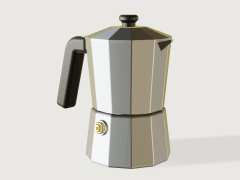
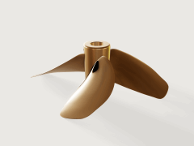
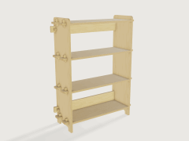
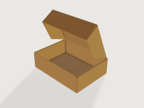
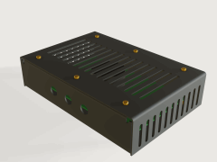
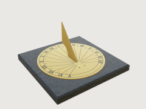
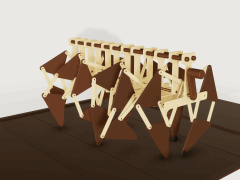
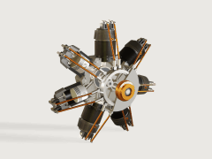

# 3DCraft

**3DCraft is an open-source parametric 3D CAD modeller built with and for AI: every action is a command, and every result is checked.**

*An agent builds. A machine checks. You decide.*


## Three ways to use it

1. **Make models with AI.** Describe a part to an AI agent. It builds the part in the window you are watching,
   step by step; you point at a face, ask for a change, and check the result. Then export it for a 3D printer,
   a laser cutter, a mill or a workshop.
2. **Use a Jig.** A Jig is a finished design with a form: the sizes that matter are fields, the rest follows
   by formulas, and every result is checked. Take the sundial: choose your place, say whether it lies in the
   garden or hangs on a wall and which way that wall faces, and you get a brass dial to laser cut and engrave
   that reads the clock time where you live. No AI needed.
3. **Build your own application on it.** The engine is a Rust library, and every command is also reachable
   from the command line, a JSON control channel and an MCP server. A gear generator, a furniture
   configurator, a CAD interface with buttons: each can be a separate program on top of 3DCraft. The licence
   is MIT.

3DCraft has no toolbar of modelling buttons. You model through commands: an agent sends them, a Jig's form
sends them, or you write them yourself. The window is there to watch, to point and to check. Whoever wants a
classic interface with buttons can build one on top: it would send the same commands.

It is written in pure Rust, with its own B-rep kernel, constraint solver, tessellator and renderers: no
OpenCascade, no Parasolid, no third-party geometry of any kind. Licence: [MIT](LICENSE).

## How it started

3DCraft started as an experiment. The occasion was practical: designing a CNC machine, furniture and the
bodies and mechanisms of marionettes, with open software and the help of an AI agent. The open tools of today
did not get there. So the question was turned around: can AI agents write a CAD kernel themselves, if a
machine checks every result?

3DCraft is the answer so far, and it was built the way it works. AI agents wrote it, under tests a machine can
check, while the developer watched. An agent models in it the same way: through commands, under checks, in a
window you are watching. The project is the proof of its own method.

## Where it stands

3DCraft is at version 0.1.0. It does not replace professional CAD today. What it cannot do yet, it refuses,
and says so. The experiment goes on: the kernel is its heart and its hardest part, every refusal is work still
owed, and it is being made better step by step.

## Get started

> **0.1.0 is the first release.** Its installers are on the
> [releases page](https://github.com/johancoppens/3dcraft/releases), and the website,
> [3dcraft.dev](https://3dcraft.dev/), has the guide, the examples and the web version.

- **[Install 3DCraft](docs/guide/install.md)**: installers for Windows, macOS and Linux (version
  0.1.0), or the [web version](https://3dcraft.dev/app/) with nothing to install.
- **[Your first five minutes](docs/guide/first-steps.md)**: open an example, play its history, try a
  Jig, export for a 3D printer.
- **[The user guide](docs/guide/README.md)**, 22 chapters in six parts: installing and connecting an AI
  agent, working with one, the window, Jigs, assemblies and files; modelling, sheet metal, surfaces and
  origami; measuring and engineering checks; making Jigs, the command line and programs on 3DCraft;
  troubleshooting and a reference of every command.
- **[The guide's lessons](docs/examples/README.md)**, seven parts that check their own volume, and three
  collections: **[finished parts](https://github.com/johancoppens/3dcraft-examples)**, the
  **[Jigs collection](https://github.com/johancoppens/3dcraft-jigs)** (from a laser-cut box and a GT2 pulley
  to a planetary gearbox and a sundial for your place) and
  **[assemblies](https://github.com/johancoppens/3dcraft-assemblies-examples)**, all in the website's
  [galleries](https://3dcraft.dev/examples/).
- **What changed:** [`CHANGELOG.md`](CHANGELOG.md).

## What it does

- **Works with your AI agent.** A built-in MCP server lets Claude or any other MCP client model in the
  window you are watching, once you switch on *Allow AI agents*; the agent reads what you selected, and
  can light up faces, fly the camera and play the history for you.
- **Parametric.** Variables with units and formulas drive everything, with conditions, tables and parts
  switched on and off; sketches solved by 3DCraft's own constraint solver; curves drawn from formulas, such
  as a gear's involute flanks. Change one number and the model rebuilds from the feature it touches.
- **Features.** Extrude, revolve, loft, sweep along a path, a helix or two rails; booleans, mirror and
  patterns; fillets and chamfers; shell, draft, offset, move and delete face, thicken; ISO metric threads;
  datums and sheets; text to extrude, emboss or engrave, also wrapped onto a cylinder or a cone.
- **Stable references.** Every face, edge and vertex has a persistent name made of where it came from, so
  a fillet stays on its edge through upstream edits; a feature that loses its edge fails, names what it
  lost and can be repaired, never silently moved.
- **Checked, not hoped.** Volumes, mass, distances, wall thickness and clearances from the exact geometry,
  and design rules kept in the document, checked at every change. The boolean kernel is held to a reference
  kernel on about twelve thousand cases with none wrong; what it cannot do yet it refuses by name.
- **Sheet metal.** A base with flanges bent by radius and K-factor, reliefs, closed corners, hems and
  louvres; the flat pattern with its bend lines; and a press-brake check that finds an order of bends in
  which punch and die clear the part.
- **Plates and cutting.** Faces given a thickness, with joints between neighbouring plates; plates and
  sheet-metal parts are recognised for cutting, with a cut list and every part's outline on one sheet for
  a laser, kerf included.
- **Unfolding and origami.** Developable surfaces between two curves, unfolded flat at true size; crease
  patterns folded by angles that follow variables, or folded flat with the order of the layers worked
  out, with Kawasaki's and Maekawa's checks.
- **Freeform surfaces.** Surfaces through networks of curves and Coons patches as exact B-splines,
  N-sided fills and trimmed faces; seams held tangent or in curvature, their continuity proven; zebra
  stripes, a curvature map and a draft check drawn on the exact surfaces.
- **Assemblies and motion.** Parts placed in a `.3dcraftasm`, by reference or packed into it, joined by
  mates, joints and couplings (gears, racks, screws) solved by 3DCraft's own solver; a mechanism plays
  over a timeline with collisions in red, and any assertion can be checked over the whole motion.
- **Jigs.** Publish a design's sizes as parameters and share it as a `.3dcraftjig`: anyone sets them in a
  form, on the desktop or in the browser, and `check-range` proves the design over its whole range.
- **Files.** `.3dcraft` holds the history, and every file a released version saves opens in every later
  one; STEP import and export, and FreeCAD documents read in; STL, 3MF and OBJ for printing; DXF and SVG
  of outlines, flat patterns, whole cut sheets for a laser, and drawings of the model with hidden lines.
- **A native window and a web version.** egui on wgpu (Vulkan, Metal, DX12 or OpenGL) on the desktop,
  WebGPU or WebGL2 in the browser; a start screen with twenty examples, tabs, a view cube, section and
  see-through, a history player, colours and materials, and a studio look with soft shadows.
- **Errors, not crashes.** A bad file, a bad parameter or a degenerate model gives an error you can act
  on, and an autosave brings your work back after a crash.

<p>
  
  
</p>

*A Jig on its form (the Gridfinity bin), and an assembly playing its motion, collisions in red (the toggle clamp).*

## Examples

| | | | |
|---|---|---|---|
| [](https://github.com/johancoppens/3dcraft-examples/tree/main/examples/20-moka-pot)<br>**Moka pot**, a part: ten pieces sized by the physics of brewing, its capacities proven | [](https://github.com/johancoppens/3dcraft-examples/tree/main/examples/17-ship-propeller)<br>**Ship propeller**, a part: blades lofted from the B-series' published tables, its balance proven | [](https://github.com/johancoppens/3dcraft-examples/tree/main/examples/22-flat-pack-bookcase)<br>**Flat-pack bookcase**, a part: plywood plates on one CNC sheet, wedged tenons, a cut list | [](https://github.com/johancoppens/3dcraft-examples/tree/main/examples/09-mailer-box)<br>**Mailer box**, a part: a die-cut blank folded into the box, its cut and crease lines to DXF |
| [](https://github.com/johancoppens/3dcraft-jigs/tree/main/jigs/13-sheet-metal-enclosure)<br>**Sheet-metal enclosure**, a Jig: a case around your board, flat patterns and bend order proven | [](https://github.com/johancoppens/3dcraft-jigs/tree/main/jigs/26-sundial)<br>**Sundial**, a Jig: hour lines for your place, in brass to laser cut and engrave | [](https://github.com/johancoppens/3dcraft-assemblies-examples/tree/main/assemblies/02-jansen-walker)<br>**Jansen walker**, an assembly: twelve legs on one crank, many closed loops in one solve | [](https://github.com/johancoppens/3dcraft-assemblies-examples/tree/main/assemblies/06-radial-engine)<br>**Radial engine**, an assembly: seven cylinders and their valve train over one engine cycle |

These eight are among the twenty examples built into 3DCraft (ten parts, six Jigs, four assemblies). Each
opens from the start screen with one click, offline and in the browser too, and is rebuilt from its history
as it opens; the player then shows how it was built, or plays the assembly's motion. The rest are in
[3dcraft-examples](https://github.com/johancoppens/3dcraft-examples), [3dcraft-jigs](https://github.com/johancoppens/3dcraft-jigs)
and [3dcraft-assemblies-examples](https://github.com/johancoppens/3dcraft-assemblies-examples), and in the
website's [galleries](https://3dcraft.dev/examples/). The examples are MIT, the Jigs and assemblies CC BY 4.0
([licences](docs/examples/published/LICENSE.md)).

How it grew: [the first showcase](docs/showcase/) and the field tests of
[12](docs/field-test/2026-10-12/README.md) and [22 October 2026](docs/field-test/2026-10-22/README.md).

## Build from source

You need [Rust](https://rustup.rs) and, on Linux, the windowing packages the guide lists
([Build from source](docs/guide/install.md#build-from-source)). In a clone of this repository:

```sh
cargo xtask fonts    # once: fetches the built-in fonts, which are not in the repository
cargo build --release -p craft3d -p craft3d-cli
target/release/craft3d-cli run --new '{"units":"mm"}' \
    --cmd variable.set  --params '{"name":"width","expr":"60 mm"}' \
    --cmd feature.block --params '{"size":["width","width * 2 / 3","8 mm"]}' \
    --out part.3dcraft
target/release/craft3d-cli render part.3dcraft --out part.png
target/release/craft3d part.3dcraft
```

To let an AI agent model in the window, start `target/release/craft3d`, switch on **Allow AI agents** in the
start screen's panel *Connect an AI agent*, and add 3DCraft to your AI tool once: for Claude Code with this
line, which the panel's **Copy command** gives with the path filled in (the panel has the configuration for
other MCP clients too, and [the guide](docs/guide/install.md#connect-an-ai-agent-over-mcp) says more):

```sh
claude mcp add 3dcraft -- "$PWD/target/release/craft3d-cli" mcp --bridge
```

Contributors and agents working on 3DCraft: read [`CONTRIBUTING.md`](CONTRIBUTING.md), [`AGENTS.md`](AGENTS.md) and [`docs/`](docs/README.md).

Contributors: [`CONTRIBUTING.md`](CONTRIBUTING.md); agents: [`AGENTS.md`](AGENTS.md); security: [`SECURITY.md`](SECURITY.md). Licence: [MIT](LICENSE).
