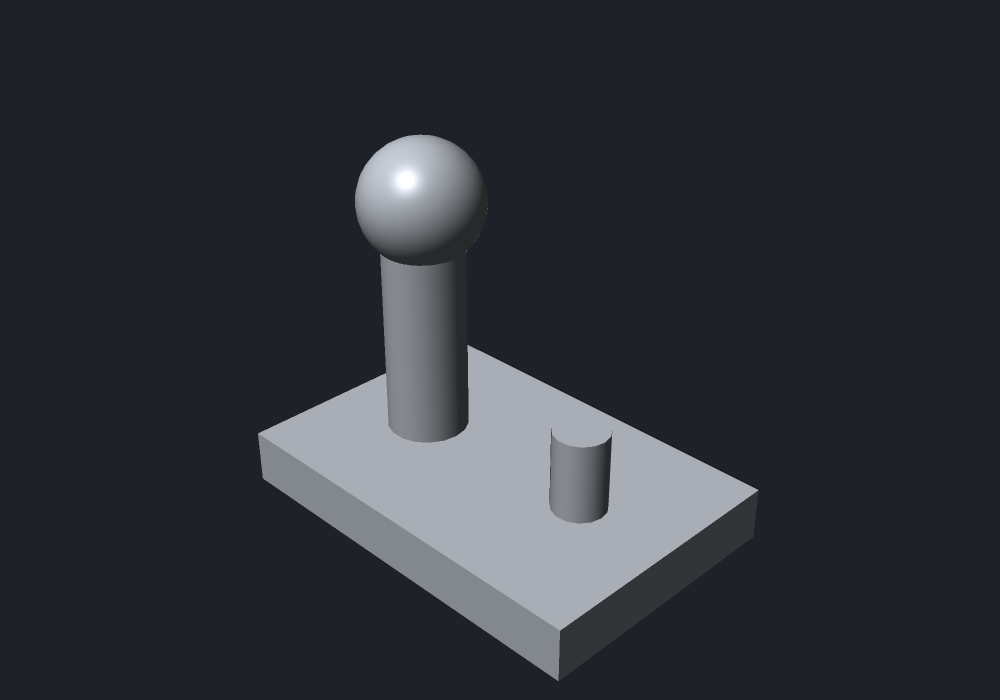
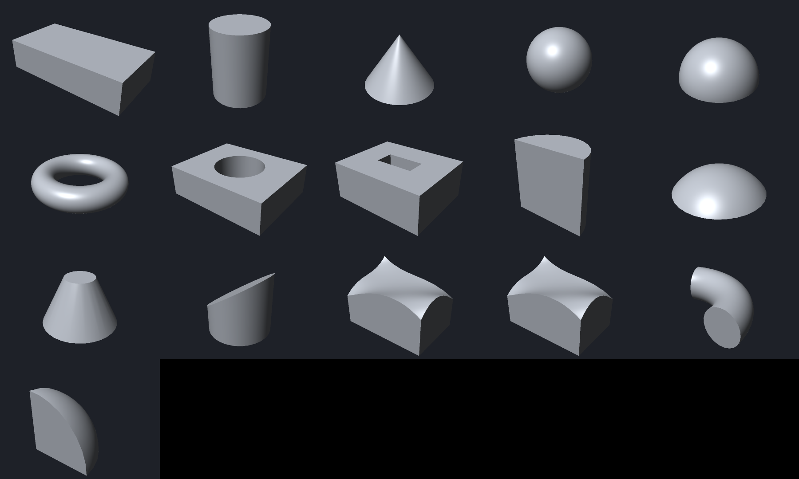
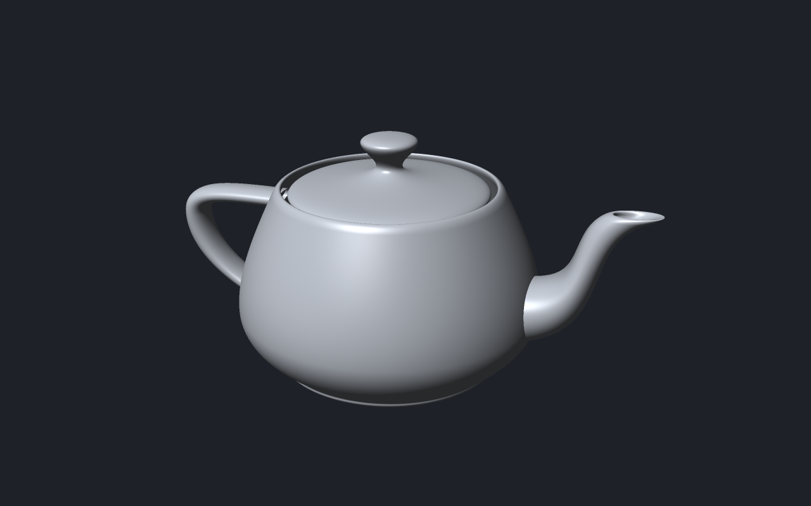

# 3DCraft

A parametric 3D CAD modeller for AI, in pure Rust, with its own kernel, tessellator and renderers.
Every action is a command, so the same engine can be driven from a UI, the CLI, a JSON control
channel or an MCP server.



**Status: early.** A part can be modelled from primitive solids (block, cylinder, sphere, cone, torus), placed and turned freely, with
variables and formulas, saved as `.3dcraft`, reopened, changed, rendered on the CPU and exported as
STL, 3MF or OBJ, all through commands: from the command line, a JSON-lines server or an MCP server.
There are no sketches, no booleans, no STEP and no desktop app yet;
[`docs/roadmap.md`](docs/roadmap.md) says what comes next.

```sh
cargo build --release -p craft3d-cli
target/release/craft3d-cli run --new '{}' \
    --cmd variable.set  --params '{"name":"width","expr":"60 mm"}' \
    --cmd feature.block --params '{"size":["width","width * 2 / 3","8 mm"]}' \
    --cmd document.measure --out part.3dcraft
target/release/craft3d-cli render part.3dcraft --out part.png
target/release/craft3d-cli convert part.3dcraft part.3mf
target/release/craft3d-cli commands          # everything it can do
```

The tessellator handles any face the kernel can describe. These are the reference solids of the test
suite, each checked against its closed-form volume and read back by FreeCAD as a closed solid:



The kernel also evaluates freeform surfaces; here is the Utah teapot (32 Bézier patches),
tessellated and drawn by the same renderer:



Agents and contributors: read [`AGENTS.md`](AGENTS.md) first. Licence: [MIT](LICENSE).
