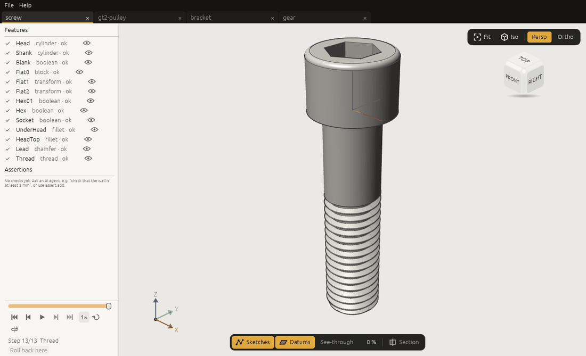
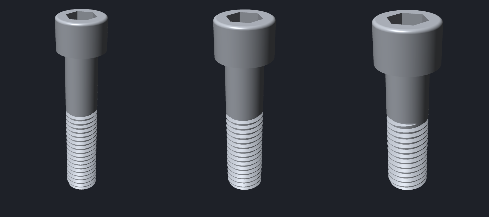
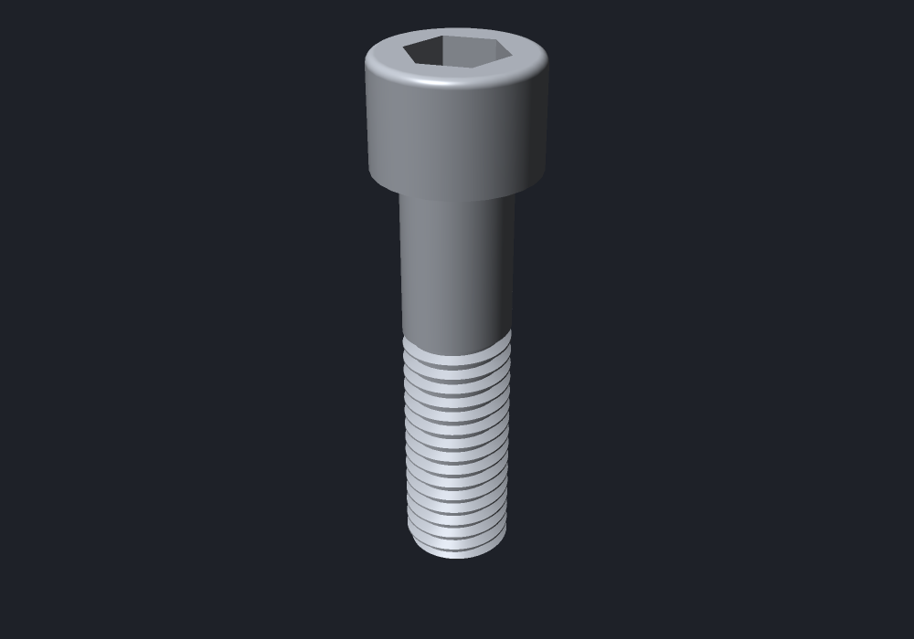
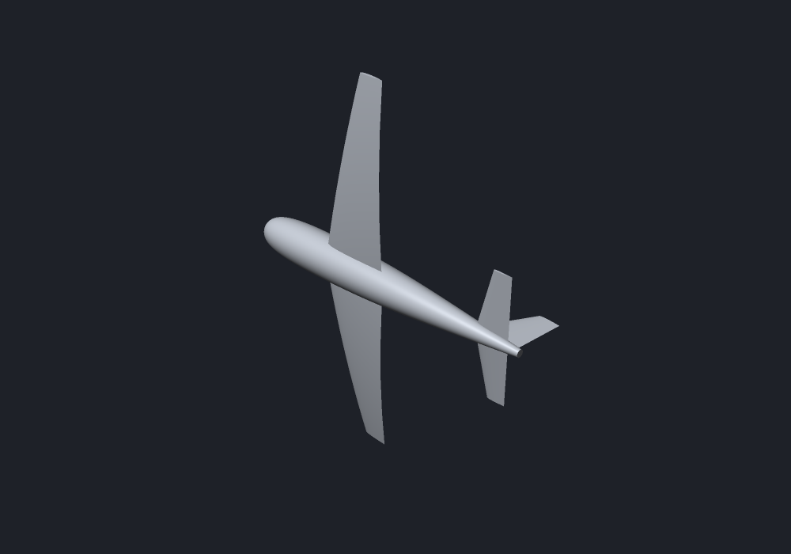
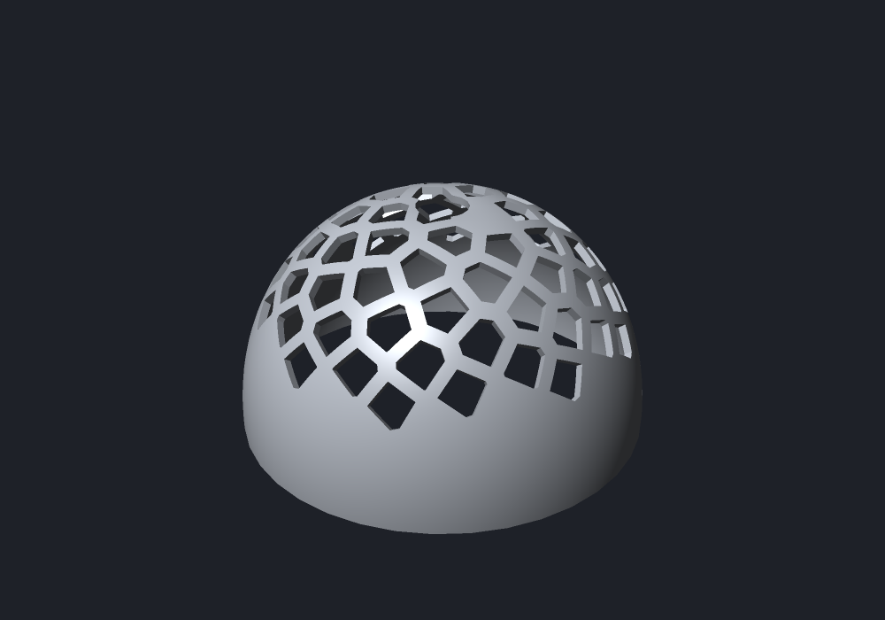
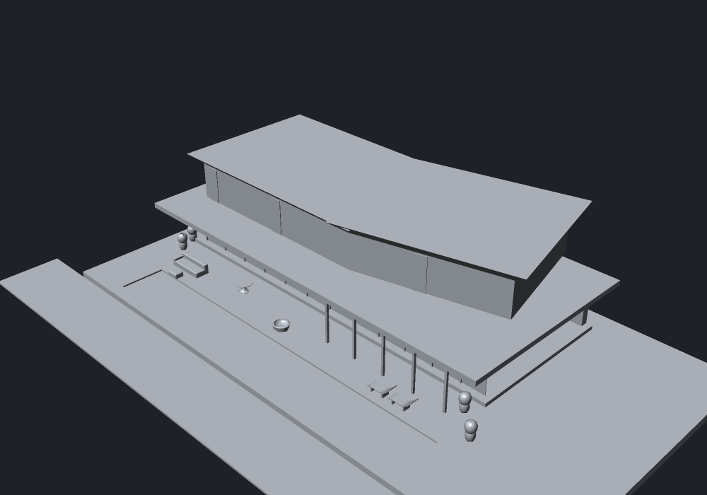
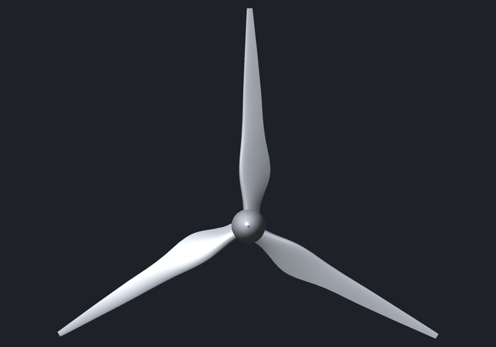

# 3DCraft

A parametric 3D CAD modeller built for AI, in pure Rust, with its own B-rep kernel, constraint solver,
tessellator and renderers: no OpenCascade, no Parasolid, no third-party geometry of any kind. Every action
is a command, so the same engine is driven from the window, the command line, a JSON control channel or an
MCP server, and an agent can build a model in the window you are watching.



## What it does today

- **Parametric modelling.** Variables and formulas drive everything; sketches of lines, arcs, circles and
  B-splines under sixteen kinds of constraint, solved by 3DCraft's own solver. Change one number and the
  model regenerates, only from the feature the change touches.
- **Features.** Extrude (to a distance, symmetric, through all, up to a face), revolve, loft, sweep along
  a path or a helix, booleans, mirror and patterns, chamfers and fillets, offset face, shell, delete face,
  and ISO metric threads (cut, or cosmetic as other modellers default to). Datum planes, axes, points and
  helices.
- **Stable references.** Every face, edge and vertex has a persistent name made of where it came from, so a
  fillet stays on its edge through upstream edits and booleans; a feature that loses its edge fails, names
  what it lost and the feature that caused it, and is repaired with `feature.edit`.
- **A boolean kernel that is checked, not hoped.** Booleans of every analytic surface kind and of polynomial
  and rational freeform faces agree with a reference kernel in 11,573 of 11,988 cases of a corpus, with
  none wrong; the rest are refused by name rather than answered badly.
- **Formats.** `.3dcraft` (the history, not the geometry: it regenerates bit for bit), STEP AP214 export that
  FreeCAD reads back as valid solids of our volume, STL, 3MF and OBJ, and DXF and SVG of sketches and flat faces.
- **A native window** (egui on wgpu; Vulkan, Metal, DX12 or OpenGL) that stays responsive while a heavy model
  regenerates, shows a quick picture first and the sharp one after, and keeps a tab per open document; a view
  cube, a section plane, see-through bodies, and the feature tree with what failed and why.
- **Never crashes.** A bad file, a bad parameter or a degenerate model gives an error you can act on; a fuzzing
  test runs every command with hostile input.

```sh
cargo build --release -p craft3d-cli
target/release/craft3d-cli run --new '{}' \
    --cmd variable.set  --params '{"name":"width","expr":"60 mm"}' \
    --cmd feature.block --params '{"size":["width","width * 2 / 3","8 mm"]}' \
    --cmd document.measure --out part.3dcraft
target/release/craft3d-cli render part.3dcraft --out part.png
target/release/craft3d-cli convert part.3dcraft part.step
target/release/craft3d-cli commands          # all 72 commands, with their parameters
```

The window, and an agent driving it over MCP:

```sh
cargo build --release -p craft3d -p craft3d-cli
target/release/craft3d --control 7878 --control-token-file .private/control.token &
claude mcp add craft3d -- "$PWD/target/release/craft3d-cli" mcp \
    --bridge 7878 --control-token-file "$PWD/.private/control.token"
```

## One variable, three screws

The [parametric screw](docs/showcase/pscrew.steps.json) is fifteen commands. Its head, hex socket, rounds,
chamfer and thread all follow the nominal diameter `d`; the thread takes the ISO 261 size and coarse pitch of
whatever diameter the shank has. Setting `d` to 8, 10 and 12 mm gives an M8 × 1.25, an M10 × 1.5 and an
M12 × 1.75, each a valid solid regenerated in about three seconds, thread cut and all:

```sh
target/release/craft3d-cli run --new '{"units":"mm"}' --script docs/showcase/pscrew.steps.json \
    --cmd variable.set --params '{"name":"d","expr":"12 mm"}' --out m12.3dcraft
```



## Showcase

Twenty-four models built with the commands that exist today; the first eight were driven step by step into
the window while the developer watched, the others were built headless or by a script. The pictures are the CPU renderer's
(`craft3d-cli render`). The `.3dcraft` files and the step scripts are in
[`docs/showcase/`](docs/showcase/); any of them is rebuilt headless with

```sh
target/release/craft3d-cli run --new '{"units":"mm"}' --script docs/showcase/gear.steps.json --out gear.3dcraft
```

| | |
|---|---|
|  **Spur gear**, module 2, 24 teeth: the involute flanks as one closed polyline of 336 points, extruded; hub, bore and keyway by booleans. |  **Gear pair** 24:12 in mesh: the pinion turned by half a tooth, its shaft joined; `document.check` with `deep` finds no interference. |
|  **Timing-belt drive** 20:40: toothed pulleys with flanges and bores; the belt is one sketch with an outer and an inner loop (arcs around the pulleys, tangent runs between them), extruded. |  **Turbine rotor**: hub by revolve, a cambered blade section extruded radially, its tip cut round by an intersect, seven of them by a circular pattern, joined to the hub; a shroud ring. |
|  **Wind turbine**: tubular tower by revolve, foundation, nacelle, spinner cone, three blades pitched by `feature.transform` and patterned about the rotor axis, everything one body. |  **Boat hull** from three profiles (side, plan, section) extruded and intersected, hollowed by the same three a wall thinner, thwarts across. Faceted: it was built before sketches had splines; a loft would make it fair. |
|  **Impeller**: a blade between two splines, extruded into B-spline walls, nine of them by a circular pattern, joined with a disc and a hub and bored: one body of 33 faces. |  **Pillar**: a leaf of a spline and a line extruded up to the wall of a roller lying across it (`upTo`), so that its top follows the roller; seen from behind. |
|  **Bearing housing**: half a base with a spline for its ends, mirrored in a datum plane and joined; a pedestal between two splines extruded up to the sleeve's wall; bored; two oil holes drilled from a datum plane turned 30° about the sleeve's axis (a datum axis); three bolt holes by a pattern, mirrored in the same datum plane. FreeCAD reads its STEP export as one closed solid of 20 faces. |  **Lofted hull**: four stations along the keel, each a spline under a deck line, joined by `feature.loft` into one smooth skin; hollowed by a second loft through the same stations a wall's thickness smaller (`cut`). Seven faces. |
|  **Twisted blade**: an aerofoil of two splines at four heights, shorter and turned further towards the tip (48° in all), lofted and joined to a round foot. |  **Vase**: one sketch, one feature. Its section is two splines (the outside and the inside of the wall) closed by a foot, a rim and the axis, turned a full turn: the walls are rational B-spline surfaces of revolution, exact, in two halves each. |
|  **Bent pipe with a flange**: a ring (the wall and the bore) carried along a line, a quarter bend and a line by `feature.sweep`: two cylinders and a piece of a torus inside and out, exact and without a seam; a flange extruded and joined. |  **Handle on a plate**: a circle swept along a path of three lines and two bends drawn in a sketch that stands on the plate, joined to the plate at once (`join`). |
|  **Gasket**: an obround section (two lines, two half circles) carried round a closed path, a rounded rectangle: a ring without ends, its flat faces one face each all the way round. |  **Hose**: a ring swept along a spline. Along a spline the faces are B-spline surfaces within half the document's tolerance of the true sweep; the feature says how far off they were found to be (1.4e-7 mm here, through 85 stations). |
|  **Shelled tray, cut open**: a block with its upright edges rounded, made hollow by `feature.shell` (3 mm walls, open at the top; the inner rounds have the radius less the wall), a bored boss sketched on the floor of the hollow, then made taller and its bore wider by `feature.offsetFace`. Its volume is the closed form to the last digit. Rendered with the section plane. |  **Coil spring**: a wire of 1.5 mm on a plane square to a helix (`datum.helix`, six turns of pitch 5), carried along it by its screw motion (`feature.sweep` with the helix as its path): one face per quarter of the wire per half turn, B-spline surfaces 1.1e-9 mm from the true sweep through 217 stations; its volume is the wire's area times the helix's length to 4e-13. |
|  **Socket head cap screw M10 × 40**: head and shank, a hex socket with its drill point, rounds and chamfers, and `feature.thread`: an ISO metric thread of 26 mm cut through the lead chamfer by the groove of the basic profile swept along a helix, with a run-out of a quarter turn. |  **Parametric screw**: the same screw driven by one variable `d`: head `1.5 d`, socket `0.8 d` (three slabs turned 60° and intersected), rounds and chamfer given by the faces of the first body and followed through every boolean, and a thread that takes the ISO size and coarse pitch of whatever diameter the shank has. |
|  **Aircraft**: a fuselage turned from a spline, wings lofted through four cambered sections (tapered, swept back, rising towards the tip and twisted 3.5° there), mirrored; a tailplane and a fin; five unions of freeform faces into one solid. |  **Voronoi helmet**: a 4 mm shell turned from two splines, 70 Voronoi cells (computed on the sphere) cut through it as radial frustums: one solid. Not the organic look of a lattice tool: its struts are flat and its rims sharp. |
|  **Modernist villa**, in metres: slabs, glazing, columns, a cantilevered floor and two upper wings at an angle under flared roofs (ruled lofts), a pool cut into the terrace, curved loungers (a closed spline extruded), filleted sofas, turned planters and a fire bowl: 49 bodies. |  **Wind turbine rotor**, in metres (tolerance 0.1 mm: `--new '{"units":"m","tolerance":1e-4}'`): each 22 m blade one smooth loft through eight cambered sections, from a thick round root to a slender tip (chord 3 m to 0.55 m, thickness 62 % to 12 %, twist 20° to 0°), three by a circular pattern, united with a revolved spinner. |

## First field test: an agent that only knew the command list

A separate AI session got nothing but the MCP connection: no source, no docs, only what `command_list`
and the error messages say. It built these, and checked every volume against a closed form or its own
computation:


A constrained plate sketch with four holes, a hollow post on its top face, ribs sketched on a side face
and a hexagonal head: four bodies, each to the predicted volume, following the variables when the plate
is made longer, and bit-identical after save and reopen.


Two spur gears (module 2, 30 and 50 teeth, bore with keyway) in mesh at centre distance 80. The
50-tooth gear was built over MCP alone in 220 commands; its volume equals the script's own area
integral to 12 digits, and the two outlines clear each other by 0.007 mm on the line of action.

Nothing crashed and no command gave a wrong result silently. The same report lists what got in the way:
no patterns (a gear is 700 literal points), no booleans, a cap face that is renamed when its outline
changes, fixed perspective views that cannot zoom, and heavy payloads for bulk geometry over MCP.
[The full findings](docs/field-test/2026-10-12/README.md), with the generator scripts.

The tessellator handles any face the kernel can describe. These are the reference solids of the test
suite, each checked against its closed-form volume and read back by FreeCAD as a closed solid:


The kernel also evaluates freeform surfaces; here is the Utah teapot (32 Bézier patches),
tessellated and drawn by the same renderer:


Agents and contributors: read [`AGENTS.md`](AGENTS.md) first. Licence: [MIT](LICENSE).
