# Example models

Eighteen parts to learn from: a bracket, a flange, a box, a spring, a gear, a name plate, a sheet-metal bracket, a G2 fin, a lamp shade, a class-A fuel tank, a class-A mouse, a sheet-metal mini-PC chassis and more. Each is a command
script (a JSON list of `[command, params]` steps) that builds a `.3dcraft` document, driven by variables
and ending with checks, at least its volume worked out by hand, so it proves itself:
`crates/engine/tests/guide_examples.rs` runs them all at every change. The pictures are drawn by
`craft3d-cli render`. See the [user guide](../guide/README.md).

**In the window:** the start screen shows the examples as cards; a click builds one in a new tab, where
you can turn it, play its history and export it ([chapter 2 of the guide](../guide/02-first-steps.md)).

**From a terminal:** build one, draw it, change it:

```sh
craft3d-cli run --new '{"units":"mm"}' --script docs/examples/bracket.json --out bracket.3dcraft
craft3d-cli render bracket.3dcraft --out bracket.png
craft3d-cli run bracket.3dcraft --cmd variable.set --params '{"name":"leg_x","expr":"60 mm"}' \
    --cmd assert.list --out longer.3dcraft
```

An agent runs the same steps through `command_batch` (each `[id, params]` becomes `{"id": …, "params": …}`),
or opens a saved file.

| | |
|---|---|
| 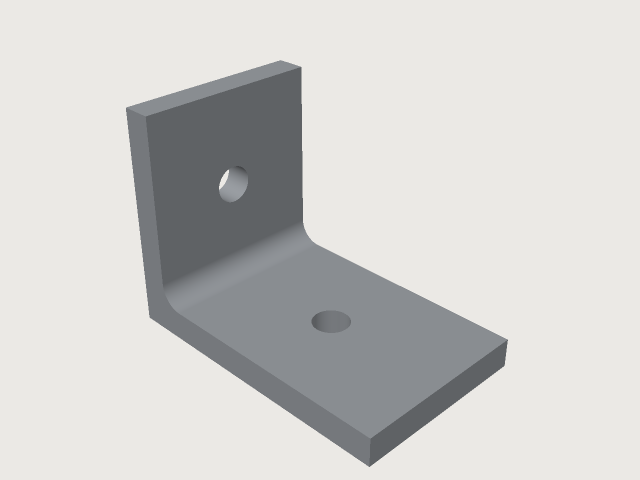 | **[L-bracket](bracket.json)**: an L profile on the `zx` plane with every corner written in the variables, extruded; a round in the inside corner (`feature.fillet` between two sides of the extrusion); a hole in each leg by a circle extruded `throughAll` with `cut`. Asserts its volume, two holes, and that they go through. The part of [chapter 7](../guide/07-first-part.md). |
| 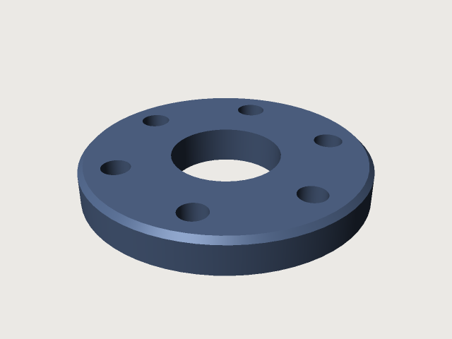 | **[Bolt flange](flange.json)**: a disc, a bore and a bolt hole as cylinders; the hole repeated `n` times round the axis by `feature.pattern`, subtracted with `feature.boolean`; a chamfer on the rim named as the first cylinder had it. A named set `bolt holes` (`set.define`) holds the holes of that size, and the assertions count them against `n` and check that they go through. |
| 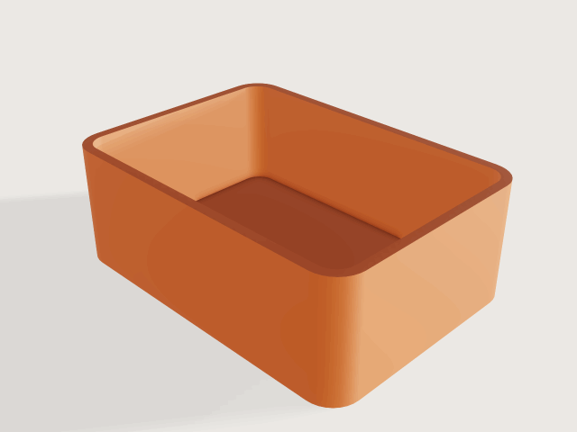 | **[Shelled case](case.json)**: a block with its four upright edges rounded (`feature.fillet`), hollowed by `feature.shell` with 2 mm walls and the top open; the inner corners get the radius less the wall. Asserts the volume (a closed form in all five variables) and a least wall thickness (the measure `thickness`). |
| 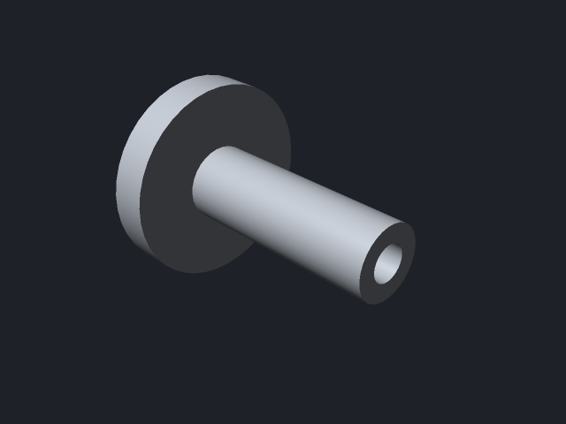 | **[Flanged bushing](bushing.json)**: a stepped section turned a full turn about the sketch's x axis (`feature.revolve`), with a bore; an M12 thread on the shank by `feature.thread` (cosmetic: the size is taken from the shank's diameter, the body is unchanged). Asserts the volume by Pappus's rule and that the bore goes through. |
| 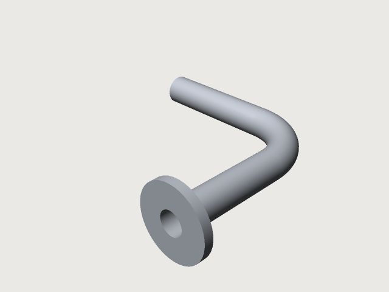 | **[Bent pipe](pipe.json)**: a ring (two circles) swept along a path of a line, a quarter bend and a line (`sketch.path`, `feature.sweep`): exact cylinders and a torus; a flange extruded and joined in one step (`join`). Asserts the volume: the ring's area times the length of the path, plus the flange. |
| 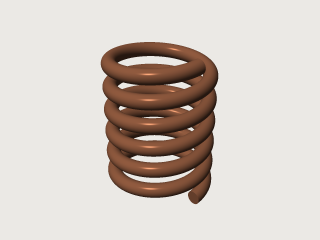 | **[Coil spring](spring.json)**: a helix of six turns (`datum.helix`) and a circle on the `zx` plane through its start, carried along it by its screw motion (`feature.sweep` with the helix as the path). Asserts the volume: the wire's area times the circumference of the coil, per turn. |
| 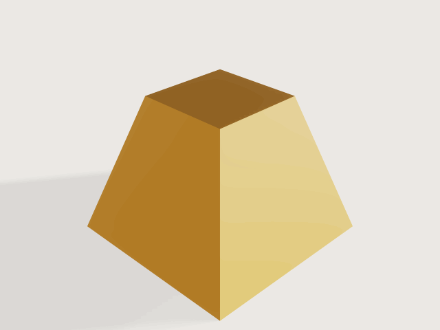 | **[Hopper](hopper.json)**: two squares, one on `xy` and one on an offset plane (`sketch.rect`, `sketch.create` with `offset`), joined by a ruled `feature.loft`. Asserts the volume of the frustum, h/3 (A₁ + A₂ + √(A₁A₂)). |
| 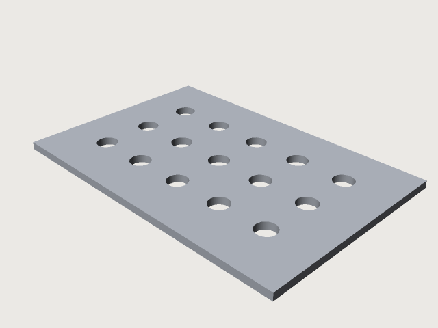 | **[Perforated panel](panel.json)**: an outline and one circle in a sketch, the circle repeated in a 5 × 3 grid by `sketch.pattern`, extruded once. Asserts the volume and the number of holes. Export its outline for a laser cutter with `craft3d-cli convert panel.3dcraft panel.dxf --sketch Outline`. |
| 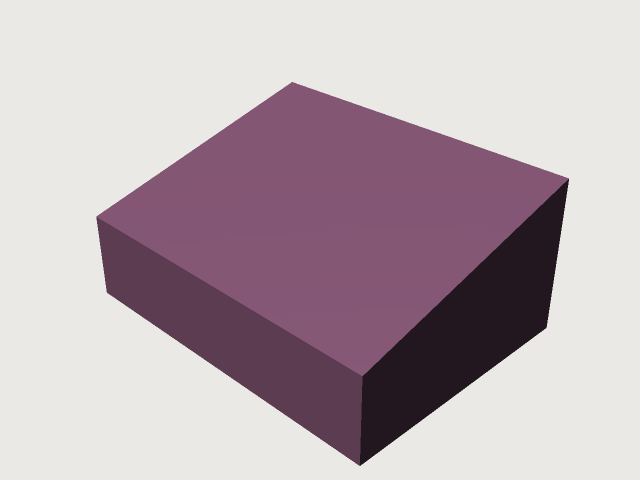 | **[Wedge](wedge.json)**: a block cut by a sheet (`feature.fill`) on a datum plane tilted 15° about a datum axis (`datum.axis`, `datum.plane`); `intersect` keeps the part under the sheet. Asserts the volume, which follows the tilt through `tan`. |
| 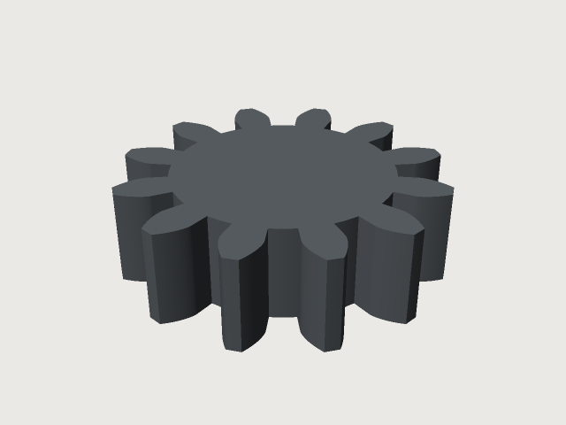 | **[Involute gear](gear.json)**: one tooth whose flanks are curves from formulas (`sketch.curve`: the involute `x = rb (cos(g + t) + t sin(g + t))`, its mirror for the other flank), closed by the tip arc and an arc inside the root circle; extruded, repeated `z` times round the axis (`feature.pattern`) and joined to the root disc. The flanks are fitted again whenever `module`, `z` or `alpha` change. Asserts the volume in closed form (the area an involute sweeps from the centre is `rb² t³ / 6`) and that it is one body. See [chapter 8](../guide/08-formulas.md#curves-from-formulas). |
| 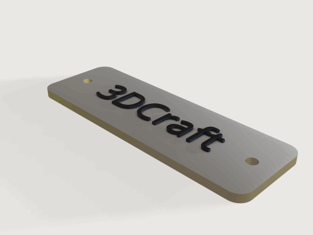 | **[Name plate](nameplate.json)**: a plate with rounded corners (`feature.fillet`) and two holes, and the word *3DCraft* written by `sketch.text` on a sketch at the plate's top and extruded as a body of its own; brushed aluminium (`material.preset`) under dark lacquered letters with a clear coat. Asserts the plate's volume, a range for the letters' and that the holes go through. |
| 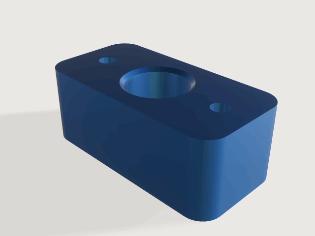 | **[Clamp block](clamp.json)**: a block with its upright edges rounded, a bore subtracted and chamfered at both mouths (`feature.chamfer` on the circular edges), two bolt holes; anodised blue. Asserts the volume (each chamfer a ring of triangle c²/2 at radius R + c/3, by Pappus), the two bolt holes and that every hole goes through. |
| 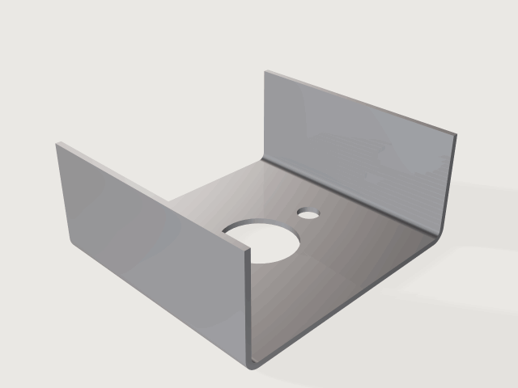 | **[Sheet-metal bracket](channel.json)**: a square base with a large and two small holes bent up into two flanges (`feature.sheetMetal`, inner radius 2 mm, K-factor 0.5); steel. With K = 0.5 the neutral layer is the middle, so the volume is the flat pattern's area times the thickness; asserts it and the bend radius. |
| 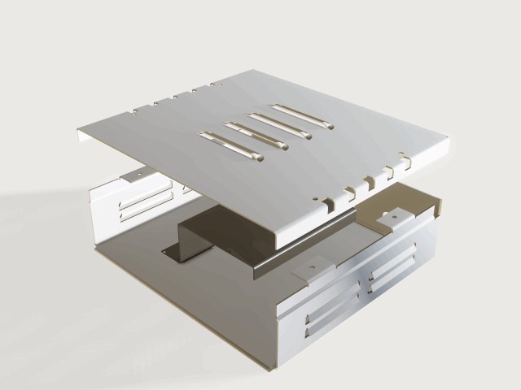 | **[Mini-PC chassis](chassis.json)**: three sheet-metal parts, a tray and a lid of brushed aluminium and a steel drive bracket, the lid lifted 45 mm to show what is inside (`lift` 0 closes it), every size a variable (thickness, bend radius, K-factor, width, depth, wall height). A tray with side walls and a back wall closed by mitres, a hemmed front edge, a jog in the side walls where the lid overlaps, inset tabs with screw holes, eight louvres bent out of slots in the walls (`cutout` flanges) and ports in the back; a lid whose vents run across its bends; a drive bracket with a flange on a flange on a flange. Asserts that every part can be bent on a press brake (`bendable`, the tray in a given order with its louvres and jogs formed first), the flat-pattern sizes and the lid's flat area in closed form, 2.5 t + r from every hole to a bend, the reliefs, the mitre gap, the bend radius and that the parts do not overlap. |
| 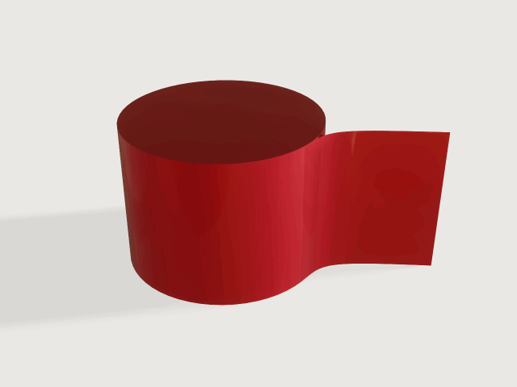 | **[G2 fin](fin.json)**: a fin laid through two splines and two lines (`feature.surface.network`) whose edge on the post is held in curvature (`"kind": "curvature"`, G2): reflections run on across the seam. Post and fin in one red car paint, so the reflections show the seam carrying on smoothly; asserts the post's volume. |
| 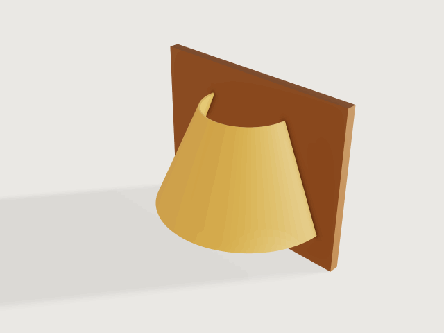 | **[Lamp shade](shade.json)**: a wall lamp. Its shade is a developable surface between two half circles at different heights (`feature.developable`, a half cone frustum), given a thickness about its middle (`feature.plate`, `side: "mid"`) with a warm subsurface glow, on a wooden wall plate with an arm and a bulb. A developable has no Gaussian curvature, so the plate's volume is its area times the thickness; asserts it within 0.1 %, and that the bulb clears the shade by 5 mm. |
| 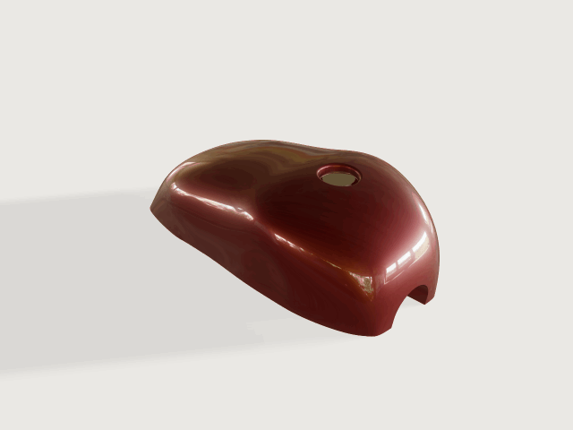 | **[Fuel tank](tank.json)**: a motorcycle fuel tank surfaced the class-A way, in a deep red paint under a clear coat. The crown is a network of eight sections across a spine and two shoulder lines: the sections lie in planes that lean (`datum.plane` through three points), forward at the nose so that it overhangs a little, backward at the tail so that it slopes down and in towards the seat; the shoulder lines lie in planes leaning out, so the tank is wider where it is higher. Each side is a network of eight curves hanging from the crown's edge to a floor line drawn on the plan, held in curvature (`"kind": "curvature"`, G2) to the crown; the knee recesses are drawn into the side curves and the floor line, where the tank has its waist. Crown and sides are sewn along their seams (`feature.boolean` with `"op": "sew"`: their surfaces touch along the whole edge, which a union cannot intersect), and a block is cut down to them. A filler recess with a rounded rim and floor, a tunnel the whole length underneath for the frame, a cap. Length, width, crown height and knee depth are public parameters (`craft3d-cli check-range` passes all 25 points). The seams are proven G2 at the default tolerances (1e-6 mm, 1e-9 rad: a curvature threshold of about 1.2e-12 per mm over a seam of 0.69 m; `docs/design/surfacing.md` › *The class-A tank*). Asserts both seams G2 (`measure.continuity`), a closed solid of 10 to 60 litres, the width, and the cap in its recess; the volume is an output in litres (`variable.measure` with `"unit": "L"`). Seen best from three-quarters front with the key light high (`view.render` with `camera`, `look.light`). |
| 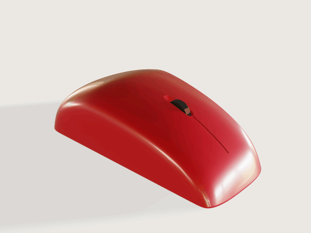 | **[Class-A mouse](mouse.json)**: low, tapered to the nose, its hump leaning toward the thumb: one Gordon surface over the top (`feature.surface.network`: two seams and a crown, the rear, four sections and the nose) held in curvature (G2) to two flat flanks turned in by the taper, the thumb's lower than the pinky's, a flat underside, sewn into a solid (`feature.boolean` with `"op": "sew"`, three times); a round along its foot, a slim slot cut as a stadium, a split line from the slot to the nose and a slim wheel, in red gloss plastic. Length (105 to 130 mm), width (56 to 70 mm), height (32 to 40 mm), the hump's place (0.36 to 0.44 of the length) and the taper (2° to 5°) are public parameters, and `craft3d-cli check-range` proves both seams G2 at the default tolerances at all 41 points of that box. The hump and the taper stop there on purpose: with the thumb's flank turned 6° to 7° and the hump at 0.46 to 0.48 the proof of the seam along the turned flank is undecided (its rounding allowance, 1.35e-11 against 1.18e-11; owed: rows written in the flank's own frame, `docs/design/surfacing.md`). Asserts both seams G2 (`continuity`, at the default tolerances), a closed solid of a mouse's volume and a wheel that turns free. See [chapter 9](../guide/09-features.md#a-class-a-mouse). Seen best from three-quarters front with the key light high, so it sits on its shadow (`view.render` with `camera`, `look.light` [200, 78]). |
