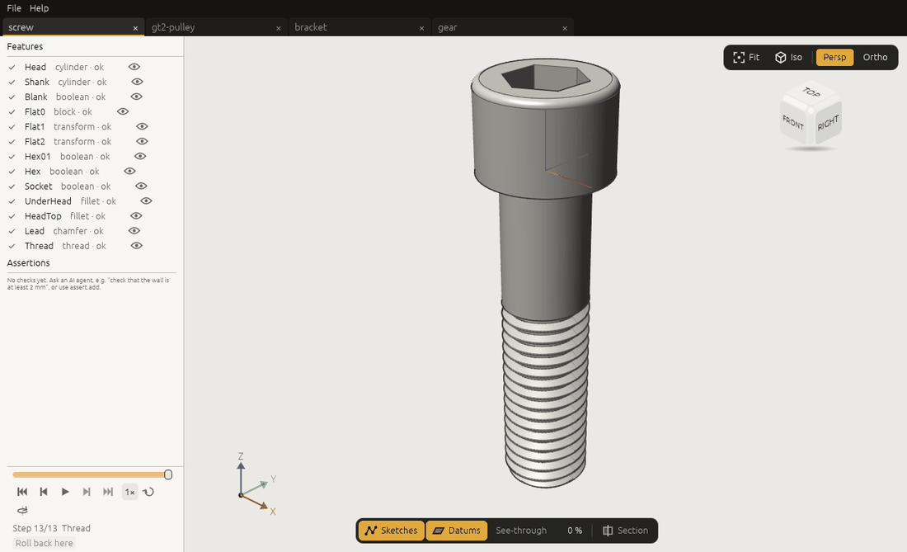

# 3. Watching and pointing

The window (`craft3d`) is where you watch the agent work and show it what you mean. It does not model by
itself: every change comes in as a command, from the agent through the MCP bridge (chapter 1) or from a
program on the control channel. What it does on its own is open, save and close files, and let you look,
click and select.



## Starting

Without a document the window shows the **start screen** in its middle (the feature list comes back with
the first document): the logo and the version, **New document** and **Open…**, the
[example models](../examples/README.md) as cards with a picture (a click builds one in a new document, from
the same command script the guide's examples use), your **recent files**, and **Connect an AI agent**: the MCP configuration to
give your client (chapter 1), with this window's own port and token file when it was started with
`--control`. **Copy configuration** puts it on the clipboard; **Copy for Claude Code** copies the
`claude mcp add` line. In the browser the start screen says that an agent cannot drive 3DCraft there yet.

## What you see

- **Tabs** along the top, one per open document; a dot marks unsaved changes. Ctrl+Tab goes to the next,
  Ctrl+W closes one (asking first if it has unsaved changes). The **File** menu has New, Open, Save and
  Save As (Ctrl+N, Ctrl+O, Ctrl+S, Ctrl+Shift+S), and **Recent files**: the last ten files opened or
  saved (by you or by an agent), newest first; one that is not there any more is greyed out, and **Clear
  recent** empties the list. The list is kept in `3dcraft/recent-files.json` in your state directory,
  beside the recovery directory; two windows open at once each keep what the other added. `--recent-file`
  names another file; a window started with a `--recovery-dir` of its own (or `none`) keeps the list for
  that run only. The browser keeps no recent files.
- **The Help menu**: **User guide** opens this guide in your browser, **Keyboard shortcuts** (also F1)
  lists every key and mouse action, **Open data folder** shows 3DCraft's folder in your state directory,
  with the autosaves, what can be recovered after a crash and the recent files (not in the browser, and
  not for a window started with folders of its own), and **About 3DCraft** gives the version and the
  commit it was built from, the platform, the licence (MIT), the links to the guide and the source, and
  the renderer in use; **Copy system info** copies those lines for a bug report.
- **The feature tree** on the left: the history, in order. Each feature has a mark: ✔ built, ⚠ failed
  (the reason under it; *caused by …* when it failed because a feature it is made from failed: click that
  one), ⏸ suppressed, ○ after the rollback marker. Under the features, the **assertions**, failed ones in
  the failed colour with their message; while there are none, a short hint says how to get one (ask an AI
  agent, for example "check that the wall is at least 2 mm", or use `assert.add`). The **eye** at the end of a feature's row hides its body, sketch
  or datum in the view (click again to show it); the model itself does not change. A double click on a
  hidden feature's row shows it again and flies to it. Under the pointer a row shows a **⌖** beside the
  eye: a click flies to the feature, as a double click does. A feature that failed, is suppressed or
  shows nothing has no ⌖, and a double click on it does nothing. A selected feature lights the faces it
  made (a fillet's round), not its whole part; a pattern or a mirror lights the instances it made, and
  its seed only its own faces.
- **The timeline** at the foot of the feature tree: drag it to see the model as it was after any step of
  the history; the features after that step are greyed. Looking back changes nothing in the document.
  Under it is a **player**, like a video player's: first step, a step back, play or pause, a step
  forward, **To end** (takes the rollback marker away and shows the whole model again), the speed (0.5×,
  1×, 2×), **loop** (start again after the last step) and **orbit** (the camera turns slowly while it
  plays). Playing shows each step once its model is built and for at least 0.8 s (at 1×), so a heavy
  model never skips a step; it stops at the end, when the document changes or when you switch tabs.
  While you look back or play, the viewport shows the step at the top: `Step 3/6 · Join · boolean`.
  **Roll back here** puts the rollback marker on the step shown (new features then go in after it).
  While you look back, clicks in the viewport do not select (go **To end** first), and a double click on
  a greyed row goes back to the end and flies to it.
- **The viewport**: bodies shaded with their edges, sketches as lines, datum planes as translucent squares.
  The model updates after every command the agent runs; a heavy model first shows a quick picture, then
  the sharp one (the status bar says `refining`).
- **The status bar** at the bottom: units, the file, when it was autosaved, the last command and its
  answer, and which renderer drew the picture.

## Moving around

| Do | To |
|---|---|
| Drag with the left button | Orbit |
| Drag with the right or middle button, or Shift and the left | Pan |
| Wheel, or a pinch on a touchpad | Zoom about the point under the pointer |
| F | Fly to the selection, or frame the whole model when nothing is selected |
| **Fit** | Frame the whole model |
| Double-click a feature in the tree, or its ⌖ | Select it and fly to what it made: from the iso view that sees it best, with some of its body around it |
| **Iso**, or a click on a face, edge or corner of the view cube | A standard view |
| **Persp** / **Ortho** | Perspective or orthographic (to scale) |

With the pointer over the viewport or the feature tree, and no text field being typed in, the history
player takes the keys of a video player:

| Key | To |
|---|---|
| Space | Play or pause the history |
| ← / → | A step back / forward |
| Home | The first step |
| End | The end of the history, in the view only (the rollback marker stays; the **To end** button removes it) |

F1 (or Help, Keyboard shortcuts) lists all of them.

The bar at the bottom of the viewport switches **Sketches** and **Datums** on and off, makes the bodies
**See-through** (to look at pockets and cavities), and turns on a **Section**: a plane across X, Y or Z,
moved by **Offset**, cutting the picture open (**Flip side** keeps the other half). None of this changes
the document.

## Pointing at things

A click selects what is under the pointer: a vertex if one is within a few points, else an edge, else the
face. Shift+click adds or removes, a double click selects the whole body, a click on empty space clears
the selection, Ctrl+drag selects everything inside a box. A click again at the same place (or Alt+click)
selects the next face behind; a right click lists all the faces under the pointer.

**The agent sees your selection.** The selection belongs to the document, not to the window, so the
agent reads it with the MCP tool `selection_get` (or the command `select.get`): each item with its
persistent name, the body, the feature that made it, its surface (a cylinder's radius and axis, a plane's
normal) and the parameter that drives it with the edit that changes it. So you can say:

> Make the hole I selected 6.5 mm.

and the agent finds the hole's `drivers` and runs the `feature.edit` it lists. The other way round, the
agent can show you what it means: through the bridge, `control_call` with `ui.highlight` (a face, an edge
or a vertex, by name) lights it up in the viewport, `ui.select` sets the selection you see, and
`ui.screenshot` takes a picture of the viewport for the agent to look at.

```text
control_call {"method": "ui.highlight", "params": {"face": "F1:face(1)", "feature": "Plate"}}
control_call {"method": "ui.get"}     -> the camera, what you clicked last (state.picked), the selection
```

## Without the window

An agent working headless looks at its work with `doc_render_preview` (or the command `view.render`): the
same CPU renderer that `craft3d-cli render` uses. `view.pick` answers "what is at this pixel of that
picture", as a click does in the window.
