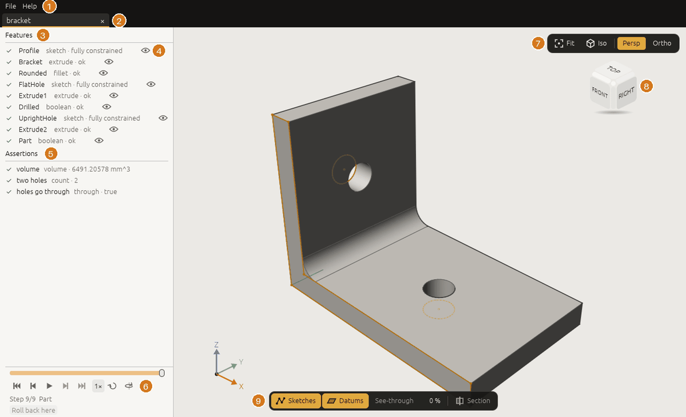
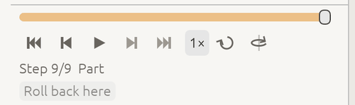
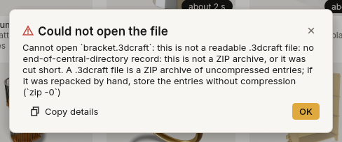

# 4. The window

*Everything you see in the 3DCraft window, and how to look around, play the history and point at things.*

The window (`craft3d`) is where you watch the agent work, look at a design and show the agent what you
mean. It does not model on its own: every change to a design comes in as a command, from an agent through
the MCP bridge ([chapter 1](01-install.md#connect-an-ai-agent-over-mcp)), from a Jig's parameter form
([chapter 5](05-jigs.md)) or from a program on the control channel. What the window does by itself is
open, save, import and export files, and let you look, play, click and select.



| | Part | What it is for |
|---|---|---|
| 1 | **File**, **Edit**, **View** and **Help** menus | Files, recent files, Jigs; Undo and Redo; panels and light or dark; the guide, the keys, About |
| 2 | **Tabs** | One per open document |
| 3 | **Feature list** | The history of the design, in order, with each step's status |
| 4 | **Eye** | Hides a feature's body, sketch or datum in the view |
| 5 | **Assertions** | The checks the design must pass |
| 6 | **History player** | Watch the design being built, step by step |
| 7 | **View buttons** | **Fit**, **Iso**, **Persp**, **Ortho** and **Studio** |
| 8 | **View cube** | Click a side, edge or corner to look from there |
| 9 | **Display bar** | **Sketches**, **Datums**, **Edges**, **See-through** and **Section** |

At the bottom is the **status bar**: the document's units, its file, when it was autosaved, the last
command and its answer, and which renderer drew the picture. When 3DCraft works for more than a moment,
a small spinner on the right of the status bar says what it is doing: *Opening welding-table… 41/82*
while a file's features are built, then *Checking 14 assertions… 5/14* while its assertions are
measured (the model is already there to look at). Quick work, such as each moment of a motion that
plays, never shows it, and once shown it stays a little while, so it does not blink. Until a newly
opened file has something to show, the middle of the viewport says *Opening welding-table…*. The texts
of the status bar change at most a few times a second; while a motion plays it says *Playing* and the
moment's `t`. An error shows at once and stays.

At the right end of the status bar is the **agent pill**: its colour says how agents stand. Outlined
grey, *Agents off*; outlined indigo, *Waiting for an agent*; indigo, *Claude Code connected*; with a
turning mark, what the agent does at this moment (*Claude Code · feature.fillet*); amber, when an agent
asks you something (*Claude Code asks for a folder*). Click it for the agent panel
([chapter 1](01-install.md#connect-an-ai-agent-over-mcp)). The browser has no pill: agents drive the
desktop app only.

## The start screen

Without a document, the window shows the **start screen** (picture in [chapter 2](02-first-steps.md)):

- **New part**, **New assembly** and **Open…**;
- **Examples**, in four sections you pick above the cards: **Parts**, ten of the [example
  models](../examples/README.md), each built in a new tab by a click from the same command script an agent
  would send; **Showcase**, parts that show what the surfacing can do (a class-A fuel tank and a class-A
  mouse whose seams are proven G2), built the same way, each card with the 3DCraft icon of its kind;
  **Assemblies**, three assemblies (the same gearbox and reducer, and a Jansen linkage walker of four
  legs) that open ready to play their motion ([chapter 17](17-assemblies.md#motion)); and **Jigs**,
  three published Jigs (a planetary gearbox, a gear reducer, a Jansen linkage leg, after the mechanism
  of Theo Jansen's Strandbeests) that open on their **Parameters** tab ([chapter 5](05-jigs.md)). These
  six come from the [3DCraft Jigs collection](https://github.com/johancoppens/3dcraft-jigs), under CC BY
  4.0;
- **Recent**: the files you opened or saved last, each with the icon of its kind and how long ago it
  changed;
- **Connect an AI agent**: the same panel as the agent pill's ([chapter
  1](01-install.md#connect-an-ai-agent-over-mcp)): the **Allow AI agents** switch, the work folder, the
  `claude mcp add` line with **Copy command**, **Copy MCP configuration**, and **Other clients** with a
  ready configuration for Claude Desktop, Cursor, VS Code or any client that starts a server over stdio.
  In the browser, the start screen says that an agent cannot drive 3DCraft there yet.

The start screen comes back when you close the last tab.

## Menus and tabs

**Tabs** along the top, one per open document, each with a small icon of its kind (a part, an assembly,
a Jig); a Jig opened to be used also says **Jig**. An amber dot at the tab's right marks unsaved changes
(the close × takes its place under the pointer). **Ctrl+Tab** goes to the next
tab and **Ctrl+Shift+Tab** to the previous one; **Ctrl+W** closes one, asking first when it has unsaved
changes (**Save**, **Don't Save**, **Cancel**). On a Mac, ⌘ takes the place of Ctrl.

The **File** menu:

| Item | Keys | Does |
|---|---|---|
| **New Part** | Ctrl+N | A new, empty part in a new tab |
| **New Assembly** | Ctrl+Shift+N | A new, empty assembly in a new tab ([chapter 17](17-assemblies.md)) |
| **Open…** | Ctrl+O | Opens a `.3dcraft` document or a `.3dcraftjig` Jig (a STEP file is imported with Import…) |
| **Open for editing** | | For a Jig in use: a new untitled model of it, to change as you like ([chapter 5](05-jigs.md)) |
| **Save** | Ctrl+S | Saves to the document's file (asks for a name the first time) |
| **Save As…** | Ctrl+Shift+S | Saves under a new name |
| **Import…** | Ctrl+I | Reads a STEP file or a FreeCAD document into the document |
| **Export…** | Ctrl+E | Writes STEP, STL, 3MF, OBJ, DXF or SVG ([chapter 12](12-files.md)) |
| **Export as Jig…** | | Publishes a document with parameters as a `.3dcraftjig` ([chapter 5](05-jigs.md)) |
| **Open recent** | | The last ten files opened or saved, by you or by an agent, newest first, each with the icon of its kind; **Clear recent** empties the list |
| **Close** | Ctrl+W | Closes the active tab |

Under them, the open documents: click one to switch to it.

A recent file that is not there any more is greyed out. The list is kept in `3dcraft/recent-files.json`
in your state folder (next to the autosaves), and two windows open at once each keep what the other
added. The browser keeps no recent files.

The **Edit** menu:

| Item | Keys | Does |
|---|---|---|
| **Undo** | Ctrl+Z | Undoes the last change to the active document; the item names it (**Undo Set teeth**) |
| **Redo** | Ctrl+Shift+Z or Ctrl+Y | Redoes the change last undone |

An item is greyed out when there is nothing to undo or redo, and while a parameter is being dragged or set. Every change counts, whoever made it: you,
or an agent over MCP. While you type into a field, Ctrl+Z undoes your typing instead. In a Jig in use
the only changes are those of its parameters, so Undo takes back the last parameter you set.

The **View** menu:

| Item | Keys | Does |
|---|---|---|
| **Side panel** | Ctrl+B | Shows or puts away the panel on the left |
| **Status bar** | | Shows or puts away the bar at the bottom |
| **System**, **Light**, **Dark** | | The **Appearance**: the panels and dialogs light or dark. **System** (the default) follows your desktop's setting, and in the browser the browser's |
| **Full screen** | F11 | The window over the whole screen (the desktop app) |

The appearance changes the panels, the start screen and the dialogs; the menu bar, the tabs, the status
bar, the menus and the popovers stay dark, and the model's view stays as it is, so pictures look the same
whichever you choose. An agent can switch it too: `ui.set {"appearance": "dark"}`.

The **Help** menu:

- **User guide** opens this guide in your browser.
- **Keyboard shortcuts** (also **F1**) lists every key and mouse action ([chapter 15](15-reference.md#keys-and-mouse)).
- **Open data folder** shows 3DCraft's folder: the autosaves, what can be recovered after a crash, and the
  recent files (not in the browser).
- **Connect an AI agent…** opens the agent panel over the pill (not in the browser).
- **About 3DCraft** gives the version and the commit it was built from, the platform, the licence (MIT),
  links to the guide and the source, and the renderer in use. **Copy system info** copies those lines
  for a bug report.

## The side panel

The left panel has tabs, chosen by the kind of document: a part has **Features**, **Variables** and
**Bodies**; an assembly has **Assembly** (its instances and mates) and **Variables**; a document with public
parameters (a Jig) has **Parameters** first. When the tabs do not fit, the rest are behind **⋯**. Drag the
panel's right edge to make it wider or narrower; it keeps that width whatever it shows.

### Features

One row per step of the history: an icon for its kind (sketches in indigo, datums in petrol, as in the
view), its name, and its key value at the right, such as *Extrude 8 mm*, *R18 × 60 mm* (a cylinder),
*3 × 22 mm* (a pattern) or *− Bore* (a subtraction and its tool).

- **A sketch sits under the feature made from it**, folded: click **›** to open it. **Datums that follow
  one another** fold into one *Datums* row in their place. The order shown is always the history's.
- **The filter** at the top keeps the rows whose name, kind or value holds what you type.
- **The line under the filter** says how it went: *23 rebuilt · 7 checks pass*, *1 failed · 3 not rebuilt*,
  or *Rolled back to Bored · 10 of 25*. The dot carries a tick or a cross, so it does not rest on colour.
- **Hold the pointer on a row**: what it uses (↑) and what uses it (↓) get an indigo tint, and a strip at
  the foot of the list names them and counts the later features that depend on it through them. Its value
  turns into a field: **click the value of the selected row to edit it** in place (Enter sets it, as one step to undo; Escape
  leaves it). Its grip (⠿) and its eye show too.
- **The eye** hides that feature's body, sketch or datum in the view; it stays on a hidden row, struck
  through. The model itself does not change.
- **Click a row** to select the feature; **double-click** it, or click the **⌖** on the row under the pointer,
  to **fly to** it.
- **A feature that fails** is a red row with its reason and two buttons: **Show where** flies to what it is
  made from, **Edit** opens its value. The features made from it are dimmed: they are not rebuilt (the
  regeneration skips what is made from a failed feature); the ones that do not depend on it are built as
  usual.
- **The gold roll-back bar** sits after the last step built. Drag its grip to roll back to another step: the
  steps after it are dimmed and the view shows the model there.
- **Drag a row by its grip** to move it in the history (`feature.move`). A place before what it is made from,
  or after what is made from it, is refused before you drop it: the indigo line does not show there.
- **Right-click a row** for its menu: *Edit…*, *Rename*, *Show dependencies* (the hover's marks stay until
  Escape), *Roll back to here*, *Suppress*, *Hide*, *Copy id* (for a message to an agent) and
  *Delete*. Each is a command, so an agent can do the same and every one can be undone.

**Checks** sit under the list: *Checks 7 · all pass*, then each check measured against its limit, such as
*7 mm ≥ 5 mm*. A failing check is red, with its reason under it, and the line at the top says *1 of 7 checks
fails*. Click a check to fly to what it measures. They fold to their heading while something is selected
(or when the panel is short), to make room.

**What is selected** shows at the foot: a face's surface (plane, cylinder R …, cone, sphere, torus, spline),
its area and its normal or axis; an edge's curve, length, the two faces it lies between and the angle there;
a body's volume, mass, area and box. *Made by* links to the feature that made it, *Name* is its persistent
name (what an agent uses). **Measure** measures a face's wall thickness, or the distance between the first two
things selected; **Copy name** copies the name.

### Variables

The document's variables as a table: name, value or formula, result. Variables are grouped by the group a
public parameter was given, or by a prefix two of them share (*base_t*, *base_r* under *Base*). A formula is
written in indigo on a line of its own, its result at the right. **Click a value or a formula to edit it**:
Enter sets it, as one step to undo; one that does not work out says why under it. **Add variable** opens a new one to fill in;
Enter makes it. The document's units and tolerance fold away at the foot.

### Bodies

One row per body the design ends with: its colour, its name, its mass (or its volume without a material) and
its eye. Click a body for its card: **Material** (choose a preset: it sets the density and the look), density,
colour, volume, mass, area, box, faces and edges, and whether it is a valid closed solid. The totals are at the
foot. The bodies that booleans used up are folded under *Tool bodies*; open it to see them and where they went.

**A Jig** opens on **Parameters** (its form); its other tabs are there to look at.

## The history player



At the foot of the side panel is the **timeline**: drag it to see the design as it was after any step
of its history. Features after that step are greyed, and the step is named at the top of the view, such as
`Step 3/6  Join`. Looking back never changes the document.

Under the timeline is a **player**, like a video player's:

| Button | Key | Does |
|---|---|---|
| ⏮ First step | Home | Shows the first step |
| ⏴ Step back | ← | One step back |
| ▶ Play / ⏸ Pause | Space | Plays the history step by step, or pauses |
| ⏵ Step forward | → | One step forward |
| ⏭ To end | End | Back to the whole design |
| **1×** | | The speed: 0.5×, 1× or 2× (click to change) |
| Loop | | Starts again at the first step after the last |
| Orbit | | Turns the camera slowly while it plays |

In a narrow feature panel the speed, Loop and Orbit move to a second row, under the other five.

The keys work while the pointer is over the view or the feature list and you are not typing in a field.
Each step is shown once its model is built, and for at least 0.8 s at 1×, so a heavy model never skips a
step. Playing stops at the end, when the document changes or when you switch tabs.

Every step is shown as finely meshed as the whole design, so a part that does not change between steps
keeps its look, and stepping through a history you have seen before is immediate.

To film the player, or anything else in the window, an agent can record the window itself, panels
included, even while it is covered by other windows: `ui.record` with frame-exact steps (`ui.advance`)
gives a video in which every step is complete ([*A video of the window*](../development.md#watching-along)
in the developer guide).

**Roll back here** puts the *rollback marker* on the step shown: the design is then built only up to that
step, and new features go in right after it, a way to insert something early in the history. **To end**
takes the marker away again. While you look back, clicks in the view do not select; go **To end** first.

### Playing a motion

A design with a **timeline** can also be played as a motion. The timeline is a variable `t`, a plain number
from 0 to 1 (`variable.set {"name": "t", "expr": "0"}`); formulas of `t` move the design, such as a crank angle
`360 deg * t`. A `t` with a unit (a thickness called `t`) is not a timeline: rename it first.

With a timeline, **History** and **Motion** appear above the player. In Motion the slider runs over `t`, and the
player plays it: from 0 to 1 in 4 s at 1×, **Loop** starts again at 0, **Back and forth** turns round at the
end, and **Collisions** draws the parts that overlap in red. The view names the moment, such as
`t = 0.500 · collision: Wall and Crank`. As with the history, nothing in the document changes; only the
features that use `t` are rebuilt for each moment, so a heavy model plays slower rather than skipping. An
assembly has no history of its own, so it shows only **Motion**: its parts are moved, not rebuilt
([Assemblies](17-assemblies.md#motion)).

While a motion plays, the view draws lighter so it keeps up: in the studio look it leaves out the frames a still
picture averages, the depth of field, the ambient occlusion and the reflections (the shadows stay), and as soon as
you pause or stop, the full look comes back and settles.
Screenshots and recordings are always at full quality. To see the full look while it plays too, an agent sets
`ui.set {"timeline": {"playQuality": "full"}}`.

When the moments of a motion are slow to make (an assembly whose parts are rebuilt as it moves, a heavy part),
the player says **This motion is heavy — bake first?** under the slider. **Bake** makes the moments of a play
ahead (`motion.bake`) while it goes on playing, with a bar that shows how far it is; afterwards it plays
smoothly. **Not now** hides the question for that document until you close 3DCraft. A motion that is quick to
show but whose parts are rebuilt as it moves is baked by itself the first time it plays, with the same bar. An agent reads the same
from `ui.get` › `timeline.heavy` (`msPerMoment`, `suggestBake`).

An agent does the same with `view.motion {"t": 0.5, "collisions": true}`, draws a point's path with
`view.trace` (`"grow": true` draws it only as far as the moment shown, so it grows while the motion plays;
exported with `file.export {"path": "path.svg", "trace": "Trace 1"}`; in the window a trace is worked out in
the background so the motion keeps playing: the answer says `"pending": true`, `view.trace {"name": "Trace 1",
"wait": true}` gives the points once they are there (it waits at most 2 s in the window: ask again), or why they
could not be made, and `ui.get` lists every trace
under `traces` with `pending` or `error`; `"background": false` works it out in the command), checks assertions over the
motion with `motion.check` ([Measure and check](10-measure.md#over-a-motion)), and makes a video of it with
`view.replay {"dir": "frames", "motion": {"frames": 120}}`.

## Looking around

| Do | To |
|---|---|
| Drag with the left button | Orbit |
| Drag with the right or middle button, or Shift and the left | Pan |
| Wheel, or pinch on a touchpad | Zoom about the point under the pointer |
| **F** | Fly to the selection, or frame the whole model when nothing is selected |
| **Fit** | Frame the whole model |
| **Iso**, or a click on the view cube | A standard view (Iso looks from the front-right corner) |
| **Persp** / **Ortho** | Perspective, or orthographic (to scale, no vanishing point) |
| **Studio** | The studio look on or off; the **▾** caret on its right opens or closes its options (see *The studio look* below) |
| **Analysis** | A surface analysis on or off; its **▾** caret opens or closes its options and legend (see *Surface analysis* below) |

The **display bar** at the bottom of the view:

- **Sketches** and **Datums** show or hide sketches and construction planes, axes and points;
  **Edges** shows or hides the dark lines along the bodies' edges (an edge you point at or select is
  still drawn). In a narrow window these three show their icons only; hover for the name.
- **See-through** makes the bodies transparent (drag the percentage), to look at pockets and cavities.
- **Section** cuts the view open with a plane across X, Y or Z, through the middle of the model at first; **Offset** moves it and **Flip side**
  keeps the other half.

On a phone or a tablet (in the browser), and in any window narrower than about 800 points (the buttons get finger-sized as soon as you touch the screen, at any width; the drawer below is for narrow windows only, so a tablet held upright at 820 points keeps the feature list beside the view):

| Do | To |
|---|---|
| Drag one finger | Orbit |
| Drag two fingers | Pan |
| Pinch | Zoom about the middle of your fingers |
| Tap | Select, as a click does |
| Double-tap | What **F** does: fly to what you tapped, or frame the whole model |
| Press and hold | The list of everything under your finger (as a right click) |
| **☰** at the left of the menu bar | Open or close the feature list, Parameters and the player as a drawer (a tap beside it, or Escape, closes it too) |

The buttons over the view are then large enough for a finger, and where the display bar has no room for
the section's options they get a row of their own just above it. A model with a history or a motion gets a
small player above the bar (play or pause, the steps or the slider, and where it is) while the drawer is
shut; the drawer holds the whole player. When the tabs do not fit, **All** at the end of their row lists
every open document, and the status bar keeps to what you act on.

None of this changes the document. Each tab remembers its own camera, section and see-through. A heavy
model first shows a quick picture, then the sharp one (the status bar says `refining`).

### The studio look

**Studio**, beside Persp and Ortho at the top right, switches between the plain look, which every
picture had so far and which is best for modelling, and the studio look, which shows what a part will look like: its colours,
how metal and how rough its faces are (Appearance), lit by a photographed environment. Three come with
3DCraft: `studio` (soft boxes, the default), `outdoor` (sky and sun) and `workshop`. The light falls
from the environment's brightest direction and casts soft shadows on the model and on a ground under
it; corners and grooves darken where little light reaches. A see-through or cut-open view is lit the
same way: what lies behind a see-through face is lit as the face is and shows through it, and the
flat cap of a section is lit like a face in its own colour.

**Studio** is a split button. The chip switches the look on and off; the small **▾** caret on its
right opens and closes the look's options. Switching the look on opens them in a popover that hangs
under the button row, with a small pointer toward the button and its right edge in line with the row's:
the environment and how far it is turned, the exposure, the background, the ground and how much it
reflects, the tone curve (AgX, ACES or Linear), shadows, ambient occlusion and reflections, bloom, and a
lens that blurs what is out of focus (its f-number and where it focuses). A change shows at once.
While the popover is open the view cube moves down under it, or hides where there is no room (on a phone), and comes back when it closes. Click
the caret again, or press Escape, to close the options: the look stays on. Clicking the chip switches
the look off. In a short window the options scroll inside the popover.

An agent sets the same look with `ui.set`, and pictures from the command line take it too:

```text
ui.set {"look": {"mode": "studio", "environment": "outdoor", "exposure": 0.5, "rotation": 90}}
craft3d-cli render part.3dcraft --out part.png --look studio --environment workshop
```

`exposure` makes the picture brighter in stops (negative darker), `rotation` turns the environment
about the vertical axis, `ground`, `ao` and `shadows` switch the ground, the darkening in corners and
the shadows off, `tonemap` chooses how bright light is fitted into the picture (`agx`, the
default, `aces` or `linear`), and `background` `plain` keeps the window's own background colour behind the
model while the environment still lights it (`environment`, the default, shows the environment). The look is a view: the document does not change. In the browser on older
graphics (WebGL2) the studio look has no shadows and no darkening in corners. In the browser the studio look is drawn simpler while you turn, pan or zoom the view (no darkening in corners, reflections or depth of field, at a lower resolution), and in full again a moment after you let go.

The studio look also has a second layer of polish, on by default:

- glossy faces (roughness under 0.4) reflect the model itself where it is in the picture, and the
  environment elsewhere (`reflections`); the ground can reflect it too (`groundReflection` from 0 to
  1, off by default: towards the horizon the ground then mirrors the sky and the background
  brightens, and the ground reflects only what is in the picture, so under a model whose
  undersides you cannot see the reflection comes out in pieces);
- short, dark contact shadows where parts touch or stand on each other (`contactShadows`);
- a face in the key light's shadow loses that light's reflection too (`specularShadow`);
- bright parts glow a little into their surroundings (`bloom`, the share of the light spread, 0.04 by
  default).

Depth of field is off until you ask for it: `dof` is a thin camera lens with an f-number (`fstop`,
2.8 by default; smaller is more blur) focused on a point. In the Studio popover, **Lens** switches it
on; **Aperture** is a slider of the usual f-stops, f/1.4 (most blur) to f/22 (nearly all sharp); **Focus**
says where it focuses: **Selection** (the default when you switch it on) on what is selected, in the
viewport or in the feature list, and it follows as you select something else; **Click** on the point
you clicked last; **Centre** on the model's centre; **Distance** at a distance along the view, with a
slider of its own. With nothing selected, a selection that is hidden, or no click yet, the lens
focuses on the centre, and the popover says so under the choice; in an orthographic view (no lens)
or with the focus behind the camera it says that nothing is blurred. While the lens is on, what is
selected keeps its own colour and is marked by its outline, so you can see it is sharp. To an agent these are `"focus": "selection"`, `"picked"`,
`"centre"`, a number (a distance) or `[x, y, z]` (a point); `ui.get` says under `lens` where it
focuses now. `view.render` focuses `selection` on the session's selection; `craft3d-cli render` has
no selection or click, so give it the point (`--focus X,Y,Z`, from `select.get` or `ui.pick`), a
distance, or `centre`. The blur follows the
document's length unit, as a real camera would: a small part seen close up has a shallow depth of
field. An orthographic view has no lens and stays sharp.

While the camera stands still the window keeps refining the picture: it averages 16 frames
(`accumulate`, 1 to 256), each with its samples moved a little within the pixel and the lens turned,
so edges smooth out and the blur fills in; moving the camera starts again from a sharp first frame.
The lines along the edges are drawn over the finished picture, so they cannot blur with it. With
depth of field they fade instead where the lens blurs the model (`"edges": "soft"`, the default of the
studio look): crisp at the focus, fainter the further from it. `"edges": "sharp"` keeps them crisp
everywhere, as the plain look draws them, and `"edges": "off"` leaves them out of the studio look
(the **Edges** toggle hides them in every look).

```text
ui.set {"look": {"mode": "studio", "dof": {"fstop": 2, "focus": "selection"}, "edges": "soft"}}
ui.set {"show": {"edges": false}}
```

`view.render` and `craft3d-cli render` draw one frame unless `accumulate` (`--accumulate`) asks for
more; they refuse a still whose frames together would take too long (all frames' samples over
2^26, about 34 frames of the default 800 × 600 picture; on the graphics card, up to 256 at any size).
`ui.screenshot` with `window: true` waits until the window has averaged its frames, so the picture is
the settled one; the count it waits for is `accumulate` too, so `ui.set {"look": {"accumulate": 4}}`
settles sooner and `"accumulate": 64` smoother. `view.replay` averages the same 16 per frame unless its
`look` says otherwise.

```text
ui.set {"look": {"mode": "studio", "dof": {"fstop": 2, "focus": "picked"}, "bloom": 0.1}}
craft3d-cli render part.3dcraft --out part.png --look studio --fstop 4 --accumulate 32
```

In the browser on WebGL2 the second layer's reflections, contact shadows and depth of field are left
out.

### Materials

Beyond its colour, metallic and roughness, a body or a face can have the layers of a real material,
which the studio look draws (the plain look keeps showing the colour):

- **anisotropy** (−1 to 1): the highlight stretched in one direction, as on brushed or turned metal.
  It follows the face's own direction: around the axis of a turned face (cylinder, cone, sphere,
  torus), along the first axis of a flat one; `anisotropyAxis` `[x, y, z]` gives a direction of your
  own instead (`"parametric"` gives the face's own direction back, as the appearance is said back);
- **clearcoat** (0 to 1) with its own `clearcoatRoughness`: a clear, glossy layer over the colour,
  as on car paint;
- **transmission** (0 to 1): light passes through, as through glass or clear plastic, bent by the
  index of refraction `ior` (1.5 by default). `thinWalled` is for a sheet: light passes straight
  through. `absorption` is the colour light takes after `absorptionDistance` millimetres inside
  (10 by default), so thick glass looks greener than thin glass. A `thinWalled` face has no
  inside for light to cross, so `absorption` has no effect on it;
- **subsurface** (0 to 1): light wraps past the edge of the shadow, as in wax, skin or wood, tinted
  by `subsurfaceColor`.

A small library gives ready sets: `material.presets` lists them (steel, aluminium-brushed, abs,
glass, car-paint, wood, and with a solid texture oak, walnut, beech, marble, granite, carbon and
cast-iron) and `material.preset` gives one to a body, its look and its density together; any number
beside it changes the preset:

```text
material.preset {"body": "Housing", "preset": "car-paint", "color": "#1f4fa0"}
material.preset {"body": "Window", "preset": "glass"}
body.appearance {"body": "Blades", "color": "#c8ccd2", "metallic": 1, "roughness": 0.3, "anisotropy": 0.8}
```

#### Solid textures

A material can also have a **pattern**: wood, marble, granite, speckle, noise, brushed or carbon,
worked out at every point of the body in the model's space rather than painted on its faces. So a
cut, a hole or a chamfer shows the wood's rings or the marble's veins running on through the body,
as in the real material. The oak, walnut, beech, marble, granite, carbon and cast-iron presets have
one, fitted to the body: wood's grain runs along the longest side of the body's box, with rings a
twentieth of its width apart, and the pith just outside the body below its thinnest side, so a board
shows the arches of a flat-sawn plank. Change any of it with a `pattern` object beside the preset,
or give your own with `body.appearance` or `face.appearance`:

```text
material.preset {"body": "BoardBottom", "preset": "walnut"}
material.preset {"body": "Top", "preset": "oak", "pattern": {"scale": 3, "seed": 7}}
body.appearance {"body": "Plinth", "roughness": 0.15, "pattern": {"kind": "marble", "colors": ["#f2f0ec", "#60646a"], "distortion": 2}}
```

A pattern takes its `kind`, two to four `colors` (a ramp; each kind has its own when left out),
its `scale` (the size of a ring, a vein, a cell or a tow, in the model's units), `axis` and `origin`
(the grain's direction and the pith; left out, fitted to the body's box), a `seed` for another
piece of the same material, `distortion` (the rings' wobble, the marble's turbulence), `detail`
(octaves of noise, 1 to 6), `grain` and `rays` (wood's fine streaks and medullary rays, 0 to 1),
`spot` (a speckle's dot size), `wrap` (carbon: woven around the axis for a tube, or flat across it
for a plate whose normal is the axis), `alongAxis` (a brushed or anisotropic highlight along the
grain) and `roughness` (at the ramp's two ends). The scale, axis and origin fitted to the body are
worked out once, when you give the material, and kept: later edits that change the body's size do
not change the grain, and a body that an earlier feature moves (a transform, a pattern's copy) slides
through its texture instead of carrying it along; give the material again to fit it anew. The studio look draws it; the plain look and the
exports show the pattern's mean colour, which becomes the body's colour when you give none. A carbon
weave is a solid pattern too: it is right on a tube around its axis and on a plate across it, and
looks stretched on faces that are neither (a plate's edges, a tube's end).

What you see through glass is worked out on the picture itself: the view of what lies behind it,
moved by the refraction as a slab of the glass's thickness would move it. Glass behind glass is not
seen through, and a transparent body casts no shadow. Exports keep what their formats can: an OBJ
export's material library has the clear coat (`Pc`, `Pcr`), the anisotropy (`aniso`), the index of
refraction (`Ni`) and the transmission (`d`, `Tf`); a 3MF export gives a transmissive material a
display colour with transparency; a STEP export writes the transmission as the surface's
transparency. Subsurface, the anisotropy's direction, the absorption's length and solid textures
are kept only in the `.3dcraft` file (a texture exports its mean colour).

### Surface analysis

**Analysis**, beside Studio, shows the quality of the surfaces instead of their shading. It is a split
button as Studio is, and opens a popover in the same place, which chooses what, with its options as
number fields, and a legend says what the colours mean; its **▾** caret (or Escape) closes the popover
and keeps the analysis on, as for the studio look. While an analysis is on the view is drawn plainly,
so the studio look's caret is greyed out until the analysis is off:

- **zebra**: black and white stripes reflected in the surfaces, as a car body reflects the lights of
  a tunnel. Where two faces meet with the same tangent plane (G1) but a jump in curvature the
  stripes kink; where the curvature carries on too (G2) they run on smoothly. The stripes follow
  the view, as reflections do: turn the model to see a seam from several sides. `stripes` is how
  many per turn, `direction` turns the tunnel on the screen, `width` is the dark share of each
  stripe and `offset` slides them along.
- **highlight**: highlight lines (Beier and Chen), the lines of a light panel above the model drawn
  where the surface's normal points at them. They stay put when you turn the view, so they show a
  surface's flow on the part itself.
- **curvature**: a colour map of the curvature, from blue (most negative) through pale to red (most
  positive): `gaussian` (saddles negative, domes positive, flat or cylindrical zero), `mean`
  (positive where the part bulges out) or `max`, the larger of the two principal curvatures. The
  numbers come from the exact surfaces, not from the triangles on screen. The range is the 95th
  percentile of the values unless you fix it (`range`).
- **draft**: for moulded parts. Faces that leave the mould along the pull direction (`pull`) with at
  least the least draft (`minDraft`, degrees) are green, faces that leave it the other way blue,
  and faces too steep to leave either way red.

**Combs** draw the curvature of edges (or of iso-curves of a face) as spikes standing off the curve,
as long as the curvature and joined at their tips: where the comb's outline jumps, the curvature does.

The analysis is a view, like the look: the document does not change, and the picture is drawn in the
plain look. An agent sets it with `ui.set`, and `view.render` takes the same object:

```text
ui.set {"analysis": {"mode": "zebra", "stripes": 32, "direction": 30}}
ui.set {"analysis": {"mode": "curvature", "curvature": "mean", "combs": {"edges": true, "density": 60}}}
ui.set {"analysis": {"mode": "draft", "pull": [0, 0, 1], "minDraft": 2}}
ui.set {"analysis": null}
```

The numbers behind the colours are measures too ([chapter 10](10-measure.md#surface-quality)).

## Pointing at things

A click selects what is under the pointer: a corner (vertex) when one is within a few points, else an
edge, else the face.

| Do | To |
|---|---|
| Click | Select a vertex, an edge or a face |
| Shift+click | Add to or take from the selection |
| Click again at the same place, or Alt+click | Select the next face behind |
| Right click | List every face under the pointer, to choose one |
| Double-click in the view | Select the whole body |
| Ctrl+drag | Select what lies inside a box |
| Click empty space, or Escape | Clear the selection (Escape first folds an open Studio or Analysis panel) |

**The agent sees your selection.** The selection belongs to the document, not to the window, so the agent
reads it: each item with its name, the body, the feature that made it, its shape (a hole's radius and
axis, a face's direction) and the size that drives it. So you can say:

> Make the hole I selected 6.5 mm.

and the agent finds the size behind that hole and changes it. The other way round, the agent can show
you what it means: it can light up a face, an edge or a corner in your view, set the selection you see,
fly the camera to a feature, play the history, and take a picture of the window to look at itself
(`ui.highlight`, `ui.select`, `ui.fit`, `ui.set`, `ui.screenshot` over `control_call`;
[`control-protocol.md`](../control-protocol.md) has the details).

## When something goes wrong

When a command fails, the status bar shows it in red with its message, and a **Copy details** button that
copies a short report for a bug report ([chapter 14](14-troubleshooting.md#reporting-a-problem)). When a
file action you started yourself fails (Open, Save, Import, Export), a dialog says what went wrong:



When 3DCraft was not closed properly (a crash, a power cut), the next start shows a bar under the menu
that offers to **Recover** what was autosaved ([chapter 14](14-troubleshooting.md#after-a-crash)).

## Without the window

An agent working headless looks at its work with `doc_render_preview` (the command `view.render`): the
same picture `craft3d-cli render` makes. `view.pick` answers "what is at this pixel of that picture", as a
click does in the window.

**Next:** [Jigs](05-jigs.md).
