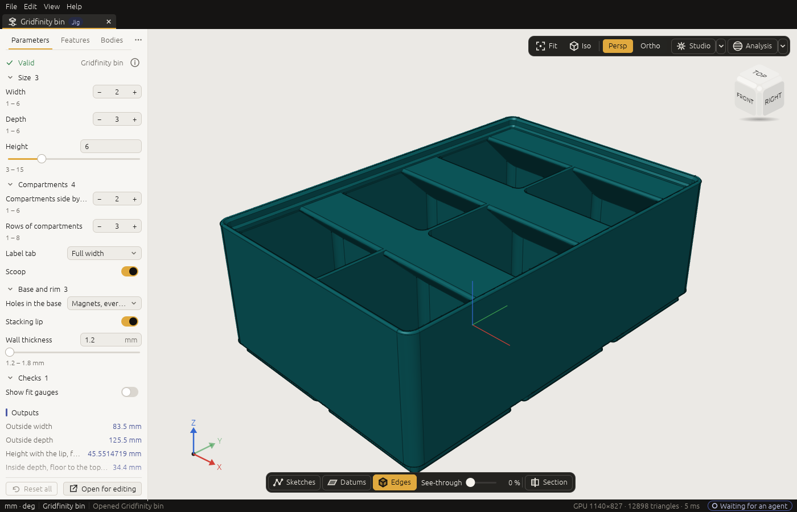

# 5. Jigs

*Use a ready-made design by setting its sizes in a form, and make designs of your own that others can
set. No AI needed to use one.*

A **Jig** is a design made to be set by others, without knowing how it is modelled: a box sized by its
width, depth and height, a pulley by its number of teeth, a welding table by its size. Its maker
**published** the sizes that drive it as **parameters**, each with a label, a range and a step. You set
them in a form, and 3DCraft rebuilds the model, exactly and in the same way every time.

A Jig is shared as a **`.3dcraftjig`** file: the design, its parameters, a title and description, and a
small picture. It runs in the desktop app and in the web version.

## The Jigs collection

The [3DCraft Jigs collection](https://github.com/johancoppens/3dcraft-jigs) holds Jigs to download and
use; its `dist` folder has the `.3dcraftjig` files. The first three:

| Jig | What it makes | Export it as |
|---|---|---|
| **Laser-cut box** (`laser-box`) | A finger-jointed box with a loose lid, cut from sheet: outside size, sheet thickness, finger width and your laser's kerf | DXF or SVG, the set *Cut sheet* |
| **Welding table** (`welding-table`) | A fixture welding table: a perforated top plate on half-lapped ribs with weld tabs | DXF or SVG of the plates; STEP |
| **GT2 pulley** (`gt2-pulley`) | A timing pulley for GT2 belts (2 mm pitch): teeth, belt width, bore, with or without flanges and a hub | STL or 3MF to print, STEP |

Each Jig's description, on its Parameters tab, says how to export it. The collection is separate from
3DCraft: anyone can make Jigs and share them.

## Using a Jig

1. **Open it**: **File › Open…** and choose the `.3dcraftjig` file, or double-click the file (once
   3DCraft is installed), or drop it on the web version's page.
2. It opens on its **Parameters** tab, beside **Features**:

   

   At the top are the Jig's title and description, then the parameters in groups. Click a group's name to
   fold it.
3. **Set the parameters.** The model follows.
   - **A number:** drag across its field (the bar under it shows where the value lies in its range; hold
     **Shift** for ten times finer, **Ctrl** to go in steps), click the **‹ ›** at its ends, or turn the
     wheel over it. To type a value, double-click the field (or press Enter over it), type it with or
     without its unit (`60 mm`, `60`, even `width / 2`) and press Enter; Escape gives up.
   - **Yes or no:** a checkbox (*Hub*, *Flanges* on the pulley).
   - **A choice:** a list to pick from.
4. **Export** the result: **File › Export…** ([chapter 12](12-files.md)). For a laser-cut Jig, choose a
   `.dxf` or `.svg` file and pick **Sheet of set: …** in the export dialog: every panel on one sheet, at
   true size.
5. **Save** if you want to keep your settings: it saves the result as an ordinary `.3dcraft` model under
   a name you choose. The `.3dcraftjig` file itself is never changed.

**The form keeps values in range.** Typing 150 into a width that goes up to 120 mm sets 120 mm and says
*clamped to 120 mm* under the field for a few seconds (and *rounded to …* for a value between two steps).
When one parameter limits another (a bore that must stay smaller than the hub), changing the first can
clamp the second, and the form says that too.

**Back to the defaults.** A parameter that is not at its default has a **↺** next to it to put it back;
**Reset all** puts every parameter back.

**Edit › Undo** (Ctrl+Z) takes back the last value you set; a whole drag is one undo step, for you and
for an agent (`edit.undo`). **↺**, **Reset all** and **Back to last good** (below) are there as well.

**When a value breaks the model** (a fillet that no longer fits, a wall thicker than the box, a check that
fails), the field turns red with the reason, and a banner over the model says *This value breaks the
model* with a **Back to last good** button that sets the last values that built. A Jig's maker should
have chosen ranges where that cannot happen; if it does, tell them.

**Closing a Jig you changed** asks *You changed the parameters of "…". Save the result as a model?*:
**Save as model…**, **Close** (forget the settings) or **Cancel**.

### Looking inside, and changing the design

The **Features** tab shows how the Jig is built, and the history player ([chapter 4](04-window.md#the-history-player)) plays it step by step.
In a Jig, only the parameters can change: the features are there to look at, and an agent that tries to
edit them is told so.

To change the design itself, click **Open for editing** on the Parameters tab (or **File › Open for
Editing**): it makes a new, untitled model of the Jig, set as it is now, that you can change as you like,
by hand or with an agent.

### In the browser

Jigs work the same in the web version, with one difference: the model follows a parameter **when you let
go** of the field, not while you drag, because the browser cannot rebuild while it draws. Export and
save as described in [chapter 12](12-files.md#files-in-the-web-version).

### With an agent or a script

An agent sets a Jig's parameters with `param.list` (the form, as a list) and `param.set`. Unlike the form,
`param.set` **refuses** a value outside its range, with the range, so the agent can correct itself:

```json
[
  ["param.list", {}],
  ["param.set", {"values": {"width": "220 mm", "height": "60 mm"}}],
  ["file.export", {"path": "box.svg", "set": "Cut sheet"}]
]
```

From a terminal, the same with `craft3d-cli run box.3dcraftjig --cmd param.set --params '…' --cmd
file.export --params '…'` ([chapter 13](13-command-line.md)).

## Making a Jig

Any design whose sizes are variables can become a Jig. You design it as an ordinary `.3dcraft` document
(with an agent, or by hand), then:

1. **Publish the variables** others may set. Each becomes a parameter, with a label, a description, a
   group, a range and a step:

   ```json
   [
     ["variable.publish", {"name": "width", "label": "Width", "description": "Outside width", "group": "Size",
                           "min": "40 mm", "max": "120 mm", "step": "1 mm"}],
     ["variable.publish", {"name": "lid", "label": "Thick lid", "group": "Finish", "kind": "boolean"}],
     ["variable.publish", {"name": "corners", "label": "Corners", "group": "Finish", "kind": "choice",
                           "choices": ["sharp", "round"]}]
   ]
   ```

   `kind` is `number` (a value with its unit, the default), `integer`, `boolean` (0 or 1) or `choice` (1
   for the first label; `choicesFrom` takes the labels from a table, [chapter 8](08-formulas.md#tables)).
   A published variable must hold a value (`40 mm`), not a formula; other variables may be formulas of it
   (`radius = 0.5 mm + (corners - 1) * 4.5 mm`). Ranges and steps may be formulas of other parameters
   (`"max": "width - 2 * wall"`). `variable.unpublish` makes a parameter an ordinary variable again.
2. **Switch options on and off** with conditions: `feature.when {"feature": "Lid", "expr": "lid"}` builds
   the lid only when the *Thick lid* box is ticked ([chapter 8](08-formulas.md#switching-parts-on-and-off)).
3. **Say what it is**: a title, a description (say how to export it), an author and a licence:

   ```json
   [
     ["document.info", {"title": "Storage box", "description": "A box with a lid. Export it as STL to print.",
                        "author": "You", "licence": "CC-BY-4.0"}]
   ]
   ```

4. **Try it** on the **Parameters** tab, which a document with parameters shows too: drag every
   parameter across its range and watch for red fields.
5. **Prove it over the whole range** with `craft3d-cli check-range mybox.3dcraft` (or the command
   `document.sample`): it builds the design at the defaults, at the corners of the ranges, at every choice
   and at random points, checks each, and lists every combination that fails with the values to
   reproduce it ([chapter 13](13-command-line.md#check-a-jig-over-its-range)). Fix the model or narrow the
   range until it passes. An assertion that could be neither proven nor disproven at a point is counted
   apart (*with unproven assertions*); `--strict` treats it as a failure. With many parameters, give
   `--max-corners 8` for a quick run.
6. **Publish it**: **File › Export as Jig…** (the command `jig.export`) writes the `.3dcraftjig`, with a
   picture of the model. That is the file you hand out; keep the `.3dcraft` to go on designing.

> **Ask an agent:** "Make this a Jig: width, depth and height between 50 and 200 mm, a wall between 1.2
> and 3 mm, and an option for a lid. Check it over the range and export it as box.3dcraftjig." The agent
> publishes the parameters, runs the range check, fixes what fails and exports the Jig.

**Good Jigs** have few parameters, clear labels with units, ranges that always build, defaults that make a
sensible part, a description that says how to export, and checks (assertions, [chapter 10](10-measure.md))
that guard what matters, such as a minimum wall.

**Next:** [How 3DCraft thinks](06-concepts.md).
