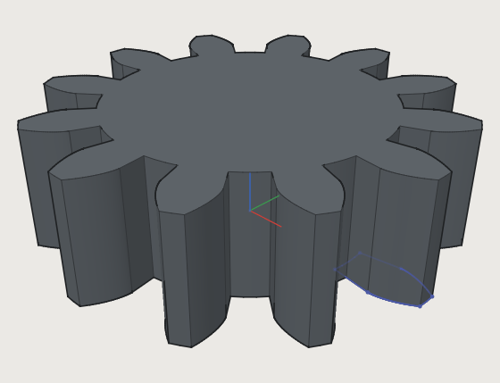
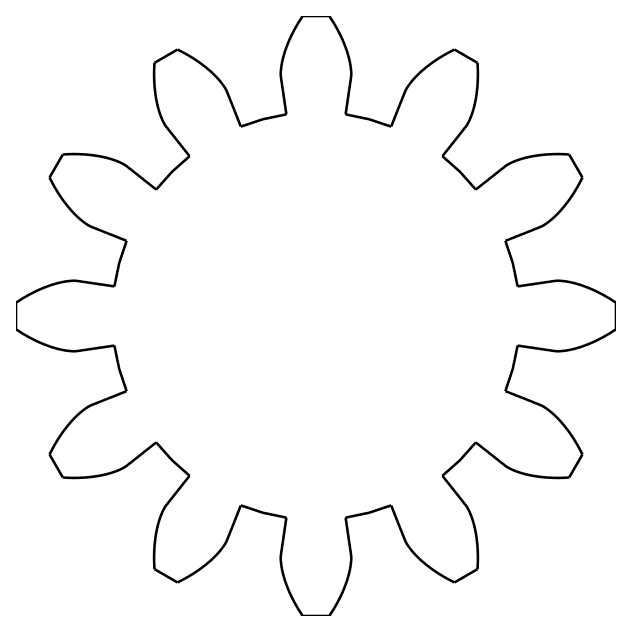

# 8. Formulas, tables and conditions

*Let a design decide for itself: choose sizes by conditions, look values up in tables, switch parts on
and off, and draw curves from formulas.*

Every size in 3DCraft can be a formula of the document's variables ([chapter 6](06-concepts.md#variables-expressions-and-units)).
This chapter is about the formulas that make a design *smart*: they are what turns a part into a Jig with
options ([chapter 5](05-jigs.md)), and what makes an involute gear exact. An agent writes them for you
when you ask ("four ribs when it is longer than 200 mm", "a lid as an option"); here is what they look
like.

## Conditions: if, choose, clamp

Choose a size from another: four ribs on a long part and two on a short one, a wall that grows with the
part but stays between limits, a bore picked from a list.

A comparison (`<`, `<=`, `>`, `>=`, `==`, `!=`) is 1 when it holds and 0 when it does not; both sides
have the same dimension. `&&` (and), `||` (or) and `!` (not) combine them. Three functions choose:

```json
[
 ["variable.set", {"name": "length", "expr": "240 mm"}],
 ["variable.set", {"name": "size", "expr": "2"}],
 ["variable.set", {"name": "ribs", "expr": "if(length > 200 mm, 4, 2)"}],
 ["variable.set", {"name": "wall", "expr": "clamp(length / 50, 1.2 mm, 5 mm)"}],
 ["variable.set", {"name": "bore", "expr": "choose(size, 3 mm, 4 mm, 5 mm)"}]
]
```

- `if(condition, a, b)` is `a` when the condition holds, else `b`. Only the chosen one is worked out, so
  the other may fail: `if(n > 0, total / n, 0 mm)` does not divide by zero. `a` and `b` have the same
  dimension; the branch not taken is only checked for that when it can be worked out. A name that is
  no variable at all (a typo) is refused in either branch, so it shows before the condition flips.
- `clamp(x, low, high)` keeps `x` between the bounds; `low` may not be above `high`.
- `choose(i, a, b, ...)` is the `i`-th value, counted from 1 (`i` a whole number).
- `==` treats two values as equal when they differ by less than a part in 10^12, so `0.1 + 0.2 == 0.3`
  holds. Compare values with each other, not their difference with zero: `sin(pi) == 0` is false.
- Order, loosest first: `||`, then `&&`, then `!`, then the comparisons, then `+ -`, `* /` and `^`:
  `a > 1 && b > 1 || c` is `((a > 1) && (b > 1)) || c`, `!a > b` is `!(a > b)` and `!a + b` is
  `!(a + b)`: put the operand of `!` in parentheses when you mean less (`(!a) + b`). `a < b < c` is
  refused: write `a < b && b < c`.
- `variable.set` on an existing name changes it, and every feature that uses it is rebuilt.
  `variable.rename` renames it everywhere it is used. `variable.delete` refuses a variable that is still
  used and names what uses it; with `"force": true` it deletes it anyway, and what used it then fails
  (undo brings it back).

## Tables

Use a table when a part comes in **standard sizes**: pick a row, and every value of that row follows.

A **table** holds values a model looks up by row: the sizes of a belt profile, a series of standard
modules. Each column has a name and, for numbers, a unit; one column, the key (the first unless `key`
says otherwise), names the rows.

```json
[
 ["table.set", {"name": "belt", "columns": ["profile", {"name": "pitch", "unit": "mm"}, "teeth"],
                "rows": [["GT2", 2, 20], ["HTD3", 3, 30]]}],
 ["variable.set", {"name": "profile", "expr": "1"}],
 ["variable.set", {"name": "pitch", "expr": "belt[profile].pitch"}],
 ["variable.set", {"name": "teeth", "expr": "belt[\"HTD3\"].teeth"}],
 ["variable.publish", {"name": "profile", "kind": "choice", "choicesFrom": "belt"}]
]
```

- `belt[profile].pitch` is the `pitch` of row `profile`, counted from 1; `belt["HTD3"].pitch` finds the row
  by its key. The value has the column's unit, so `pitch` is a length here. A row the table does not have,
  a column it does not have, or a text where a number is needed fails the variable with that reason.
- `table.set` replaces the whole table in one undo step, and everything that uses its values is rebuilt.
  `table.list` shows the tables and what uses them; `table.rename` renames a table everywhere;
  `table.delete` refuses a table that is still used (with `"force": true` it deletes it anyway).
- A choice parameter with `choicesFrom` offers the table's keys (here GT2 and HTD3) and follows the table
  when it changes: it keeps its key when rows move, and when its key is removed it becomes 0 (no choice) and
  `table.set` warns under `parameterWarnings`. `param.set` takes a key as the value; a JSON number is always
  the row's number. Keys that are numbers are looked up by how they are written: `t["2.5"]`.
- A cell is a number or a short text (at most 64 characters, no quotes); at most 10 000 rows and 64
  columns. A table and a variable never share a name.

## Switching parts on and off

Make a part **optional**: a lid, flanges, a hub, a second row of holes. Tick a box on a Jig's form and the
part appears; untick it and it is gone, with everything after it still built.

`feature.suppress {"feature": "Round"}` switches a feature off by hand; `"suppressed": false` switches it
on again. `feature.when` switches it by a **condition**, an expression kept with the feature and
evaluated at every regeneration: the feature is built when it is a number other than zero, and is
**inactive** when it is zero.

```json
[
  ["feature.when", {"feature": "Lid", "expr": "lid"}],
  ["feature.when", {"feature": "LidFillet", "expr": "lid"}],
  ["feature.when", {"feature": "GT2 tooth", "expr": "profile == 1"}],
  ["feature.when", {"feature": "Flange", "expr": "flanges && teeth < 40"}]
]
```

**Give the condition with the feature.** The commands that add a feature (`feature.block`,
`feature.extrude`, `feature.fillet`, `datum.plane`, …; not `sketch.create`, `body.split` and
`file.import`, whose features get a condition with `feature.when`) take it as `when`, so the feature is switched from
its very first regeneration: a fillet of a lid that is off is never built, and never fails on the way.
It is one step, one undo, as if `feature.when` had come with it; an extrusion with `cut` or `join` gives
the condition to both features it adds.

```json
[
  ["feature.cylinder", {"radius": "8 mm", "height": "2 mm", "position": [0, 0, 30], "name": "Lid", "when": "lid"}],
  ["feature.fillet", {"edges": [["Lid:face(0)", "Lid:face(2)"]], "radius": "0.5 mm", "name": "LidFillet", "when": "lid"}]
]
```

A boolean public parameter (`lid`) or a choice (`profile == 2`) then switches parts of the model from a
form, with `param.set`. `"expr": null` takes the condition away. Comparisons, `&&`, `||`, `!` and `if`
work as in any expression; a condition with a unit (`3 mm`), or one that does not evaluate, fails the
feature with the reason. A suppressed feature stays off whatever its condition. `variable.rename` and
`table.rename` rewrite conditions too, and `variable.delete` names a feature whose condition uses it.

Off, by hand or by its condition, a feature behaves as if it were not in the history:

- one that **changes** a body (a boolean, fillet, chamfer, face operation, shell, thread, pattern, or a
  transform or mirror without `keep`) passes that body on unchanged; what comes after it is built from
  the body as it was before it. `document.inspect` says `passesOn` with the feature whose body it is;
- one that **makes** a body (a block, an extrusion, a sweep, a thicken, a copy with `keep`) makes none.
  A boolean that used it as its tool passes its target on; a union that used it as its target passes its
  tool on; a subtraction or intersection that used it as its target makes no body, and its tool goes
  with it (no cutter is left over; with `keepTool` the tool stays); a pattern, transform, mirror or shell of it makes none either (`passesNothing` says why);
- its faces and edges are **not there** for a fillet, a chamfer or a face operation: the others it names
  are changed, and one left with none passes its body on unchanged. An optional boss united with a plate
  and chamfered gives the plain plate when the boss is off, whether the chamfer has the condition too or
  not. A thicken left with no faces makes no body, and a shell opened only on such faces passes its
  body on unchanged (it is never sealed shut). `document.inspect` lists what a feature left out under
  `leftOut`, with the reason, and so does its tooltip in the feature list;
- what it was given does not apply: its colour (`body.appearance`, `face.appearance`) and material
  (`body.material`) wait until it is on again, and the body it passes on keeps the colour it had;
- a sketch on a face only the switched-off feature makes, an extrusion up to (`upTo`) such a face, or a
  datum on such a face, edge or vertex, fails, naming the feature that is off. Give it the same condition, so they come and go together.

**To make a part disappear, put the condition on the feature that makes it.** A feature that *changes* a
body passes it on unchanged when it is off: a transform with `"expr": "0"` leaves the body where it was
(it is not moved, and it does not disappear), and a fillet that is off leaves the edge sharp. The block,
the extrusion or the union that brings the part in is the feature to switch: with it off, everything made
from it goes with it. In `document.inspect` a feature that is off says what it passes on: `passesOn` with
the feature whose body that is, or `passesNothing` with the reason; in the feature list, hold the pointer
over it.

A sketch or a datum that is off is not there for what refers to it: an extrusion of a sketch that is off
fails, so give the extrusion the same condition. In `document.inspect`, `ui.get` and the feature list an
inactive feature has the status `inactive`, distinct from `suppressed`; the list shows it greyed with a
*when* mark, and its condition on hover. Switched on again, the feature gives exactly the bodies it gave
before.

## Curves from formulas



`sketch.curve` draws the curve `x(t)`, `y(t)` for `t` over a range, in the sketch's axes. `x` and `y` are
expressions in `t` and the document's variables; inside them `t` is the curve's own parameter, also when
a variable is called `t` (that variable is not reached there, and a variable used there cannot be renamed
to `t`). The range `t: [from, to]` is two expressions in the variables, both plain numbers, both angles
or both lengths. A plain `t` inside `sin`, `cos` and `tan` is in radians. An Archimedean spiral of one
turn, closed along the x axis:

```json
[
 ["variable.set", {"name": "a", "expr": "10 mm"}],
 ["variable.set", {"name": "b", "expr": "3 mm"}],
 ["sketch.create", {"name": "Spiral"}],
 ["sketch.curve", {"sketch": "Spiral", "x": "(a + b * t) * cos(t)", "y": "(a + b * t) * sin(t)", "t": [0, "2 * pi"]}],
 ["sketch.line", {"sketch": "Spiral", "from": "e2", "to": "e1"}],
 ["feature.extrude", {"sketch": "Spiral", "distance": "2 mm"}]
]
```

The flank of an involute gear tooth, from the base circle `rb` to the tip circle `ra`, is
`x = rb (cos(t) + t sin(t))`, `y = rb (sin(t) - t cos(t))` for `t` from 0 to `sqrt((ra / rb)^2 - 1)`;
the [gear example](../examples/gear.json) turns it to its place by adding an angle `g` to `t` inside the
`sin` and `cos`, and mirrors it for the other flank. Change the module `module`, the number of teeth `z`
or the pressure angle `alpha`, and every flank is computed again:



- The curve is fitted again at every regeneration, so it follows the variables: a cubic B-spline within
  half the document's tolerance of the formulas at every point checked (three in every span between
  samples, refined until they hold), with its ends exactly where the formulas put them. `sketch.curve`
  and `sketch.inspect` give the `fit`: `controlPoints` and `deviation`, the largest distance found.
- It ends on two points (`e1` and `e2` above; or `start` and `end`, existing points), which the curve holds
  in place: lines, arcs and splines built on them close a profile with it. A constraint that would move
  them fails the sketch. When the ends meet the curve is closed (one point) and a profile on its own.
- A formula that fails somewhere in the range (`1 / (t - 1)`), is not finite, gives a single point, or
  jumps cannot be fitted: the command, or later the sketch, says why and near which `t`. A kink is
  rounded within the tolerance or refused; split the curve there into two for a sharp corner.
- A formula curve has no unknowns and takes no `tangent` or `pointOn` constraint yet.

**A spline through computed points.** `sketch.spline` with `"live": true` and `through` keeps the points
as they are and fits the spline through them again at every regeneration, so points held by expressions
(`["r * cos(30 deg)", "r * sin(30 deg)"]`) or by constraints move it; without `live` the spline is fitted
once and then shaped by its control points.

**Next:** [Modelling features](09-features.md).
