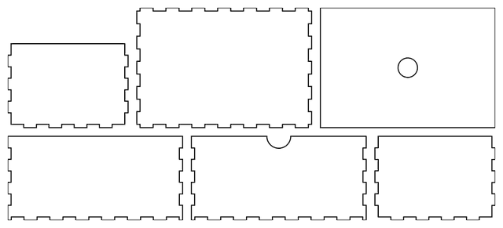
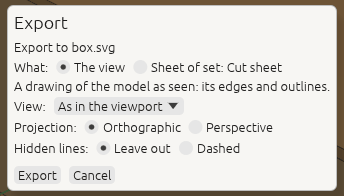
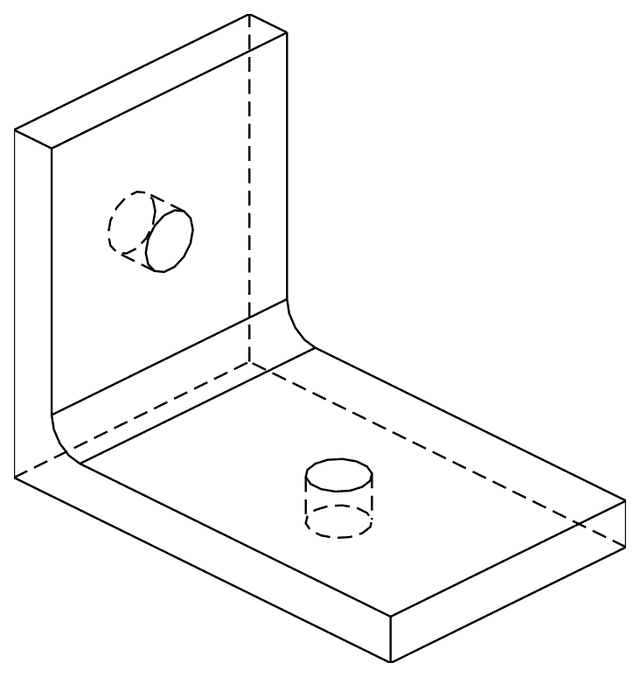

# 12. Files, export and drawings

*Save your design, bring in parts from other CAD programs, and export for 3D printing, laser cutting,
other CAD programs and drawings.*

| Format | Open or import | Save or export | Holds |
|---|---|---|---|
| `.3dcraft` | **Open…** (`file.open`) | **Save** (`file.save`) | Your design: its history, variables, sketches, features, checks, sets, colours |
| `.3dcraftjig` | **Open…** (`file.open`) | **Export as Jig…** (`jig.export`) | A design to be set by its parameters, with its info and a picture ([chapter 5](05-jigs.md)) |
| STEP (`.step`, `.stp`) | **Import…** (`file.import`) | **Export…** (`file.export`) | Exact solids, units, names, colours; no history. For other CAD programs |
| STL, 3MF, OBJ | no | **Export…** | Triangle meshes, for 3D printing and rendering |
| DXF, SVG | no | **Export…** | Flat outlines at true size, for laser cutting; or a drawing of the model as seen |

In the window, the **File** menu does all of this with your system's file dialogs. An agent uses the
commands in brackets; its paths are relative to the read and write roots the window or server was started
with ([chapter 1](01-install.md#connect-an-ai-agent-over-mcp)). `craft3d-cli` on its own reads and writes
anywhere you can ([chapter 13](13-command-line.md)).

## Saving: the `.3dcraft` file

A `.3dcraft` file holds the recipe, not just the shape: opening it rebuilds the bodies, bit for bit the
same as when it was saved. Saving is safe: a full disk or a crash leaves the previous file as it was.

**The promise:** every `.3dcraft` file written by a released version of 3DCraft opens in every later
version and rebuilds to the same bodies. A file from a *newer* version is refused by an older one with a
message that names both versions, never guessed at.

A Jig (`.3dcraftjig`) is the same kind of file, published to be used: opening it shows its Parameters tab,
and saving saves your result as a new `.3dcraft`, never over the Jig ([chapter 5](05-jigs.md)).

## Exporting from the window

1. **File › Export…** (Ctrl+E).
2. Choose where to save and type a name. **The extension picks the format**: `.step`, `.stl`, `.3mf`,
   `.obj`, `.dxf` or `.svg`.
3. For some formats 3DCraft then asks a question or two in the **export dialog** (below). Click
   **Export**.

**What is exported** depends on what is selected:

| Selected | STEP, STL, 3MF, OBJ | DXF, SVG |
|---|---|---|
| Nothing | Every body | A drawing of the model as seen |
| Bodies | Those bodies | (select flat faces or a sketch) |
| Flat faces | (the dialog offers *Export all bodies*) | The outlines of those faces |
| One sketch | (the dialog offers *Export all bodies*) | The outline of the sketch |

When the selection does not fit the format, the window says so before anything is written. Bodies you
hid with the eye are left out of a drawing, but not out of STEP or mesh exports of every body.

## 3D printing: STL, 3MF and OBJ


The export dialog asks for the **quality**: how closely the triangles follow the curved faces.

| Quality | For |
|---|---|
| **Coarse** | Small files and quick previews; curves in visible steps (20° per triangle side) |
| **Normal** | Round to the eye and to a printer (10°); the default |
| **Fine** | Smooth up close: four times finer, 5°, a larger file |

The last quality you chose is offered next time. **3MF** is the best choice for printing: it carries the
unit, the bodies' names and their colours. **STL** is triangles only, in the document's unit (millimetres
unless the design says otherwise). **OBJ** writes its colours to a material file (`.mtl`) next to it.

An agent writes the same with:

```json
[
 ["file.export", {"path": "part.3mf"}],
 ["file.export", {"path": "part.stl", "quality": "fine"}],
 ["file.export", {"path": "part.stl", "tolerance": 0.01}]
]
```

`tolerance` (in the document's unit) and `angle` (degrees; 0 for none, else 1 to 90) set the accuracy
yourself; a `tolerance` alone, with no `quality` or `angle`, has no angle criterion. The result says
`tolerance`, `angle`, `quality` and how many meshes are `closed` (watertight). A mesh of more than 20
million triangles, all bodies together, is refused: choose a coarser quality.

## Other CAD programs: STEP

```json
[
 ["file.export", {"path": "part.step"}],
 ["file.import", {"path": "supplier-part.step"}]
]
```

**Export** writes every body as an exact solid (AP214), with the document's unit, each body under its
feature's name and with its colours. To export some of the bodies, select them in the window, or name them:
`"bodies": ["Bracket", "F4"]` (also for STL, 3MF and OBJ).

**Import** (**File › Import…**) reads the solids and sheets of AP203, AP214 and AP242 files, assemblies
too (one feature per placed solid, with their colours), and converts the units. The file is kept inside the
document, so it rebuilds without it. An imported body is a feature like any other: cut it, round it,
measure it. Its faces are named by their order in the file (`F5:face(0)`). What cannot be read is refused,
naming the part of the file at fault.

## Laser cutting: flat outlines in DXF and SVG

Select one or more **flat faces**, or one **sketch**, and export to `.dxf` or `.svg`: you get the outline
at true size, with its holes. Lines, arcs, circles and splines stay what they are, so the laser follows
them smoothly. A face is drawn as seen from outside the body, never mirrored.

**A whole cut sheet at once.** When the design has a **named set** of the panels to cut (as the
laser-cut box Jig has, *Cut sheet*), the export dialog offers **Sheet of set: …**: every flat face of
the set laid out side by side on one sheet, each body on a layer of its own. **Sheet width** wraps the
row at a width (your laser's bed, such as `600 mm`; empty for one row) and **Gap** sets the space between
the parts (5 mm when empty).



The same as commands:

```json
[
 ["file.export", {"path": "panel.dxf", "sketch": "Outline"}],
 ["file.export", {"path": "panel.svg", "face": "F2:endCap()"}],
 ["file.export", {"path": "parts.dxf", "faces": ["F2:endCap()", "F2:startCap()"], "gap": 5}],
 ["file.export", {"path": "box.svg", "set": "Cut sheet", "width": "600 mm", "gap": "8 mm"}]
]
```

`gap` and `width` are lengths like any other: `5`, `"5 mm"` or `"kerf * 4"`. `feature.offsetProfile` grows
a sketch by half the laser's kerf before you export it. DXF files are AutoCAD 2000 ASCII with their unit;
SVG files give their size in mm, cm or in, so they print and import at true size.

## Drawings of the model as seen

With **nothing selected**, a `.dxf` or `.svg` export is a **drawing of the whole model** from a view: the
edges of the bodies and the outlines (silhouettes) of curved faces, with the lines behind a face left out
or drawn dashed.



The export dialog asks:

- **View**: *As in the viewport* (what the window shows now), or *Iso*, *Front*, *Back*, *Left*, *Right*,
  *Top*, *Bottom*.
- **Projection**: **Orthographic** is to scale, one unit in the file for one unit of the model, so you
  can measure it; **Perspective** is for an illustration, true size only at the depth the camera looks
  at.
- **Hidden lines**: **Leave out**, or **Dashed** on a layer of their own.

It offers your last choice next time.



As commands:

```json
[
 ["file.export", {"path": "bracket-front.dxf", "view": "front"}],
 ["file.export", {"path": "bracket-iso.svg", "view": "iso", "hidden": "dashed"}],
 ["file.export", {"path": "bracket-look.svg", "projection": "perspective"}]
]
```

The layers are `visible`, `silhouette` and `hidden`. Curved edges are written as fine straight pieces in
this version. The section and a rewound timeline are not applied: the drawing shows the whole model as it
is.

## Files in the web version

The web version reads and writes files on your computer; nothing is uploaded.

- **Chrome, Edge and Chromebooks:** Open…, Import…, Save As… and Export… show your system's file
  dialog. Export… first asks for the format in a small dialog of its own (the last one you used is
  chosen), makes the file, and then shows the system's dialog to say where it goes. Save writes back to
  the file the document was opened from or last saved to; the first time, the browser asks whether the
  page may change that file. If the file cannot be written, the document stays open and unsaved. An OBJ
  with colours then offers its material file (`.mtl`) with a *Save…* button: save it next to the `.obj`.
- **Firefox and Safari** have no such dialogs for web pages: Save and Export ask for a name in a small
  dialog of their own and the file is a **download** (in the browser's downloads, often the *Downloads*
  folder); Open and Import use the browser's file chooser. Add `?download` to the address to work this
  way in Chrome too.
- **Drop a file** on the page to open it (a `.3dcraft` or `.3dcraftjig`) or import it (a STEP file).
- The status bar says where each file went (*saved `part.3dcraft`*, *downloaded `part.step`: see the
  browser's downloads*) or why it was not written. Closing a file dialog does nothing.
- **There is no autosave in the browser**: a document lives in the page until you save it, and the browser
  asks before a page with unsaved changes is closed or reloaded.

## Autosave and recovery

The desktop window autosaves documents with unsaved changes 30 seconds after a change, into a recovery
folder (on Linux `~/.local/state/3dcraft/recovery`; **Help › Open data folder** shows it on any system).
After a crash, the next start shows a bar with what was left: **Recover**, **Discard** (click twice: it
cannot be undone), **Later**. Closing the window normally asks, for each document with unsaved changes,
whether to save it, and then drops its autosave. An agent has the same with `recovery.list`,
`recovery.open` and `recovery.discard`, also in `craft3d-cli serve` and `mcp` when they are started with
`--recovery-dir DIR`.

**Next:** [The command line and scripts](13-command-line.md).
