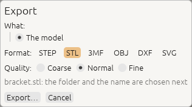
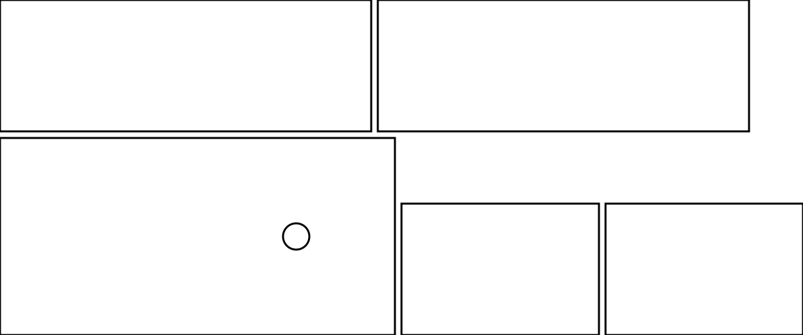

# 12. Files, export and drawings

*Save your design, bring in parts from other CAD programs, and export for 3D printing, laser cutting,
other CAD programs and drawings.*

| Format | Open or import | Save or export | Holds |
|---|---|---|---|
| `.3dcraft` | **Open…** (`file.open`) | **Save** (`file.save`) | Your design: its history, variables, sketches, features, checks, sets, colours |
| `.3dcraftjig` | **Open…** (`file.open`) | **Export as Jig…** (`jig.export`) | A design to be set by its parameters, with its info and a picture ([chapter 5](05-jigs.md)) |
| STEP (`.step`, `.stp`) | **Import…** (`file.import`) | **Export…** (`file.export`) | Exact solids, units, names, colours; no history. For other CAD programs |
| FreeCAD (`.FCStd`), BRep (`.brep`) | **Import…** (`file.import`) | no | The finished objects as exact solids, with their names, places and colours; no history |
| STL, 3MF, OBJ | no | **Export…** | Triangle meshes, for 3D printing and rendering |
| DXF, SVG | no | **Export…** | Flat outlines at true size, for laser cutting; or a drawing of the model as seen |

In the window, the **File** menu does all of this with your system's file dialogs. An agent uses the
commands in brackets; its paths are relative to the read and write roots the window or server was started
with ([chapter 1](01-install.md#connect-an-ai-agent-over-mcp)). `craft3d-cli` on its own reads and writes
anywhere you can ([chapter 13](13-command-line.md)).

## Saving: the `.3dcraft` file

A `.3dcraft` file holds the recipe, not just the shape: opening it rebuilds the bodies, bit for bit the
same as when it was saved. Saving is safe: a full disk or a crash leaves the previous file as it was.

**The promise:** every `.3dcraft` file written by a released version of 3DCraft opens in every later
version and rebuilds to the same bodies. A file from a *newer* version is refused by an older one with a
message that names both versions, never guessed at.

A Jig (`.3dcraftjig`) is the same kind of file, published to be used: opening it shows its Parameters tab,
and saving saves your result as a new `.3dcraft`, never over the Jig ([chapter 5](05-jigs.md)).

## Exporting from the window

1. **File › Export…** (Ctrl+E) opens the **export dialog**.
2. Choose **What** goes into the file, then the **Format**: only the formats that can hold what you
   chose are offered. Set the options the format has (below).
3. Click **Export…**. Your system's save dialog opens with the name already ending in the right
   extension, in the folder you exported to last. Choose where, and save: the file is written at once.
   If you type a name without the extension, or with another format's, 3DCraft names the file for the
   format you chose (`part` becomes `part.stl`), so the file always holds what its name says.

**What** you can export:

| What | Formats | What you get |
|---|---|---|
| **The model** | STEP, STL, 3MF, OBJ | Every body |
| | DXF, SVG | A drawing of the model as seen |
| **The selection** | STEP, STL, 3MF, OBJ | The selected bodies |
| | DXF, SVG | The outlines of the selected flat faces, or of one selected sketch, or the flat pattern of one selected sheet-metal part |
| **Sheet of set: …** | DXF, SVG | Every flat face of a named set on one sheet (below) |
| **Flat pattern of …** | DXF, SVG | A sheet-metal part, unfolded ([chapter 9](09-features.md#sheet-metal)) |
| **Crease pattern of …** | DXF, SVG | A fold's creases on its paper ([chapter 16](16-origami.md)) |
| **Flat patterns of every part** | DXF, SVG | Every sheet-metal part unfolded on one sheet |

*The selection* is chosen first when something is selected (and the sheet or pattern you exported last
from this document when it still has it). When no format can hold what is selected (an edge, say), the
dialog says why and offers the model instead. Bodies you hid with the eye are left out of a drawing, but
not out of STEP or mesh exports of every body.

## 3D printing: STL, 3MF and OBJ



The export dialog asks for the **quality**: how closely the triangles follow the curved faces.

| Quality | For |
|---|---|
| **Coarse** | Small files and quick previews; curves in visible steps (20° per triangle side) |
| **Normal** | Round to the eye and to a printer (10°); the default |
| **Fine** | Smooth up close: four times finer, 5°, a larger file |

The last quality you chose is offered next time. **3MF** is the best choice for printing: it carries the
unit, the bodies' names and their colours. **STL** is triangles only, in the document's unit (millimetres
unless the design says otherwise). **OBJ** writes its colours to a material file (`.mtl`) next to it.

An agent writes the same with:

```json
[
 ["file.export", {"path": "part.3mf"}],
 ["file.export", {"path": "part.stl", "quality": "fine"}],
 ["file.export", {"path": "part.stl", "tolerance": 0.01}]
]
```

`tolerance` (in the document's unit) and `angle` (degrees; 0 for none, else 1 to 90) set the accuracy
yourself; a `tolerance` alone, with no `quality` or `angle`, has no angle criterion. The result says
`tolerance`, `angle`, `quality` and how many meshes are `closed` (watertight). A mesh of more than 20
million triangles, all bodies together, is refused: choose a coarser quality.

## Other CAD programs: STEP

```json
[
 ["file.export", {"path": "part.step"}],
 ["file.import", {"path": "supplier-part.step"}]
]
```

**Export** writes every body as an exact solid (AP214), with the document's unit, each body under its
feature's name and with its colours. To export some of the bodies, select them in the window, or name them:
`"bodies": ["Bracket", "F4"]` (also for STL, 3MF and OBJ). A body switched off by its condition (`when`) or
suppressed is left out of the list, so one list serves every option of a Jig; `cut.list` and `cut.export` take
`bodies` the same way. Without `bodies`, a body hidden in the view (`feature.visible`, the eye in the feature
list) is left out of STEP, STL, 3MF and OBJ, as a drawing leaves it out, and of the cut list; the result's
`hiddenLeftOut` says which. Named in `bodies`, a hidden body is written all the same.

**Import** (**File › Import…**) reads the solids and sheets of AP203, AP214 and AP242 files, assemblies
too (one feature per placed solid, with their colours), and converts the units. The file is kept inside the
document, so it rebuilds without it. An imported body is a feature like any other: cut it, round it,
measure it. Its faces are named by their order in the file (`F5:face(0)`). What cannot be read is refused,
naming the part of the file at fault.

A **FreeCAD document** (`.FCStd`) imports the same way: one body per finished, visible object (a cut, not
the two shapes it was cut from; a PartDesign body, not its pads and pockets), named after its label, where
FreeCAD placed it and in its colour. Hidden objects are left out and listed in the result. FreeCAD's history
does not come along: the bodies are exact solids, edited here like any other.

## Laser cutting: flat outlines in DXF and SVG

Select one or more **flat faces**, or one **sketch**, and export to `.dxf` or `.svg`: you get the outline
at true size, with its holes. Lines, arcs, circles and splines stay what they are, so the laser follows
them smoothly. A face is drawn as seen from outside the body, never mirrored. The SVG's lines are a
0.01 mm hairline, the width laser software cuts rather than engraves; opened in a web browser they look
very thin or even invisible, so check the outline in Inkscape or your laser software instead.

**A whole cut sheet at once.** When the design has a **named set** of the panels to cut (as the
laser-cut box Jig has, *Cut sheet*), the export dialog offers **Sheet of set: …**: every flat face of
the set laid out side by side on one sheet, each body on a layer of its own. **Sheet width** wraps the
row at a width (your laser's bed, such as `600 mm`; empty for one row) and **Gap** sets the space between
the parts (5 mm when empty).


The same as commands:

```json
[
 ["file.export", {"path": "panel.dxf", "sketch": "Outline"}],
 ["file.export", {"path": "panel.svg", "face": "F2:endCap()"}],
 ["file.export", {"path": "parts.dxf", "faces": ["F2:endCap()", "F2:startCap()"], "gap": 5}],
 ["file.export", {"path": "box.svg", "set": "Cut sheet", "width": "600 mm", "gap": "8 mm"}]
]
```

`gap` and `width` are lengths like any other: `5`, `"5 mm"` or `"kerf * 4"`. `feature.offsetProfile` grows
a sketch by half the laser's kerf before you export it. DXF files are AutoCAD 2000 ASCII with their unit;
SVG files give their size in mm, cm or in, so they print and import at true size.

## Cut lists: the plates of a design

A design built from panels (a shelf, a box, a cabinet) is cut from sheets. `cut.list` finds every body that
is a **plate**, a flat part of one thickness whose sides are square to its faces (holes straight through
are fine), and every **sheet-metal part**, by its flat pattern. It groups them by thickness and material
(`body.material`), gives each part its length × width (the smallest rectangle around it), its area and the
length of its cut, and counts the parts that are the same: the same outline and holes, however the body
lies in the model, also turned over. A body that is not a plate is listed under `notPlates` with the reason
and the face: a pocket's floor, a chamfer, a round on an edge.

`cut.export` writes the outlines to DXF or SVG at true size, each part in its own frame on a layer named
after it, a plate as seen from its top: of its two faces the one whose outward normal points most up, by the
first of its z, y and x that is not zero (so a plate standing upright with its front facing -y is drawn from its
far, +y face, the mirror image of `file.export` of the front face; the result's `top` names the face), a
sheet-metal part from its sketch's side: side by side on one sheet (`width` and `gap` as for a sheet of faces; it lays out in rows, it does
not nest), or one file per part (`"layout": "each"`). One of each part is drawn and the result says how many
to cut; `"copies": true` draws every body. `kerf` moves the cut off the part by that distance (half the width
the beam cuts away): the outline out, the holes in, the outside corners rounded as a round beam goes round
them. A kerf the beam cannot follow (a slot narrower than the beam) is refused with the largest that fits; an inner round smaller than the kerf comes out at the kerf's radius, as a sharp inner corner does, and the result says so.

### A cut list: a small shelf

Two sides, a top and a bottom of 18 mm birch plywood, and a 6 mm hardboard back with a cable hole:

```json
[
 ["feature.block", {"name": "Left side", "size": [18, 200, 300]}],
 ["feature.block", {"name": "Right side", "size": [18, 200, 300], "position": [582, 0, 0]}],
 ["feature.block", {"name": "Bottom", "size": [564, 200, 18], "position": [18, 0, 0]}],
 ["feature.block", {"name": "Top", "size": [564, 200, 18], "position": [18, 0, 282]}],
 ["feature.block", {"name": "Back", "size": [600, 6, 300], "position": [0, 200, 0]}],
 ["sketch.create", {"plane": "zx", "offset": 200, "name": "Cable hole"}],
 ["sketch.circle", {"sketch": "Cable hole", "center": [150, 150], "radius": 20}],
 ["feature.extrude", {"sketch": "Cable hole", "distance": 20, "symmetric": true, "cut": "Back", "name": "Back with hole"}],
 ["body.material", {"body": "Left side", "name": "birch plywood", "density": 680}],
 ["body.material", {"body": "Right side", "name": "birch plywood", "density": 680}],
 ["body.material", {"body": "Bottom", "name": "birch plywood", "density": 680}],
 ["body.material", {"body": "Top", "name": "birch plywood", "density": 680}],
 ["body.material", {"body": "Back", "name": "hardboard", "density": 900}],
 ["cut.list", {"format": "csv"}],
 ["cut.export", {"path": "shelf.svg", "copies": true, "width": "1250 mm", "gap": "10 mm"}]
]
```

The cut list (`csv`, ready for a spreadsheet; without `format` the same as JSON, with each part's frame in
the model):

```text
material,thickness (mm),name,count,length (mm),width (mm),area (mm^2),cut length (mm),holes,kind,bodies,reason
hardboard,6,Back with hole,1,600,300,178743.3629385641,1925.663706,1,plate,Back with hole,
birch plywood,18,Left side,2,300,200,60000,1000,0,plate,Left side; Right side,
birch plywood,18,Bottom,2,564,200,112800,1528,0,plate,Bottom; Top,
```



## Drawings of the model as seen

**The model** exported as `.dxf` or `.svg` is a **drawing of the whole model** from a view: the
edges of the bodies and the outlines (silhouettes) of curved faces, with the lines behind a face left out
or drawn dashed.


The export dialog asks:

- **View**: *As in the viewport* (what the window shows now), or *Iso*, *Front*, *Back*, *Left*, *Right*,
  *Top*, *Bottom*.
- **Projection**: **Orthographic** is to scale, one unit in the file for one unit of the model, so you
  can measure it; **Perspective** is for an illustration, true size only at the depth the camera looks
  at.
- **Hidden lines**: **Leave out**, or **Dashed** on a layer of their own.

It offers your last choice next time.


As commands:

```json
[
 ["file.export", {"path": "bracket-front.dxf", "view": "front"}],
 ["file.export", {"path": "bracket-iso.svg", "view": "iso", "hidden": "dashed"}],
 ["file.export", {"path": "bracket-look.svg", "projection": "perspective"}]
]
```

From the command line: `craft3d-cli convert bracket.3dcraft bracket-front.dxf --view front`
([chapter 13](13-command-line.md#converting-files-convert)).

The layers are `visible`, `silhouette` and `hidden`. Edges are written as the curves they are: lines,
circles and arcs (where they face the view), ellipses and elliptic arcs, splines; a circle seen edge on
is a line. The outlines of curved faces are fine straight pieces. The section and a rewound timeline are not applied: the drawing shows the whole model as it
is.

## Files in the web version

The web version reads and writes files on your computer; nothing is uploaded.

- **Chrome, Edge and Chromebooks:** Open…, Import…, Save As… and Export… show your system's file
  dialog. Export… opens the same export dialog as on the desktop (what, the format, the options; the
  format you used last is chosen), makes the file, and then shows the system's dialog to say where it
  goes. Save writes back to
  the file the document was opened from or last saved to; the first time, the browser asks whether the
  page may change that file. If the file cannot be written, the document stays open and unsaved. An OBJ
  with colours then offers its material file (`.mtl`) with a *Save…* button: save it next to the `.obj`.
- **Firefox and Safari** have no such dialogs for web pages: Save asks for a name in a small dialog of
  its own, the export dialog has a **File name** field, and the file is a **download** (in the browser's downloads, often the *Downloads*
  folder); Open and Import use the browser's file chooser. Add `?download` to the address to work this
  way in Chrome too.
- **Drop a file** on the page to open it (a `.3dcraft` or `.3dcraftjig`) or import it (a STEP file).
- The status bar says where each file went (*saved `part.3dcraft`*, *downloaded `part.step`: see the
  browser's downloads*) or why it was not written. Closing a file dialog does nothing.
- **There is no autosave in the browser**: a document lives in the page until you save it, and the browser
  asks before a page with unsaved changes is closed or reloaded.

## Autosave and recovery

The desktop window autosaves documents with unsaved changes 30 seconds after a change, into a recovery
folder (on Linux `~/.local/state/3dcraft/recovery`; **Help › Open data folder** shows it on any system).
After a crash, the next start shows a bar with what was left: **Recover**, **Discard** (click twice: it
cannot be undone), **Later**. Closing the window normally asks, for each document with unsaved changes,
whether to save it, and then drops its autosave. An agent has the same with `recovery.list`,
`recovery.open` and `recovery.discard`, also in `craft3d-cli serve` and `mcp` when they are started with
`--recovery-dir DIR`.

**Next:** [The command line and scripts](13-command-line.md).
