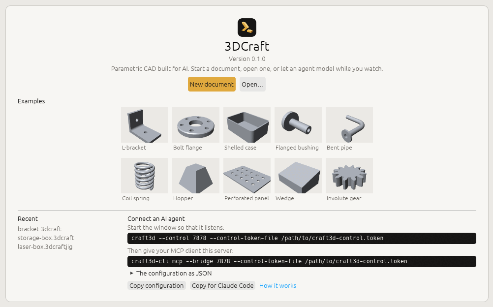

# Start here: the 3DCraft user guide

> **For version 0.1.0**, the first release. A test runs this guide against 3DCraft at every change: every
> command and parameter it names must exist, its example scripts must build and pass their checks, and the
> results it quotes in several chapters must come out as written.

<!-- SHOT: start-screen.png | the new start screen, as in first-steps.md | the same picture as first-steps.md uses -->

**3DCraft is an open-source parametric 3D CAD modeller built with and for AI: every action is a command,
and every result is checked.**

*An agent builds. A machine checks. You decide.*

You describe a part with its sizes, and 3DCraft builds an exact solid model of it: a bracket, a box, a
gear, a holder, a spare part. Then you save it, 3D-print it, laser-cut it or send it to a workshop.

**Every action is a command**, with a name and a few values, such as `feature.block` with a size. An AI
agent sends those commands while you watch. A Jig's form sends them when you move a slider. You can write
them yourself too.

**Every result is checked.** 3DCraft measures what it builds on the exact geometry. A design can also
carry its own checks, such as its volume, a wall thickness or holes that go through, and they are
measured again after every change.

**A model is a recipe that can be changed.** Make the box 10 mm wider and everything that depends on its
width follows.

3DCraft has no toolbar of modelling buttons. You model through commands: an agent sends them, a Jig's form
sends them, or you write them yourself. The window is there to watch, to point and to check.

3DCraft is open source, under the MIT licence. You do not need to know anything about programming or CAD
to start.

3DCraft is at version 0.1.0. It does not replace professional CAD today. What it cannot do yet, it refuses,
and says so.

## Three ways to use 3DCraft

1. **Make models with AI.** Describe a part to an AI agent. It builds the part in the window you are
   watching, step by step; you point at a face, ask for a change, and check the result. Then export it for
   a 3D printer, a laser cutter, a mill or a workshop. Start with
   [Install › Connect an AI agent](install.md#connect-an-ai-agent-over-mcp) and
   [Working with an AI agent](agent.md).
2. **Use a Jig.** A Jig is a finished design with a form: the sizes that matter are fields, the rest
   follows by formulas, and every result is checked. A laser-cut box sized for what goes in it, a
   Gridfinity bin with your compartments, a sundial drawn for the place where it will stand. No AI needed,
   and it works in the browser too. Start with [Your first five minutes](first-steps.md) and
   [Using a Jig](jigs.md).
3. **Build your own application on it.** The engine is a Rust library, and every command is also
   reachable from the command line, a JSON control channel and an MCP server. A gear generator, a furniture
   configurator, a CAD interface with buttons: each can be a separate program on top of 3DCraft. You can
   also write the commands by hand, as a script. Start with
   [The command line and scripts](command-line.md) and [Programs on 3DCraft](programs.md).

You can mix them. An agent can make a Jig for you, and you can open what an agent built and change its
numbers yourself.

## The chapters

The guide has six parts. Read the first part in order; after that, go to what you need.

**Start**

1. [Install 3DCraft and connect an AI agent](install.md): the installers for Windows, macOS and Linux,
   the web version that needs no installing, and how to let an AI agent work in the window.
2. [Your first five minutes](first-steps.md): open an example, look around, play its history, set a Jig
   and export the result.
3. [Working with an AI agent](agent.md): what to ask, what a session looks like, how to check the agent's
   work, and five tasks to try first.

**Using it**

4. [The window](window.md): the start screen, menus, tabs, the feature list, the history player, the
   studio look, surface analysis, and pointing at things.
5. [Using a Jig](jigs.md): the Parameters tab, its limits, and the Jigs on the start screen.
6. [Assemblies](assemblies.md): parts placed together, joined by mates, played as a motion.
7. [Files, export and drawings](files.md): saving, STEP, meshes for 3D printing, outlines for laser
   cutting, cut lists, drawings, the web version, autosave.

**Modelling**

8. [How 3DCraft thinks](concepts.md): the history, variables and units, sketches and constraints,
   features, names that stay put, failed features.
9. [A first part, command by command](first-part.md): an L-bracket with a rounded corner and two holes.
10. [Formulas, tables and conditions](formulas.md): choices made by formulas, tables of sizes, parts
    switched on and off, curves drawn from formulas.
11. [Modelling features](features.md): extrude, revolve, sweep, loft, text, booleans, patterns, fillets,
    shells, threads, datums, sheets, colours and materials.
12. [Sheet metal](sheet-metal.md): a part bent from one sheet, its flat pattern, and whether a press brake
    can bend it.
13. [Surfaces and developables](surfaces.md): sheets that bend without stretching, surfaces through
    curves, smooth seams, plates.
14. [Origami](origami.md): crease patterns folded by angles you give, flat folds, Kawasaki and Maekawa.
15. [Selection and named sets](selection.md): finding faces by what they are, the selection you share
    with the agent, sets kept in the document.

**Checking**

16. [Measuring and assertions](measure.md): volumes, distances, walls, checks kept in the document, outputs.
17. [Engineering checks](engineering-checks.md): sections, fill levels, floating, forces and stresses,
    checks over a motion.

**Building on 3DCraft**

18. [Making Jigs](making-jigs.md): publish a design's sizes as a form, prove it over its range, share it.
19. [The command line and scripts](command-line.md): `craft3d-cli` runs commands and scripts, renders
    pictures, converts files and checks a Jig.
20. [Programs on 3DCraft](programs.md): your own program on the engine, through `serve`, the window's
    control channel, MCP or the Rust library.

**Help**

21. [Troubleshooting](troubleshooting.md): what a refusal means, failed features, undo, crash recovery,
    reporting a problem.
22. [Reference](reference.md): every command by family, keys and mouse, units and functions, the
    programs and their options.

## Examples and lessons

- **The start screen** shows examples, Jigs and assemblies as cards, each kind under its own tab: a click
  on a card opens it in a new tab. Its **More examples** link opens the gallery, [3dcraft.dev/examples](https://3dcraft.dev/examples/), with
  every example, Jig and assembly made for 3DCraft so far.
- **The lessons** are seven short command scripts that go with this guide: an L-bracket, a flange, a
  case, a spring, a gear, a bushing and a hopper ([the lessons](../examples/README.md)). Each checks its
  own volume. You run them yourself ([The command line and scripts](command-line.md#scripts)) and change
  their numbers.

## Words used in this guide

| Word | Meaning |
|---|---|
| **Document** | One design, saved as a `.3dcraft` file. It holds the recipe, not only the shape. |
| **Feature** | One step of the recipe: a block, a hole, a rounded edge. The **feature list** shows them in order. |
| **Sketch** | A flat drawing on a plane (lines, arcs, circles) that a feature turns into a solid, for example by pushing it out. |
| **Body** | A solid shape the features make. A document can hold several. |
| **Variable** | A named number with a unit (`width = 60 mm`) that features use, so the model follows when it changes. |
| **Check**, **assertion** | A rule the design must meet, such as its volume or a least wall thickness, kept in the document and measured again after every change. The window says *checks*; the commands say `assert`. |
| **Parameter** | A variable a Jig shows in its form, with a label and a range. |
| **Jig** | A design made to be set by others through its parameters, shared as a `.3dcraftjig` file. |
| **Assembly** | A document that places parts together, saved as a `.3dcraftasm` file. Each placed part is an **instance**. |
| **Agent** | An AI assistant connected to 3DCraft through **MCP** (the Model Context Protocol), which lets it run 3DCraft's commands. |
| **Command** | One action, such as `feature.fillet` or `file.export`, with its values written as JSON (`{"radius": "3 mm"}`). |
| **The window**, **the command line** | The two programs: `craft3d` shows your design; `craft3d-cli` runs commands in a terminal and is the MCP server. |

In this guide, **File › Export…** means the *Export…* item of the *File* menu, and text in `this font` is
something you type or a name 3DCraft shows.
