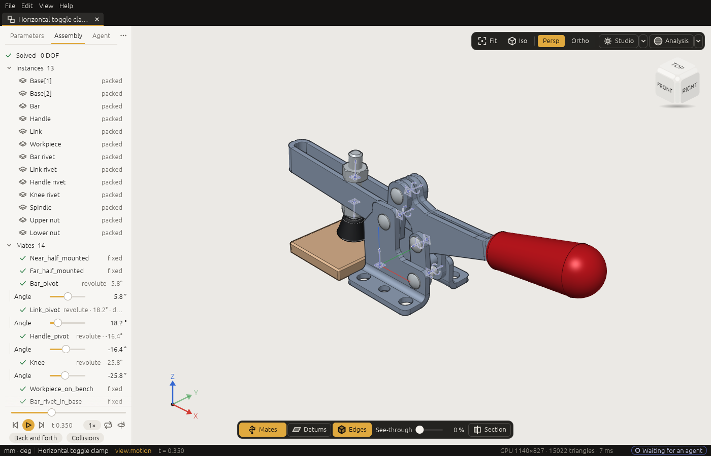

# Assemblies

*Put parts together: place instances of your documents and Jigs in an assembly, give each its own sizes,
join them with mates, play the motion, and export the whole as one STEP file with its structure.*

An **assembly** is a document of its own, saved as a `.3dcraftasm` file. It holds no features. It holds
**instances** of other documents (parts, Jigs, or other assemblies) and **mates** that say how they sit
against each other. An instance is a reference, not a copy: you edit a part in its own document, and the
assembly follows when you save it.

## Open one first

The start screen has four assemblies: a toggle clamp, a Jansen walker, a scissor jack and a radial engine.
Click **Toggle clamp**: the clamp that holds a workpiece down on a bench, a handle, a link and a bar
joined as a four-bar linkage. It opens in a tab of its own.

<!-- CHECK: the four assembly cards' names on the new start screen, and that the toggle clamp opens ready to play its motion (Motion chosen in the player) -->

<!-- SHOT: assembly.png | the toggle clamp assembly in the window: the Assembly tab with its instances and mates, the player in Motion mode part-way, iso view; theme light, window 1400x900 | open the toggle clamp from the start screen (or file.open toggle-clamp.3dcraftasm); ui.set {"appearance": "light"}; ui.set {"view": "iso"}; ui.fit (plan: shots/pictures/09-assembly.json) -->


- The side panel's **Assembly** tab lists the **instances**, the placed parts, and under them the
  **mates**, the joints between them, with how many degrees of freedom are left.
- Press **Space** with the pointer over the view: the clamp plays its **motion**, opening and closing. The
  player is in **Motion** mode ([The window › Playing a motion](window.md#playing-a-motion)).
- Double-click an instance in the list to fly to it; **Open** opens its part in a tab of its own.

## A small assembly, step by step

Two bars, one turning on the other. These are the commands an agent sends; you can run them yourself as
a script ([The command line and scripts](command-line.md#scripts)).

**1. A part to place.** A bar whose length is a public parameter, saved as `bar.3dcraft`:

```json
[
  ["variable.set", {"name": "len", "expr": "60 mm"}],
  ["variable.publish", {"name": "len", "label": "Length", "min": "20 mm", "max": "200 mm", "step": "1 mm"}],
  ["feature.block", {"size": ["len", "10 mm", "5 mm"], "name": "Block"}],
  ["file.save", {"path": "bar.3dcraft"}]
]
```

**2. The assembly, and the bar placed twice.** The second instance is 80 mm long: a part with public
parameters can be placed with other values.

```json
[
  ["assembly.new", {"units": "mm"}],
  ["instance.add", {"source": "bar.3dcraft", "name": "Base"}],
  ["instance.add", {"source": "bar.3dcraft", "name": "Arm", "position": [0, 0, 10], "params": {"len": "80 mm"}}]
]
```

**3. Mates.** The base is fixed to the world, its bottom face on the XY plane. The arm stands on the
base's top face and turns about the axis square to it, set to 30 degrees:

```json
[
  ["mate.add", {"kind": "fixed", "a": "world/xy", "b": "Base/F1:face(0)", "name": "Ground"}],
  ["mate.add", {"kind": "revolute", "a": "Base/F1:face(1)", "b": "Arm/F1:face(0)", "name": "Hinge"}],
  ["joint.set", {"mate": "Hinge", "value": "30 deg"}],
  ["assembly.solve", {}]
]
```

`assembly.solve` answers `"ok": true` and `"dof": 0`: every mate is met, and nothing is left free.

**4. A motion, and a check over it.** A timeline `t` drives the hinge a full turn. The check says the two
bars never overlap, and `motion.check` measures it at 17 moments of the turn:

```json
[
  ["variable.set", {"name": "t", "expr": "0"}],
  ["variable.set", {"name": "Hinge_angle", "expr": "360 deg * t"}],
  ["assert.add", {"name": "no clash", "measure": "overlap", "of": ["Base", "Arm"], "is": false}],
  ["motion.check", {"samples": 17}],
  ["file.save", {"path": "two-bars.3dcraftasm"}]
]
```

`motion.check` answers `"ok": true`: *no clash* passed at every moment. Open `two-bars.3dcraftasm` in the
window and play it: the arm turns round on the base.

The rest of this chapter goes through each part in detail.

## Instances

`instance.add` places a document: a part, a Jig, or another assembly.

- **Where it comes from.** The `source` is read from the folder 3DCraft may read from, and kept as a path
  relative to the assembly's file, with the SHA-256 of its bytes.
- **Where it starts.** `position` and `rotation` (a rotation vector in degrees) say where an instance
  starts; mates move it from there.
- **Units.** A part drawn in another length unit (inches in a millimetre assembly) is rebuilt in the
  assembly's unit at its own size. Its parameters are set in its own unit first, so a bare number for a
  length parameter of an inch part means inches (`"params": {"w": "2"}` is 2 in). Write the unit to be
  sure (`"50.8 mm"`).

**Sizes per instance.** A part with public parameters (a Jig's, or any `variable.publish`) can be placed
with other values: `"params": {"len": "80 mm"}`, or an expression of the assembly's own variables
(`"params": {"len": "long"}`). A value is held to the parameter's range, not to its step. Each different
set of values is a *configuration*, built once however many instances use it.

When a feature of the part fails with the values given (a fillet too large for the plate), the instance is
still placed with the bodies from before that feature, as the part itself shows them, but it says so:
`assembly.inspect` gives the instance `featureFailed` (*its feature `Plate` (F2) failed: radius: too large
for edges.0*; through a subassembly, *its instance `Plate`: …*), its row in the Assembly tab is marked ⚠
with the reason in its tooltip, and the assembly's `document.check` is not ok.

**One body of a multi-body part.** `"body": "Gear"` shows only the body the feature `Gear` made, where the
part puts it. This is how the bodies of an existing Jig become parts of an assembly. If the part changes
so that `Gear` makes no body any more, the instance says so by name; it never shows another body instead.

**Following the part.** An open assembly follows its parts by itself. Save a part (also in the tab
`instance.open` opened) and every open assembly that uses it shows the new version. A part changed by
another program is read again when you switch to the assembly's tab or come back to the window. A part
that changed and cannot be read again (moved, deleted) keeps showing the last version, and its row in the
Assembly tab says why (⚠). `assembly.reload` reads the sources again by hand and lists the instances whose
part changed.

**Pinned.** `"pinned": true` keeps an instance to the part as it is now. Those bytes are kept in the
assembly's file, so the instance shows them whatever the part's file holds later; its row is marked ⚠ once
the file changed. `assembly.pack` packs them.

## Mates

A mate joins geometry of two instances. It names that geometry through the instance, with the part's own
names: `Base/F1:face(1)` is the top of the block `F1` of the instance `Base`. Or it names the world:
`world/xy`, `world/z`, `world/origin`.

Each side gives a **frame**: a flat face gives its plane at the face's centre with its outward normal, a
round face its axis, a circular edge its centre and axis, a corner a point, a datum of the part its own.
The world's frames all sit at the origin:

| Reference | Its z (the axis a joint turns about or slides along) | Its x (where an angle of 0 points) |
|---|---|---|
| `world/xy`, `world/z`, `world/origin` | the world's z | the world's x |
| `world/yz`, `world/x` | the world's x | the world's y |
| `world/zx`, `world/y` | the world's y | the world's z |

Any other `world/...` is refused when the mate is made. The second frame is put against the first, facing
it (`"flip": true` keeps it the same way round), moved by `offset` and turned by `angle`.

| Kind | What stays free |
|---|---|
| `fixed` | nothing |
| `revolute` | a turn about the axis (`<mate>_angle`) |
| `slider` | a slide along it (`<mate>_distance`) |
| `cylindrical` | both |
| `planar` | sliding in the plane and turning in it |
| `ball` | turning about the point |

`joint.set` sets a free motion. It makes the assembly variable `Hinge_angle`, which you can use in formulas
and publish as a parameter (it then shows as a slider). `assembly.solve` says whether the mates are met
and what each instance can still do. A mate on a face that is gone from the part fails with that face's
name and never moves to another face.

Closed loops (a four-bar linkage) are solved as a whole, and `assembly.solve` says which mates contradict
each other, and by how much, when they cannot all be met.

**Couplings.** Gears, racks and screws couple two mates:
`coupling.add {"kind": "gear", "mates": ["A", "B"], "value": 2}`. A screw may name one cylindrical mate
twice, a thread whose slide follows its own turn: `{"kind": "screw", "mates": ["Thread", "Thread"],
"value": "3 mm"}` advances 3 mm a turn.

A **linear** coupling ties any number of motions, each with a coefficient: the sum of coefficient times
motion is the value (0 unless given). A planetary stage, the ring held, turns the carrier by Willis'
formula:

```json
[
  ["coupling.add", {"kind": "linear", "name": "Stage", "terms": [
    {"mate": "Sun", "coefficient": "12"},
    {"mate": "Ring", "coefficient": "36"},
    {"mate": "Carrier", "coefficient": "-48"}]}]
]
```

A term's `motion` is the mate's main free motion unless you name it (`angle`, `distance`, `x`, `y`). An
angle counts in radians, so a rack of 5 mm radius is `[{"mate": "Slide"}, {"mate": "Turn", "coefficient":
"-5 mm"}]`, and two sliders where one moves twice as far as the other are `[{"mate": "A"}, {"mate": "B",
"coefficient": "-2"}]`. A coupling whose mate fails, whose mate has no such motion, whose terms differ in
kind (a length against an area), or whose value does not evaluate, fails by name, and `assembly.solve` is
not ok.

## In the window

The side panel's **Assembly** tab is the assembly's tree: the instances (a subassembly's own nested under
it), then the mates with their kind and value, and how many degrees of freedom are left. Click a row to
select the instance, double-click to fly to it; the eye hides it, and **Open** opens its part in a tab of
its own.

Every joint you can set by hand is a slider on the **Parameters** tab: the joints the assembly stays
solved with. In a linkage that moves one way (a four-bar), the joints that move it have a slider until you
set one; then that one drives the loop and is its only slider. In the view, **Alt and a drag** on a part
moves it along its free motion: drag the crank and the linkage follows (a part fixed to the world does not
move). Both are `joint.set`, and one drag is one step to undo.

To join two parts, select a face of each (Shift+click the second), right-click and choose *Revolute
between these* (or *Fixed*, *Slider*, *Cylindrical*, *Planar*, *Ball*): that is `mate.add`.

## Motion

An assembly plays over the timeline `t` as a part does
([The window › Playing a motion](window.md#playing-a-motion)): give it a variable `t` and drive a joint by
a formula of it, as step 4 above does.

Each moment is solved from the one before it, so the linkage stays the way it was assembled (elbow up
stays up), and the same `t` always shows the same state. Where the mechanism cannot go further (a dead
point), `view.motion` says so with the `t` it stopped at, and `motion.check` lists every dead point it
meets.

A trace names its point through an instance, as a mate does: `view.trace {"point": "Coupler/End2"}`. In the
window the trace of an assembly is worked out in the background, so a play does not stop for it; read it
with `view.trace {"name": …, "wait": true}`.

An instance whose parameters are formulas of `t` (a belt whose loop follows the carriage) is a new
configuration at every moment, built when the moment is first shown. `motion.bake` builds them all ahead,
side by side, so the motion then plays smoothly: `["motion.bake", {"frames": 120}]` makes the moments
`t = k / 120` (add `"collisions": true` to find the collisions too). It changes nothing in the document;
an edit lets go of what it made. In the window the player does not wait for these shapes: it shows the
parts where they are at once, a belt for a moment with the shape it had nearest, and bakes the motion in
the background by itself, so the second play is exact and smooth. Over the control channel, `motion.bake`
returns at once in the window; `{"cancel": true}` stops it.

## Subassemblies

An instance of a `.3dcraftasm` is a **subassembly**. By default it moves as one block (`"mode":
"rigid"`); `"mode": "flexible"` lets its own joints move in the parent, with its own couplings. Mates reach
into it through its instances: `Leg/Arm/F1:face(1)`. An assembly that would contain itself is refused.

A flexible subassembly's own drives (a joint it sets with `joint.set`, or drives by its own `t`) are
**free in the parent** unless the parent sets what they depend on. Publish the variable in the subassembly
(the joint's own `Hinge_angle`, or a `swing` it follows) and give it in the instance's `params`. So a leg
that plays its own motion can also be turned by the machine it is part of. To play the leg's own motion in
the parent, publish its `t` and pass the parent's on: `"params": {"t": "t"}`.

## Packing, export and checks

- `assembly.pack` puts copies of all parts into the `.3dcraftasm` file, so it opens anywhere;
  `assembly.unpack` writes them out as files again.
- `file.export` to `.step` writes the assembly with its structure: each part once, placed by every
  instance. STL, 3MF and OBJ hold the placed bodies. Hidden instances are left out of all of them, and the
  result's `hiddenLeftOut` names them; a body named in `bodies` is written, hidden or not.
- `assembly.inspect` lists the instances, their configurations, the mates and how they stand.

**Checks name instances**, as step 4 does. The measures take their subjects as in a part
([Measuring and assertions](measure.md)): `clearance` and `distance` take `from` and `to`; `volume`,
`area`, `mass`, `extent`, `thickness` and the others take `of`; `overlap` takes `of`, and `to` beside it.
With `of` alone, `overlap` asks whether any two of those bodies overlap; with `to`, whether any of `of`
overlaps any of `to` (`{"measure": "overlap", "of": "Lid", "to": "Box", "is": false}`).

A subject names bodies the same way everywhere in an assembly:

- an instance's name means all its bodies: `Arm`, however many bodies its part has; `Sub`, every body of a
  subassembly, rigid or flexible;
- `Instance/Body` names one body by the name of the feature that made it in the part, also when the part
  has one body: `Arm/Block`;
- a path reaches into a subassembly: `Sub/Inner`, `Sub/Inner/Block`.

Every `measure.*` command that takes a subject names them the same way on an assembly, and labels each body
in its answer by its instance's name. A name is looked up as a shown body's name first (an instance of one
body), then as an id (`F3`), then as an instance or a path: an instance named like an id is reached by that
name only where no shown body has that id, so name instances otherwise. `{"body": …, "follow": true}` names
a shown body only, not a path. Renaming an instance renames it in its checks; an instance a check names is
not deleted until the check is.

**What the solve says is measured too.** `jointAngle {mate}` and `jointDistance {mate}` are a joint's
solved value, driven or free; `position {instance, axis}` (or `{point: "Foot/Toe"}`) and
`rotation {instance}` an instance's pose. The pose measures reach an instance inside a rigid subassembly by
its path too. As checks they hold over the motion (`motion.check` gives an angle's least and greatest value
and each sample in degrees, `"unit": "deg"`, as the bounds are written). With `variable.measure` they become
outputs that formulas use: `{"name": "crank", "measure": "jointAngle", "mate": "Drive"}`, then `2 * crank`
in an output or a check. `measure.joint {mate}` and `measure.pose {instance}` answer them at once (angles in
degrees).

**Next:** [Files, export and drawings](files.md).
