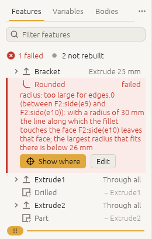

# How 3DCraft thinks

*The few ideas behind nearly everything 3DCraft does, and nearly every message it gives: the history,
variables and units, sketches, features, names that stay put, and failed features.*

You can use 3DCraft with an agent or a Jig without reading this chapter. Read it when you want to
understand what the agent is doing, or to model by hand.

## The history is the source of truth

A document is a recipe: **variables, sketches, datums and an ordered list of features**, plus checks
(assertions) and named sets. That is what a `.3dcraft` file holds.

The solid bodies are *derived*. 3DCraft rebuilds them from the history after every change (it
*regenerates*), and rebuilds only the features downstream of what changed. There is no way to push a face
around behind the history's back: to change the model, you change a variable, a sketch or a feature's
parameters, and the history is replayed.

These commands change the history:

- `feature.edit {"feature": "Holes", "count": "n"}` changes some parameters of a feature, keeping its
  place and its name. It also repairs a feature that lost what it was made from: give the new sketch,
  target or edges. A parameter given as a plain number (`"count": 8`) replaces the expression that was
  there, and the feature no longer follows the variable.
- `feature.suppress` switches a feature off without deleting it, and `feature.when` switches it by a
  condition. Off, it behaves as if it were not in the history
  ([Formulas › Switching parts on and off](formulas.md#switching-parts-on-and-off)).
- `feature.move {"feature": "Round", "position": 3}` moves a feature to that index in the list of
  features `document.inspect` gives (sketches and datums count). A feature moved before what it is made
  from fails and says so.
- `feature.rename` renames a feature or a sketch (sketches are features); `variable.rename` renames a
  variable everywhere it is used, checks included.
- `history.rollback {"feature": "Bored"}` rebuilds only up to that feature, and new features go in right
  after it: a way to insert something early in the history. `{"feature": null}` removes the marker
  ([Modelling features › Inserting early in the history](features.md#inserting-early-in-the-history)).
- `edit.undo` and `edit.redo` undo and redo any change, one command at a time.

## Variables, expressions and units

Every length, angle and count may be an **expression** in the document's variables:

```json
[
 ["variable.set", {"name": "width", "expr": "60 mm"}],
 ["variable.set", {"name": "holes", "expr": "4"}],
 ["feature.block", {"size": ["width", "width * 2 / 3", "8 mm"], "name": "Plate"}]
]
```

Make `width` 80 mm, and the plate is 80 by 53.3 mm.

**Units.**

- Lengths are `um`, `mm`, `cm`, `m`, `in` and `ft`; angles `deg` and `rad`; all in lower case.
- A number without a unit is in the document's length unit (`file.new {"units": "mm"}`) where a length
  is expected.
- Units mix freely: `1 in + 3 mm` is 28.4 mm.
- Forces, stresses, masses and moments have units too (`N`, `MPa`, `kg`, `N m`, …): see
  [Engineering checks › Forces, stresses and moments](engineering-checks.md#forces-stresses-and-moments).

**Changing the document's unit.** `document.setUnit {"units": "in", "keep": "sizes"}` changes the unit and
keeps the model as large as it was: a plain `10` read as a length becomes `10 mm`. `"keep": "numbers"`
keeps every number and changes only the unit, so what has no unit grows or shrinks with it. Keeping the
sizes is proven on the result (every body, check and output as it was), or refused when a plain number
could be a length or not.

**A variable that cannot be worked out.** An expression that cannot be worked out (`width + 3 deg`, an
unknown name) is kept, but the variable *fails*: its result and `document.check` carry the error, and what
uses it fails too until it is fixed.

**A variable defined from itself.** "Make the wall 1 mm thicker" is `{"name": "wall", "expr": "3 mm"}`, not
`wall + 1 mm`, which is refused. Only that direct self-reference is refused. A cycle through other
variables (`a` = `b + 1 mm`, then `b` = `a + 1 mm`) is kept, and every variable on it fails with *circular
definition* until one is changed.

**Writing expressions.**

- **A unit belongs to the number just before it.** `1/16 in` is 1 / (16 in), an inverse length, and
  `pi / 4 rad` is pi / (4 rad): write `1 in / 16` and `pi / 4 * 1 rad`. A unit may also follow a
  parenthesis, a function's call or `pi`, and gives the plain number there its unit: `(a + b) mm`,
  `(360 / n) deg`, `sqrt(2) mm`, `2 * pi rad / n`. The value inside has to be a plain number (with `a`
  a length, `(a + b) mm` is an error, not an area). After a variable's name a unit is refused,
  also when the variable stands alone in parentheses (`width mm`, `(width) mm`): multiply by one
  instead (`width * 1 mm`); the error names the variable. When a variable comes out as an inverse length
  or angle because a `/` is followed by a number with a unit, its result has a `warning`; an inverse
  written as meant (`1 / (2 mm)`, `10 mm / (360 deg)`) has none.
- **Angles.** A number without a unit where an angle is expected (a pattern's `angle`, a transform's, an
  angle constraint's value) is in degrees (the document's angle unit). `pi` is a plain number, so
  `2 * pi / n` there is a few degrees, not a turn: write `360 deg / n` or `2 * pi rad / n`. Such a
  parameter, a plain number with a `pi` in it that has no unit (itself or in a variable it uses), is
  kept as it is, as files rely on it, and `document.check` lists it under `warnings` (`kind:
  "plainAngle"`). Inside `sin`, `cos` and `tan` a plain number is in radians and an angle is an angle:
  `sin(30 deg)`, `sin(pi / 6)` and `sin(pi rad / 6)` are all 0.5; a plain number there larger than a
  full turn in radians (`sin(30)`) gives the variable's result a `warning` that says so. An angle
  variable's `value` is in radians (`angleUnit: "rad"`); its result also gives `degrees`.
- The variables and their values are listed by `document.inspect` (`variables`); there is no separate
  list command.
- **Reserved names.** A variable name is ASCII letters, digits and `_`, not starting with a digit, and
  not a word expressions use themselves: `pi`, the units (`um`, `mm`, `cm`, `m`, `in`, `ft`, `deg`,
  `rad`) and the functions below. `variable.set` refuses one at once and says what it clashes with and
  what to call it instead: a gear's module is usually `m`, which is the metre, so call it `module` or
  `mn`; `mod` is the function `mod(a, b)`.
- Functions: `sqrt`, `abs`, `sin`, `cos`, `tan`, `asin`, `acos`, `atan`, `atan2`, `min`, `max`, `floor`,
  `ceil`, `round`, `trunc`, `mod`, `exp`, `ln`, `log10`, `log2`, `pow`, `sinh`, `cosh`, `tanh`,
  `asinh`, `acosh`, `atanh` (plain numbers in and out), `hypot(dx, dy)` or `hypot(dx, dy, dz)` (the
  length of a vector, in its components' unit), `sign(x)` (-1, 0 or 1, of a value of any unit;
  `round(x, step)` rounds to a step, as `floor` and `ceil` do), the conditions of
  [Formulas, tables and conditions](formulas.md), the constant `pi`, and `^` for powers (a whole-number exponent; `pow(x, y)` takes any exponent of
  a plain number).

Conditions (`if`, `choose`, comparisons), tables of values and curves drawn from formulas have a chapter of
their own: [Formulas, tables and conditions](formulas.md).

## Sketches and constraints

A **sketch** is a flat drawing (lines, arcs, circles, splines) that a feature turns into a solid: an
extrusion pushes it out, a revolution turns it round an axis. A **constraint** is a rule the drawing keeps,
such as "this line is horizontal" or "these two points are 40 mm apart". The **freedom left** (`dof`, the
degrees of freedom) counts how much the drawing could still move without breaking a rule: 0 means every
point is fixed.

A sketch lies on a plane: `xy`, `yz` or `zx` (each with an optional `offset`), a datum plane
(`datum.plane`), or a flat face of a body (`"face": "F2:endCap()"`).

**The sketch's own axes.** In the sketch, coordinates are the plane's own `[x, y]`: on `xy` they are X and
Y, on `yz` Y and Z, on `zx` Z and X. The sketch's normal is the third axis (+Z, +X, +Y).

On a face the axes follow the face, not the world: on the bottom of a block the sketch's x is world Y, its
y world X, and its normal points down, out of the body. `sketch.create` answers with the `frame` (origin, x
and y in world coordinates) and the `normal`: read them before placing anything on a face.
`"xAxis": [1, 0, 0]` turns the sketch's x axis to a world direction (projected onto the face, about its
origin; y is then the normal × x), so on the bottom of a block x is world X and y world −Y. To cut through
a part from below, a sketch on the `xy` plane is often simpler.

**Drawing.** Entities are added with `sketch.point`, `sketch.line`, `sketch.polyline`, `sketch.rect`,
`sketch.circle`, `sketch.arc`, `sketch.path` (lines and arcs end to end), `sketch.spline`, `sketch.curve`
(a curve from formulas, [Formulas › Curves from formulas](formulas.md#curves-from-formulas)) and
`sketch.pattern`. Each gets an id, `e1`, `e2`, …, returned by the command.

**Constraints** (`sketch.constrain`) tie them down: `coincident`, `pointOn`, `horizontal`, `vertical`,
`parallel`, `perpendicular`, `tangent`, `equal`, `concentric`, `symmetric`, `midpoint`, `fixed`, `x`, `y`,
`distance`, `angle`, `radius`, `diameter`. 3DCraft's own solver solves the sketch at every regeneration.

**Coordinates written as expressions are held.** In `"points": [["0 mm", "0 mm"], [0, "leg_x"]]`, each
point that has an expression among its coordinates is held where the expressions put it (by `x` and `y`
constraints, which follow the variables). A point given only as plain numbers, `[0, 0]`, is a starting
place the solver may move.

The same holds in every drawing command: the corners and centres of `sketch.rect`, `sketch.circle` and
`sketch.arc`, and the ends, centres and through points of the arcs of `sketch.path`. A through point
written so becomes a point kept on its arc's circle: moved far enough by a variable, it can end up beyond
the arc's ends. A radius written as an expression (`sketch.circle`, an arc of `sketch.path`) is held by a
`radius` constraint.

**The freedom left.** `sketch.inspect` reports `dof`. 0 means fully constrained, which is what you want for
a part that must follow its variables. A sketch with freedom left builds, and `document.check` has one
warning (`kind: "underConstrained"`) that lists every such sketch with its `dof`.

**Too many constraints.** A constraint that repeats what others already say is `redundant`: listed, and
harmless while they agree. One that contradicts them is `conflicting`: the sketch fails, and so does what
is made from it.

- Its result names it (`"conflicting": ["c10"]`) and the ones it contradicts (`"conflicts":
  [{"constraint": "c10", "contradicts": ["c3", "c7"]}]`): taking out any one of those would let it hold.
  An empty list comes with a `reason`, and `truncated: true` says not every constraint was tried.
- Change its value with `sketch.edit {"sketch": "R", "constraint": "c10", "value": "40 mm"}`, or remove
  it with `sketch.delete {"sketch": "R", "constraint": "c10"}`.
- A redundant constraint becomes a conflicting one when a variable changes (a length written as `40 mm`
  next to a rectangle drawn to `w`), so prefer one constraint per measure.
- A value written without variables that a constraint can never take (a negative distance, radius or
  diameter; an angle for a length or a length for an angle) is refused by `sketch.constrain` and
  `sketch.edit`, and the sketch is left as it was.

## Features

A feature makes or changes a body: primitives (`feature.block`, `feature.cylinder`, `feature.sphere`,
`feature.cone`, `feature.torus`), features from sketches (`feature.extrude`, `feature.revolve`,
`feature.sweep`, `feature.loft`, `feature.fill`), combinations (`feature.boolean`, `feature.pattern`,
`feature.mirror`, `feature.transform`), and operations on faces and edges (`feature.fillet`,
`feature.chamfer`, `feature.shell`, `feature.offsetFace`, `feature.moveFace`, `feature.draft`,
`feature.deleteFace`, `feature.thicken`, `feature.thread`). [Modelling features](features.md) goes through them.

Each feature has an id (`F1`, `F2`, … in order) and a name (given with `name`, or made up). Most take the
body of another feature and *consume* it: after `feature.boolean {"target": "Disc", "tool": "Bore", "name":
"Bored"}` there is one body, `Bored`; `Disc` and `Bore` are steps on the way. Build on the newest one.

## Persistent names

Features refer to faces and edges by **names that say how the face was made**, never by a number in the
current body:

| Name | Means |
|---|---|
| `F1:face(1)` | Face 1 of primitive F1 (for a block: 0 bottom, 1 top, 2 front, 3 back, 4 left, 5 right) |
| `F2:side(e9)` | The side an extrusion or revolution F2 swept from sketch curve `e9` |
| `F2:startCap()`, `F2:endCap()` | The flat faces where extrusion F2 starts and ends |
| `F3:fillet(0)` | The first round fillet F3 made |
| `F6:copy(1)/F4:face(0)` | Face 0 of F4 as it is in F6's body, where F4 came in as the tool (instance 1) |
| `F6:copy(1,3)/F4:face(0)` | The same in instance 3 of a pattern |

**A feature's name stands for its id.** Wherever a name starts with a feature, write its name or its id:
`Plate:face(1)` is `F2:face(1)` when the feature called `Plate` is `F2`, and so is every feature inside a
name (`Joined:copy(1)/Pin:side(e2)`). The name is looked up when the command runs, and the document stores
the id, so a renamed feature keeps its references.

Write names rather than ids in a script. Ids are handed out in the order features are made, so a script
that writes `F3` means another feature once a step is added before it. One that writes names means the same
features whatever is added, and can name faces of what it made in an earlier step without building first to
learn the ids. (A feature inserted at the rollback marker leaves every id that was there as it was.)

- A name no feature has (or, in an old file, several have) is an error that says so.
- A feature whose name holds `/`, `,`, `|` or a bracket is written by its id.
- `Plate:startCap` and `Plate:endCap` (with or without `()`) are the start and end cap of an extrusion of
  one profile. With several profiles they are refused, and the error lists the full names.

An edge is named by the two faces it lies between: a fillet takes `"edges": [["F2:side(e9)",
"F2:side(e10)"]]`. A feature that works on a body (a fillet, a chamfer, a shell, a thread) may use the
names of an earlier body of its chain; they are followed to the newest one (`["F1:face(0)", "F1:face(2)"]`
on the flange after two booleans).

A sketch or a datum plane placed on a face takes the face as it was in the body the name gives. When a
later feature has moved that face into another plane (a draft, a moved face), the result says so under
`warnings`, with the name of the face as it is now: use that name to place it on the face as it is.

You rarely type these: `document.inspect` lists every body's `faceNames`, a click in the window gives the
name of the face, and `select.query` finds faces by what they are (`{"hole": true, "radius": "4 mm"}`,
[Selection and named sets](selection.md)).

**What happens when you edit upstream.** Because names come from how a face was made, an edit upstream
(a longer leg, more holes, a different radius) keeps every name that still means something, and the
fillet stays on its edge. When an edit takes away what a feature refers to, the feature **fails and says
so**, naming what it lost; it is never quietly moved onto another face.

## Failed features

A feature that cannot be built is kept in the history with the status `failed` and a reason, and
regeneration carries on with the rest. On the L-bracket of
[A first part, command by command](first-part.md), a round in the inside corner far too large for it:

```text
variable.set {"name": "inner_r", "expr": "30 mm"}
document.check
-> {"ok": false, "problems": [
     {"feature": "F3", "name": "Rounded", "problem": "radius: too large for edges.0 (between F2:side(e9) and F2:side(e10)): with a radius of 30 mm the line along which the fillet touches the face F2:side(e10) leaves that face; the largest radius that fits there is below 26 mm"},
     {"feature": "F6", "name": "Drilled", "causedBy": "F3", "problem": "target: `Rounded` failed; fix it first"},
     {"feature": "F9", "name": "Part", "causedBy": "F3", "problem": "target: `Drilled` failed; fix it first"}]}
```

The reason starts with the parameter at fault (`radius`, `edges.0`, `target`), and `causedBy` points at the
first failure in a chain: fix that one (here, a smaller `inner_r`, or `edit.undo`) and the rest is rebuilt.

In the window, the failed feature is a red row with its reason, and the rows made from it are dimmed:

<!-- SHOT: failed-feature.png | the same picture as troubleshooting.md | see troubleshooting.md -->


**Next:** [A first part, command by command](first-part.md).
