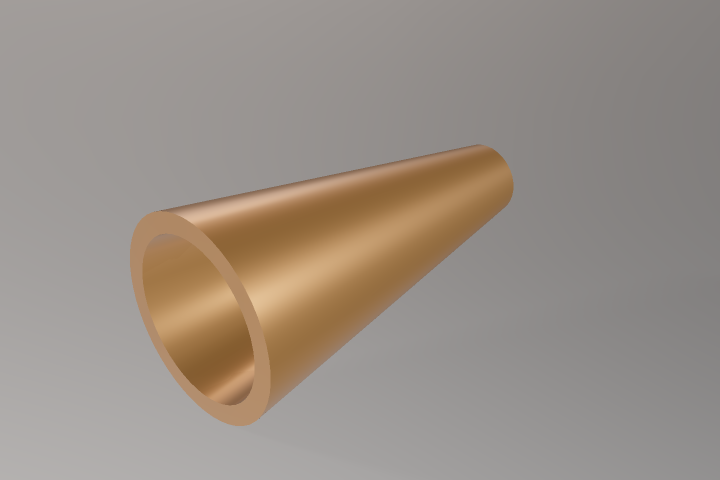
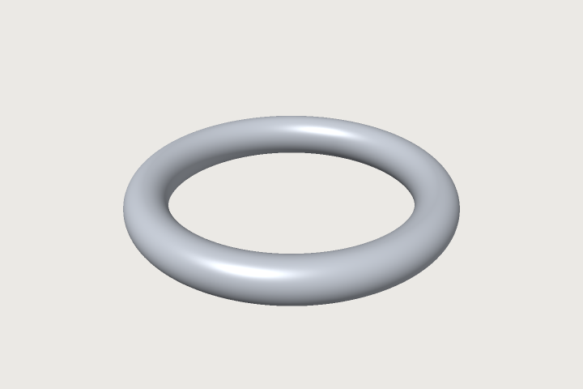
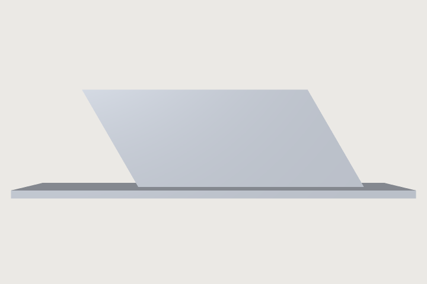

# Modelling features

*What each kind of feature does, with the parameters that matter: a chapter to come back to.*

A **feature** makes or changes a body: a block, an extrusion of a sketch, a hole, a rounded edge. This
chapter goes through them family by family. Two families have chapters of their own:
[Sheet metal](sheet-metal.md), and [Surfaces and developables](surfaces.md).

The full list of parameters of any command is in `command_list` (or `craft3d-cli commands --filter <id>`),
with a summary that also says what each refuses. The [lessons](../examples/README.md) use most of the
features below in parts that check their own volume.

## Primitives

`feature.block` (`size`, `position` of its low corner), `feature.cylinder` and `feature.cone` (`radius`,
`height`, `position` of the centre of the base, `axis`), `feature.sphere`, `feature.torus` (`major`,
`minor`). An `axis` (and the axis or normal of a transform, mirror, pattern or face move) is three
expressions, plain numbers or lengths as a position takes them, so a part can stay square to a wall
whose angle depends on parameters: `"axis": ["cos(a)", "sin(a)", 0]` or `["dx", "dy", 0]`. Only where it
points counts; one of no length fails the feature, and so does one that mixes lengths with plain
numbers other than 0 (`[1, "25 mm", 0]`: give all as lengths or all as numbers).

Their faces are numbered in a fixed order: a block's 0 bottom, 1 top, 2 front, 3 back, 4 left, 5 right; a
cylinder's 0 the wall, 1 the base, 2 the top.

## From sketches

- **Extrude** (`feature.extrude`): the closed loops of a sketch along its normal; a loop inside another is a
  hole. One end: `distance` (negative goes the other way; `symmetric` puts half on each side),
  `throughAll`, or `upTo` a face. `cut`, `join` or `intersect` combines it with a body in the same step.
- **Revolve** (`feature.revolve`): about the sketch's `x` or `y` axis, one of its lines, or a datum axis;
  `angle` defaults to a full turn. Example: [bushing](../examples/bushing.json).
- **Sweep** (`feature.sweep`): a profile carried along a `path`, a sketch of lines, arcs and splines end to
  end, square to the profile's plane at its start, or a helix (`datum.helix`). Example:
  [spring](../examples/spring.json). With a second `rail` it is a sweep along two rails (below).
- **Loft** (`feature.loft`): through two or more profiles on planes one after the other; smooth, or
  `ruled` (straight from each to the next). Example: [hopper](../examples/hopper.json).
- **Offset profile** (`feature.offsetProfile`): every loop of a sketch grown or shrunk by a distance;
  extrude it, or export it as a laser's path with its kerf.

## Sweep along two rails

`feature.sweep` with `rail` carries the profile along two curves at once: two of its points follow the
two rails, so it grows and shrinks as they part and close in. `path` and `rail` are each a sketch of one
open chain (lines, arcs and splines end to end), and each starts on the outline of the profile (or both
close into rings, below). The two
are walked together by the fraction of each one's length, the profile's x axis along the line between
them and its y axis as near to the normal of the `path`'s sketch as that allows: for rails drawn in one
plane, the sections stand square to it, so draw the profile on the plane through both rails' starts
that stands square to theirs. `scale` is `"uniform"` (the default: a circle stays a circle) or
`"width"` (only along the line between the rails; the height stays as drawn). A tapering spout, a ring
whose hole tapers with it:

```json
[
 ["variable.set", {"name": "r0", "expr": "15 mm"}],
 ["variable.set", {"name": "r1", "expr": "6 mm"}],
 ["variable.set", {"name": "ri", "expr": "12 mm"}],
 ["variable.set", {"name": "len", "expr": "60 mm"}],
 ["sketch.create", {"name": "Mouth", "plane": "zx"}],
 ["sketch.circle", {"sketch": "Mouth", "center": [0, "r0"], "radius": "r0"}],
 ["sketch.circle", {"sketch": "Mouth", "center": [0, "r0"], "radius": "ri"}],
 ["sketch.create", {"name": "Left", "plane": "xy"}],
 ["sketch.polyline", {"sketch": "Left", "points": [[0, 0], ["r0 - r1", "len"]]}],
 ["sketch.create", {"name": "Right", "plane": "xy"}],
 ["sketch.polyline", {"sketch": "Right", "points": [["2 * r0", 0], ["r0 + r1", "len"]]}],
 ["feature.sweep", {"sketch": "Mouth", "path": "Left", "rail": "Right", "name": "Spout"}],
 ["assert.add", {"name": "volume", "measure": "volume", "of": "Spout", "eq": "pi * len / 3 * (r0^2 + r0 * r1 + r1^2) * (1 - (ri / r0)^2)"}]
]
```



Where both rails are parallel lines of the same length the faces are exact planes and cylinders.
Elsewhere they are spline surfaces, and the result says under `path` how far they are from the true
sweep at most (`deviation`): a bound that is proven, never more than half the document's tolerance (a face
within an eighth of the tolerance of a plane is made that plane, and a profile drawn a little off its
plane is laid into it, which moves it by at most the tolerance). A tolerance finer than 4096 units in the
last place of the model's size is refused: below that, rounding is not bounded. A
face is named after the curve of the profile and the curves of the two rails it runs between
(`F4:side(e2,e3,e3)`), so a rail can be redrawn without losing what is built on the faces. Refused, with
the place: a rail that does not start on the profile, rails that meet or cross, rails that start at one
point, and a sweep that would fold or pass through itself.

**Rings.** Both rails may close: a sketch of lines, arcs and splines that close into one loop, or one
circle. Each ring has to pass through the outline of the profile, and the body is a closed ring
without ends (`closed` in the result). A circle carried round two concentric circles is a torus:

```json
[
 ["variable.set", {"name": "major", "expr": "40 mm"}],
 ["variable.set", {"name": "minor", "expr": "6 mm"}],
 ["sketch.create", {"name": "Section", "plane": "zx"}],
 ["sketch.circle", {"sketch": "Section", "center": [0, "major"], "radius": "minor"}],
 ["sketch.create", {"name": "Inner", "plane": "xy"}],
 ["sketch.circle", {"sketch": "Inner", "center": [0, 0], "radius": "major - minor"}],
 ["sketch.create", {"name": "Outer", "plane": "xy"}],
 ["sketch.circle", {"sketch": "Outer", "center": [0, 0], "radius": "major + minor"}],
 ["feature.sweep", {"sketch": "Section", "path": "Inner", "rail": "Outer", "name": "Ring"}],
 ["assert.add", {"name": "torus", "measure": "volume", "of": "Ring", "eq": "2 * pi * major * pi * minor^2"}]
]
```



**The up direction.** `up` sets the direction the profile stands in with the line between the rails,
instead of the normal of the `path`'s sketch: `"x"`, `"y"`, `"z"`, two face names for the straight edge
between them, or a datum axis (which way it points does not matter; `null` in `feature.edit` goes back
to the default). Draw the profile on the plane through both rails' starts that holds it. The profile
stands in the plane of the line between the rails and the up direction, so tilting the up direction
leans it along the rails' run. A wall 4 mm thick between two straight rails 60 mm long, drawn on the zx
plane tilted 30° about x and standing along the line where that plane meets the yz plane, leans back by
30° towards the start of the rails (its top is h sin 30° = 15 mm behind its foot), on a ground plate;
its volume is its section times its run times cos 30°:

```json
[
 ["variable.set", {"name": "h", "expr": "30 mm"}],
 ["datum.plane", {"from": "zx", "angle": "30 deg", "about": "x", "name": "Tilt"}],
 ["datum.axis", {"planes": ["Tilt", "yz"], "name": "Lean"}],
 ["sketch.create", {"name": "Blade", "plane": "Tilt"}],
 ["sketch.rect", {"sketch": "Blade", "from": [0, 0], "to": ["h", 4]}],
 ["sketch.create", {"name": "Near", "plane": "xy"}],
 ["sketch.polyline", {"sketch": "Near", "points": [[0, 0], [0, 60]]}],
 ["sketch.create", {"name": "Far", "plane": "xy"}],
 ["sketch.polyline", {"sketch": "Far", "points": [[4, 0], [4, 60]]}],
 ["feature.sweep", {"sketch": "Blade", "path": "Near", "rail": "Far", "up": "Lean", "name": "Wall"}],
 ["feature.block", {"size": [24, 100, 2], "position": [-10, -30, -2], "name": "Ground"}],
 ["assert.add", {"name": "wall", "measure": "volume", "of": "Wall", "eq": "4 mm * h * 60 mm * cos(30 deg)"}]
]
```



An up direction along the rails would lay the profile into their course; that is refused as the fold
it makes.

## Text

`sketch.text` puts a text in a sketch: the outlines of its letters, closed profiles that extrude, cut and
emboss as any profile does. Text may hold formulas in braces, written again at every regeneration: a
length in the document's unit, an angle in its angle unit, a number as it is (`{{` and `}}` write a
brace). `size` is the height of the capitals (or, with `sizeOf: "em"`, the em). A raised serial number
on a plate:

```json
[
 ["variable.set", {"name": "partNo", "expr": "42"}],
 ["feature.block", {"size": [60, 20, 3], "name": "Plate"}],
 ["sketch.create", {"name": "Label", "face": "F1:face(1)"}],
 ["sketch.text", {"sketch": "Label", "text": "No. {partNo}", "size": "8 mm", "at": [30, 10], "align": "center", "anchor": "middle"}],
 ["feature.extrude", {"sketch": "Label", "distance": "1 mm", "join": "Plate", "name": "Raised"}]
]
```

- **Fonts.** `sans` (Noto Sans) and `mono` (JetBrains Mono) come with 3DCraft; `stroke` is the
  single-stroke font, for engraving, CNC, lasers and pen plotters: its letters are open strokes, exported
  with `file.export` as DXF or SVG of the sketch, not extruded. `font.add` adds any OpenType or
  TrueType file under a name (`font.list` lists them all). The document keeps the font, so it opens the
  same on another machine, unless the font forbids that (its embedding permission): then the document only
  names the font, and asks for it again when it is opened.
- **Placing it.** The text stands on its point `at` (a point of the sketch, so constraints can move it):
  `anchor` says which line sits there (the first baseline, the top of the capitals, the middle, the last
  baseline), `align` whether the lines go right of it, around it or left of it, and `rotation` turns it.
  Lines break at newlines (`\n` in JSON), and with a `width` also at spaces. `lineSpacing` scales the
  font's own line height.
- **Along a curve.** `sketch.textOnCurve` sets the letters upright along a line, arc, circle or spline of
  the sketch: each letter keeps its shape, its baseline along the curve; `start` is the length along the
  curve where it starts, `offset` lifts it off the curve; the letters stand on the left of the curve as it runs (inside a
  circle, which runs counter-clockwise), or with `side: "right"` on its right (outside a circle, still
  reading left to right); `reversed` runs the curve the other way.
- **Names.** Each outline of a letter is named after the text, the letter's place in the text and the
  letter: the side of the B of `"AB"` extruded is `F3:side(e2.glyph(1,U+0042).contour(0))`. Change the text
  and a face of a letter that is no longer at its place fails by its name; it is never handed to another
  letter. `sketch.textEdit` changes the text, font, size or anything else; `sketch.inspect` lists the
  glyphs with their contours.
- **Measuring.** The measure `textExtent` (`what`: `width`, `height`, `capHeight`, `lines`, `inkWidth`,
  `inkHeight`) holds a text to a size in an assertion, or makes it an output for formulas.

## Booleans

`feature.boolean` with `op` `union`, `subtract` or `intersect` combines the body of `target` with the
body of `tool`; both go into the new feature (`keepTool` keeps the tool's body to use again). The kernel is
3DCraft's own and handles planes, cylinders, cones, spheres, tori and freeform faces; what it cannot do
yet it **refuses with the reason**, never with a wrong solid. Faces that touch or lie within the
tolerance of each other are the hardest cases; a cutting tool made a little longer than the part avoids
them and says what is meant (the examples use `thickness + 2 mm` from `-1 mm`).

## Patterns, mirror, transform

- `feature.pattern`: `count` copies of a body; linear with `step` (`[dx, dy, dz]`), circular with `angle`
  about `axis` through `point` (`"360 deg / n"` with `count: "n"`), a screw with both. A pattern of a
  pattern makes a grid. Example: [flange](../examples/flange.json).
- `sketch.pattern` repeats curves inside a sketch (`count`, `step`, `count2`, `step2`, or `angle` about a
  `center`): one extrusion then makes all the holes.
- `feature.mirror` in a plane (`normal` and `point`, or a datum `plane`); `feature.transform` moves or turns
  a body (`translate`, `angle`, `axis`, `pivot`). With `keep` the source keeps its body and you get a copy.

## Fillets and chamfers

`feature.fillet` (`radius`) and `feature.chamfer` (`distance`; or `distance` and `second`; or `distance`
and `angle`) take `edges` as pairs of faces: `[["F1:face(2)", "F1:face(4)"], …]`. `chain: true` adds the
edges that continue an edge smoothly. Straight edges between flat faces and circular edges round an axis
are exact; other edges get a spline face within the tolerance. A radius that does not fit fails with the
largest that does. `document.edges` lists every edge of a body with its two faces. Examples:
[bracket](../examples/bracket.json), [case](../examples/case.json), [flange](../examples/flange.json).

## Shell and face operations

- `feature.shell` makes a body hollow with walls of `thickness`; the faces in `open` are taken away. A
  rounded box gets inner rounds of the radius less the wall. Example: [case](../examples/case.json). Shell
  before a modelled thread: a thread's flanks curve too tightly to be offset, and the shell after it
  fails and says so.
- `feature.offsetFace` moves faces along their normals (a boss taller, a bore wider); `feature.moveFace`
  moves or turns them; `feature.draft` tilts them about a `neutral` plane; `feature.deleteFace` takes faces
  out as if they had never been made (a hole filled, a fillet back to a sharp edge);
  `feature.thicken` makes a layer of `thickness` on faces.

## Threads

`feature.thread` puts an ISO metric thread on a cylindrical face: external on a shank, internal in a hole.
`face` is the cylinder, `start` the flat face at the end where it starts, `size` an ISO size such as `M10`
(or left out: the size of the face), `length`. It is **cosmetic** by default (the body is unchanged and
the face carries the thread, as other modellers do); `modeled: true` cuts the real groove, which takes
seconds. Example: [bushing](../examples/bushing.json).

## Datums

Construction geometry that makes no body: `datum.plane` (at a `distance` from a plane or a face, turned by
an `angle` `about` an axis, or `through` three points), `datum.axis`, `datum.point`, `datum.helix`. Sketch
on a datum plane, mirror in it, pattern about a datum axis. A datum plane turned `about` an axis goes
through that axis: to turn a plane about a line that is not a world axis, make that line a `datum.axis`
first. `datum.references` lists what a feature can be placed by.

## Sheets

`feature.fill` makes a **sheet**: flat faces with no volume, bounded by the loops of a sketch. A sheet is a
cutting tool: `feature.boolean` of a solid with a sheet that reaches across it keeps the part in front of
the sheet (`subtract`, the side its normal points to) or behind it (`intersect`). An open chain in a
loft gives a sheet too, and `feature.thicken` turns faces into a solid layer. `feature.fold` folds a sheet
along a crease pattern ([Origami](origami.md)). Sheets through curves, sheets that unfold flat, and plates
made of sheets are in [Surfaces and developables](surfaces.md).

## Several bodies

A document may hold any number of bodies: every feature that does not take another body adds one.
`body.split` splits a body that fell into pieces (a cut through the middle) into one body per piece.
`document.interference` says whether bodies overlap.

## Colours and materials

`body.appearance` gives a body a colour, and how metal (`metallic`, 0 to 1) and how rough (`roughness`, 0
to 1) it looks. `face.appearance` gives single faces a colour of their own. `body.material` gives a body a
density, and then `document.inspect` gives its mass:

```text
body.appearance {"body": "Part", "color": "#b9bec4", "metallic": 0.9, "roughness": 0.35}
face.appearance {"faces": ["Part:face(1)"], "color": "#c8102e"}
body.material {"body": "Part", "name": "aluminium", "density": "2.7 g/cm3"}
```

A colour's channels and a density may be expressions of the variables (`["if(dark, 60, 200)", 120, 40]`,
`"sheets[sheet].density g/cm3"`), so they follow a parameter: a Jig's choice of wood recolours the part
and weighs it again.

**A face's own colour wins over its body's.** A body colour given to a later feature (a transform, a
boolean) colours the other faces, and leaves the faces coloured earlier as they are.

To give the whole body one colour, clear its faces' own colours in one step:
`face.appearance {"body": "Moved", "clear": true}`. It takes away every face colour the body's faces
carry, wherever along the history it was given (an imported STEP part with a colour on every face too),
as one step to undo, and lists what it cleared. A pattern's instances are one body: the seed's colour goes
from every instance.

A colour that also colours a face of another body (a copy kept by a mirror, the other piece of a
`body.split`) is kept, because clearing one body never changes another. The answer says which body
shares it, and gives under `kept` the command that clears it from both: the face by its own name at the
feature it was given on, such as `face.appearance {"body": "F1", "faces": ["F1:face(1)"], "clear":
true}`. Single faces are cleared the same way.

In the window, a body's card in the **Bodies** tab has **Clear face colours** when its faces carry
colours of their own, and a **Shared** row (*1 colour, with Twin*) when some are shared.

**A feature that is switched off** ([Formulas › Switching parts on and off](formulas.md#switching-parts-on-and-off))
passes on what it was given, where the body it passes on has none of its own:

- A material, colour or face colour set on a pattern of spacers still weighs and colours the one spacer
  it passes on when it is off. So set them on the last feature of a part.
- A colour or material the passed-on body has already (given to it, or to what it is made from, by a
  feature that is on) wins: a red part moved by a transform that is off and given blue stays red.
- Colours are filled in face by face. A face that has a colour without the feature that is off keeps it;
  only the faces that have none take that feature's colours. A plain spacer with one green face, passed on
  by a pattern given blue, is blue with its green face.
- A face colour on a face that is gone while the feature is off (the second instance of a pattern, the
  wall a cut would make) colours nothing and waits. It never stops a picture or an export.
  `document.inspect` marks a material that comes from a feature that is off with `"off": true`.

### Materials

Beyond its colour, metallic and roughness, a body or a face can have the layers of a real material. The
studio look draws them ([The window › The studio look](window.md#the-studio-look)); the plain look keeps
showing the colour.

- **anisotropy** (−1 to 1): the highlight stretched in one direction, as on brushed or turned metal. It
  follows the face's own direction: around the axis of a turned face (cylinder, cone, sphere, torus), along
  the first axis of a flat one. `anisotropyAxis` `[x, y, z]` gives a direction of your own instead
  (`"parametric"` gives the face's own direction back).
- **clearcoat** (0 to 1), with its own `clearcoatRoughness`: a clear, glossy layer over the colour, as on
  car paint.
- **transmission** (0 to 1): light passes through, as through glass or clear plastic, bent by the index of
  refraction `ior` (1.5 by default). `thinWalled` is for a sheet: light passes straight through.
  `absorption` is the colour light takes after `absorptionDistance` millimetres inside (10 by default), so
  thick glass looks greener than thin glass. A `thinWalled` face has no inside for light to cross, so
  `absorption` has no effect on it.
- **subsurface** (0 to 1): light wraps past the edge of the shadow, as in wax, skin or wood, tinted by
  `subsurfaceColor`.

A small library gives ready sets. `material.presets` lists them: steel, aluminium-brushed, abs, glass,
car-paint, wood, and with a solid texture oak, walnut, beech, marble, granite, carbon and cast-iron.
`material.preset` gives one to a body, its look and its density together. Any value beside it changes the
preset:

```text
material.preset {"body": "Housing", "preset": "car-paint", "color": "#1f4fa0"}
material.preset {"body": "Window", "preset": "glass"}
body.appearance {"body": "Blades", "color": "#c8ccd2", "metallic": 1, "roughness": 0.3, "anisotropy": 0.8}
```

### Solid textures

A material can also have a **pattern**: wood, marble, granite, speckle, noise, brushed or carbon. It is
worked out at every point of the body, in the model's space, rather than painted on its faces. So a cut, a
hole or a chamfer shows the wood's rings or the marble's veins running on through the body, as in the real
material.

The oak, walnut, beech, marble, granite, carbon and cast-iron presets have one, fitted to the body. Wood's
grain runs along the longest side of the body's box, with rings a twentieth of its width apart, and the
pith just outside the body below its thinnest side, so a board shows the arches of a flat-sawn plank.
Change any of it with a `pattern` beside the preset, or give your own with `body.appearance` or
`face.appearance`:

```text
material.preset {"body": "BoardBottom", "preset": "walnut"}
material.preset {"body": "Top", "preset": "oak", "pattern": {"scale": 3, "seed": 7}}
body.appearance {"body": "Plinth", "roughness": 0.15, "pattern": {"kind": "marble", "colors": ["#f2f0ec", "#60646a"], "distortion": 2}}
```

A pattern takes:

- `kind`, and two to four `colors` (a ramp; each kind has its own when left out);
- `scale`: the size of a ring, a vein, a cell or a tow, in the model's units;
- `axis` and `origin`: the grain's direction and the pith (left out, fitted to the body's box);
- `seed`, for another piece of the same material;
- `distortion` (the rings' wobble, the marble's turbulence) and `detail` (octaves of noise, 1 to 6);
- `grain` and `rays` (wood's fine streaks and medullary rays, 0 to 1), `spot` (a speckle's dot size);
- `wrap` (carbon: woven around the axis for a tube, or flat across it for a plate whose normal is the
  axis), `alongAxis` (a brushed or anisotropic highlight along the grain), and `roughness` at the ramp's
  two ends.

The scale, axis and origin fitted to the body are worked out once, when you give the material, and kept.
Later edits that change the body's size do not change the grain, and a body that an earlier feature moves
(a transform, a pattern's copy) slides through its texture instead of carrying it along. Give the material
again to fit it anew.

The studio look draws the texture. The plain look and the exports show the pattern's mean colour, which
becomes the body's colour when you give none. A carbon weave is right on a tube around its axis and on a
plate across it, and looks stretched on faces that are neither (a plate's edges, a tube's end).

### Glass, and what exports keep

What you see through glass is worked out on the picture itself: the view of what lies behind it, moved
by the refraction as a slab of the glass's thickness would move it. Glass behind glass is not seen
through, and a transparent body casts no shadow.

Exports keep what their formats can:

- an OBJ export's material library has the clear coat (`Pc`, `Pcr`), the anisotropy (`aniso`), the index
  of refraction (`Ni`) and the transmission (`d`, `Tf`);
- a 3MF export gives a transmissive material a display colour with transparency;
- a STEP export writes the transmission as the surface's transparency.

Subsurface, the anisotropy's direction, the absorption's length and solid textures are kept only in the
`.3dcraft` file; a texture exports its mean colour.

## Hiding and looking back

`feature.visible` with `"visible": false` hides a feature's body, sketch or datum in the view (the window,
`view.render`, `view.pick`); `true` shows it again. The eye in the feature list does the same.

Hiding is not switching off. A hidden feature is still built and measured, and later features are still
made from it. What changes is what is shown and written:

- a drawing of the model, and STEP, STL, 3MF and OBJ exports of every body, leave a hidden body out, and
  so does the cut list. The export's result names them under `hiddenLeftOut`, and the export dialog names
  them under **All bodies**;
- named in `bodies`, or selected for the export, a hidden body is written all the same
  ([Files › Other CAD programs](files.md#other-cad-programs-step)).

A hidden feature is saved with the document and undone like a colour; `document.inspect` marks it
`"hidden": true`.

`view.scrub` shows the model as it was after one step (`{"step": 3}` or `{"feature": "Plate"}`;
`{"feature": null}` shows it as it is again), without changing the document: the timeline in the window
does the same. To build on from that step, move the real marker there with `history.rollback`.

## Switching a feature on or off

`feature.suppress` switches a feature off by hand, and `feature.when` by a condition, such as a yes-or-no
parameter of a Jig. Off, a feature behaves as if it were not in the history.
[Formulas › Switching parts on and off](formulas.md#switching-parts-on-and-off) is the one place that
explains both.

**Next:** [Sheet metal](sheet-metal.md).
