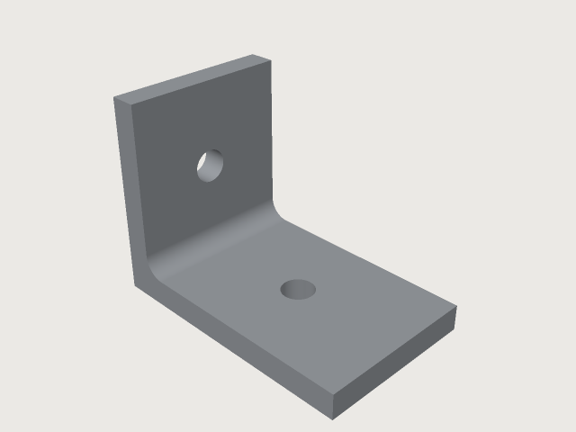
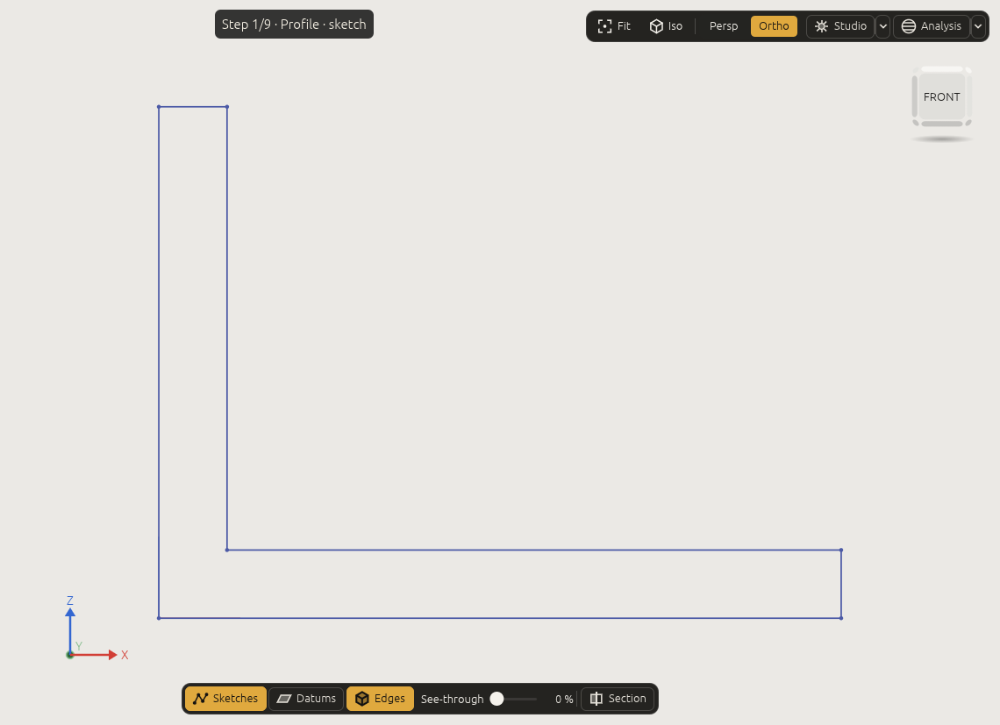

# A first part, command by command

*Build an L-bracket with a rounded corner and two holes, one command at a time, and see what each one
does. This is what an agent sends for you, written out.*

An L-shaped angle bracket of 4 mm stock, 25 mm wide, legs of 40 mm (flat, along X) and 30 mm (upright,
along Z) measured to the outside of the corner at the origin, a 3 mm round in the inside corner and a
5 mm hole in each leg. The whole script is the lesson [`bracket.json`](../examples/bracket.json).

Ask an agent for it in those words and it sends commands like the ones below. Here they are one by one,
with what each does. To run them yourself, put them in a script for `craft3d-cli run --script`
([The command line and scripts](command-line.md#scripts)), or give them to `command_batch` (each
`[id, params]` becomes `{"id": …, "params": …}`).



## 1. The numbers, as variables

```json
[
 ["variable.set", {"name": "leg_x", "expr": "40 mm"}],
 ["variable.set", {"name": "leg_z", "expr": "30 mm"}],
 ["variable.set", {"name": "thickness", "expr": "4 mm"}],
 ["variable.set", {"name": "width", "expr": "25 mm"}],
 ["variable.set", {"name": "hole_d", "expr": "5 mm"}],
 ["variable.set", {"name": "inner_r", "expr": "3 mm"}]
]
```

Everything below is written in these names, so the bracket follows when one changes.

## 2. The profile, and an extrusion

The L is drawn on the `zx` plane. On that plane a sketch point is written `[z, x]`: its first coordinate
is the height Z, its second the distance X along the flat leg. The plane's normal is +Y, so extruding the
L by `width` makes the bracket run from Y = 0 to Y = 25:



```json
[
 ["sketch.create", {"name": "Profile", "plane": "zx"}],
 ["sketch.polyline", {"sketch": "Profile", "closed": true, "points": [["0 mm", "0 mm"], [0, "leg_x"], ["thickness", "leg_x"], ["thickness", "thickness"], ["leg_z", "thickness"], ["leg_z", 0]]}],
 ["feature.extrude", {"sketch": "Profile", "distance": "width", "name": "Bracket"}]
]
```

The polyline's six corners are points `e1` to `e6`, its sides lines `e7` to `e12` (the result lists
them). Every corner has an expression among its coordinates, so each is held there, and `sketch.inspect`
says `"dof": 0`. The extrusion is feature F2 (the sketch is F1); its faces are `F2:side(e7)` …
`F2:side(e12)`, one per side of the profile, and `F2:startCap()`, `F2:endCap()`.

## 3. A round in the inside corner

The inside corner is the edge between the side swept from `e9` (the top of the flat leg, from point `e3`
to `e4`) and the side swept from `e10` (the inner face of the upright):

```json
[
 ["feature.fillet", {"edges": [["F2:side(e9)", "F2:side(e10)"]], "radius": "inner_r", "name": "Rounded"}]
]
```

To find such a pair without reading the sketch: `document.inspect` lists the faces, `select.query
{"kind": "face", "where": {"normal": {"along": "z"}}}` finds the faces facing up, or click the faces in the
window and ask the agent to read the selection.

## 4. Two holes

A circle on the `xy` plane under the flat leg, extruded through everything in the way and cut from the
body; then one on the `yz` plane for the upright:

```json
[
 ["sketch.create", {"name": "FlatHole", "plane": "xy"}],
 ["sketch.circle", {"sketch": "FlatHole", "center": ["(leg_x + thickness) / 2", "width / 2"], "radius": "hole_d / 2"}],
 ["feature.extrude", {"sketch": "FlatHole", "throughAll": true, "cut": "Rounded", "name": "Drilled"}],
 ["sketch.create", {"name": "UprightHole", "plane": "yz"}],
 ["sketch.circle", {"sketch": "UprightHole", "center": ["width / 2", "(leg_z + thickness) / 2"], "radius": "hole_d / 2"}],
 ["feature.extrude", {"sketch": "UprightHole", "throughAll": true, "cut": "Drilled", "name": "Part"}]
]
```

`cut` makes the extrusion and the boolean in one step; the result is named `Part` and is the body to
build on. A sketch can also be placed on a face of the body (`"face": "F2:endCap()"` instead of `plane`).

## 5. Say what it must be

```json
[
 ["assert.add", {"name": "volume", "measure": "volume", "of": "Part", "eq": "(leg_x * thickness + (leg_z - thickness) * thickness) * width + (1 - pi / 4) * inner_r^2 * width - 2 * pi * (hole_d / 2)^2 * thickness"}],
 ["assert.add", {"name": "two holes", "measure": "count", "of": {"kind": "face", "where": {"hole": true}}, "eq": 2}],
 ["assert.add", {"name": "holes go through", "measure": "through", "of": {"hole": true}}],
 ["body.appearance", {"body": "Part", "color": "#b9bec4", "metallic": 0.9, "roughness": 0.35}],
 ["document.check", {}]
]
```

`body.appearance` gives the part a brushed-aluminium look: a colour, metallic and roughness, which the
viewport, the pictures and a 3MF export show ([Modelling features › Colours and materials](features.md#colours-and-materials)).

The volume, worked out by hand: the L is a 40 × 4 bar and a 4 × 26 upright, times the width; the round
adds the corner square less a quarter circle, (1 − π/4) r², along the width; each hole takes π (d/2)² t.
That is 6491.206 mm³, and 3DCraft measures 6491.205780556 mm³ on the exact geometry. `document.check`
answers `"ok": true`, three assertions passed.

## 6. Change it

```json
[
 ["variable.set", {"name": "leg_x", "expr": "60 mm"}]
]
```

The flat leg is now 60 mm; the round is still in the corner, the hole moved to the middle of the longer
leg (its centre is written in `leg_x`), and the result of the command says the three assertions still
pass. `assert.list` gives the new volume, 8491.206 mm³. With `inner_r` set to 30 mm the round no longer fits: [How 3DCraft thinks › *Failed
features*](concepts.md#failed-features), shows what 3DCraft answers.

## 7. Save and export

```json
[
 ["file.save", {"path": "bracket.3dcraft"}],
 ["file.export", {"path": "bracket.step"}],
 ["file.export", {"path": "bracket.3mf"}]
]
```

Open `bracket.3dcraft` in the window and play its history ([The window](window.md#the-history-player)) to see the
steps above one by one.

**Next:** [Formulas, tables and conditions](formulas.md).
