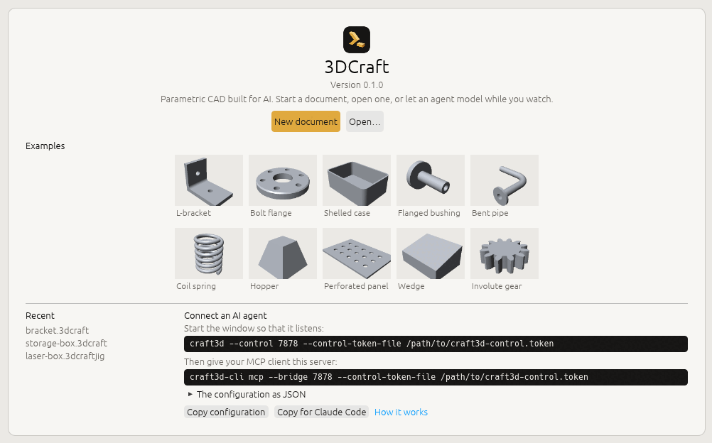
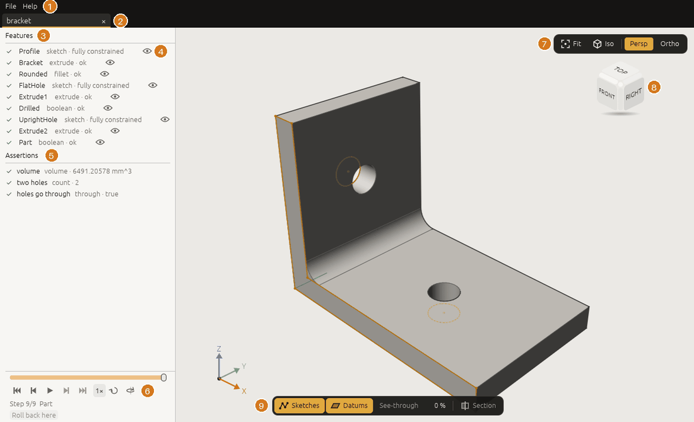
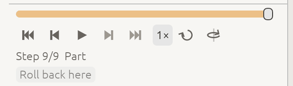
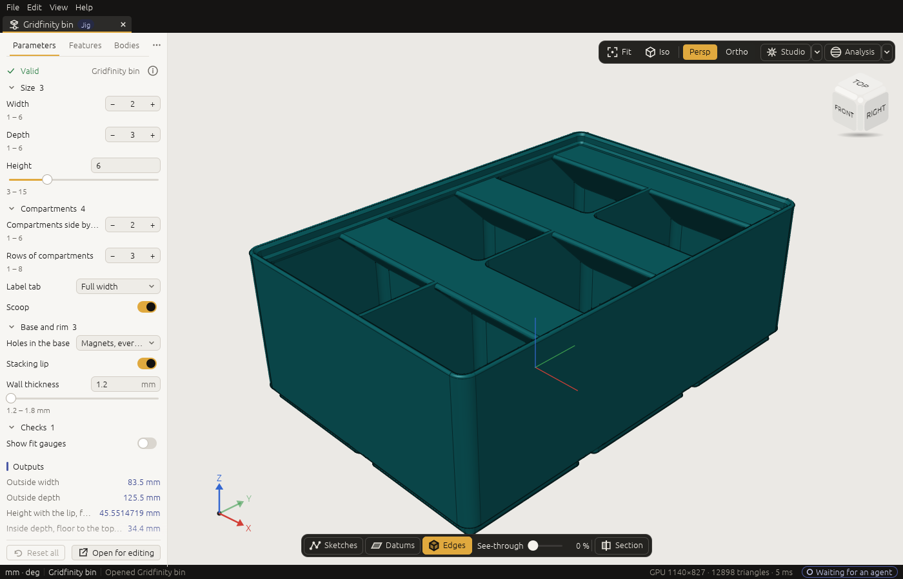
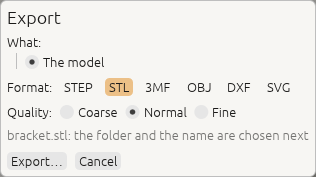

# Your first five minutes

*Open an example, look around, watch how it was built, set a Jig and export a part for a 3D printer. No AI
agent needed.*

You need 3DCraft installed, or the web version open in your browser
([Install 3DCraft](install.md)).

## 1. Open an example

Start 3DCraft. Without a document, the window shows its **start screen**:

<!-- SHOT: start-screen.png | the new start screen with no document open: New part, New assembly, Open…, the two examples in front (steel bookend, T-slot aluminium profile), the eight other examples, the six Jigs, the four assemblies, More examples, Recent with three neutral file names, Connect an AI agent with its switch off; theme light, window 1400x900 | start craft3d with --recent-file pointing at a list of three neutral files; ui.set {"appearance": "light"}; no document open (plan: shots/pictures/01-start-screen.json, its todo) -->

<!-- CHECK: the new start screen's words and order: New part, New assembly, Open…; two examples in front (Steel bookend, T-slot aluminium profile), then eight more examples, six Jigs, four assemblies and More examples; Recent; Connect an AI agent -->

Two simple examples stand in front: a steel bookend and a T-slot profile. Click the **T-slot aluminium
profile** card. 3DCraft opens it in a new tab.

It is a 30 × 30 mm aluminium profile, the kind machine frames and 3D-printer frames are built from: four
T-slots along its length, sawn to 300 mm, with a threaded hole in each end.

The profile has two sizes you may change, so it opens on its **Parameters** tab. Click the **Features**
tab next to it.

<!-- CHECK: that the T-slot profile opens on its Parameters tab (it has public parameters) and that its tab and card are named as written -->

<!-- SHOT: window.png | the T-slot aluminium profile on its Features tab, iso view, sketches and datums hidden, status bar with the agent pill; markers 1 to 10 added afterwards (menus, tabs, feature list, eye, checks, player, view buttons, view cube, display bar, agent pill); theme light, window 1400x900 | file.open the T-slot profile; ui.set {"appearance": "light"}; ui.set {"parameters": {"open": false}}; ui.set {"show": {"sketches": false, "datums": false}}; ui.set {"view": "iso"}; ui.fit (plan: shots/pictures/02-window.json, with the T-slot profile instead of the bookend) -->

On the left is the **feature list**: the steps that made the profile, in order.

| Step | What it made |
|---|---|
| **Cross section** | A sketch of the profile's outline: one quarter drawn, then turned round three more times. It is folded under the next row; click **›** to see it |
| **Extruded profile** | The outline pushed out to the profile's length |
| **Die corner rounds** | The 32 small inside corners of the slots, rounded as the extrusion die leaves them |
| **Tapped first end**, **Tapped second end** | An M8 thread in the hole at each end |
| **Countersunk thread entries** | A small cone at the mouth of each thread |

Under the list are the **checks** (3DCraft's own word for them is *assertions*). These are what the
profile must pass, measured on the model: its cross-section's area and stiffness against formulas worked
out by hand, a comparison with a maker's catalogue, and the wall round the thread. A ✔ means it passes.

## 2. Look around

| Do this | To |
|---|---|
| Drag with the left mouse button | Turn the model (orbit) |
| Drag with the right button (or Shift and the left) | Move it (pan) |
| Turn the wheel, or pinch on a touchpad | Zoom in and out, about the point under the pointer |
| Click a side or corner of the **view cube** (top right) | Look from the front, the top, a corner, … |
| Press **F**, or click **Fit** | See the whole model again |

Now click the **Die corner rounds** row: the rounded corners light up in the view. **Double-click** the
row (or click the **⌖** that appears on it) and the camera flies to them. Press **F** to see everything
again.

> **Tip:** the **eye** at the end of a row hides that step's body or sketch in the view. Click it again to
> show it. The model itself does not change.

## 3. Watch how it was built

Under the feature list is the **history player**, like a video player:

<!-- SHOT: player.png | the player at the foot of the side panel, part-way through the T-slot profile's history (3 / 6): the timeline, step back, the round play button, step forward, where you are, speed, loop and orbit; theme light, scale 2 if possible | file.open the T-slot profile; ui.set {"parameters": {"open": false}}; view.scrub {"step": 3}; crop to the player (plan: shots/pictures/03-player.json) -->

1. Point at the view and press **Home**, or drag the timeline to its left end. The view shows the model
   after the first step: only the sketch of the cross section.
2. Press **Space**, or click the round play button. The profile is built again, step by step, with the
   name of each step at the top of the view. The player counts the steps: `1 / 6`, `2 / 6`, …
3. Click **Orbit** (the last button) and play again: the camera turns slowly while it plays.
4. Press **End** to see the finished part again.

Playing back never changes the document; it only shows it as it was.

## 4. Change a size

Click the **Parameters** tab. Click the value of **Length**, type `500 mm` and press Enter. The profile
grows to 500 mm, and its checks are measured again: they still pass, because a longer profile has the
same cross section.

Click **↺** beside **Length** to put it back.

## 5. Set a Jig

A **Jig** is a finished design with a form: the sizes that matter are fields, and the rest follows. Close
the profile's tab (**File › Close**, or Ctrl+W; choose **Don't Save**). The start screen comes back.

<!-- CHECK: that closing the last tab brings the new start screen back, and that its Jigs section shows the Gridfinity bin card under that name -->

Under **Jigs**, click **Gridfinity bin**: a storage bin for the Gridfinity system, printed without
supports. It opens on its **Parameters** tab.

<!-- SHOT: jig-parameters.png | the Gridfinity bin Jig opened from the start screen, on its Parameters tab with its groups open (Size, Compartments, Base and rim, Checks), the form's footer with the Jig's licence, iso view; theme light, window 1400x900 | open the Gridfinity bin from the start screen (or file.open gridfinity-bin.3dcraftjig); ui.set {"appearance": "light"}; ui.set {"view": "iso"}; ui.fit (plan: shots/pictures/05-jig-parameters.json, with the Gridfinity bin instead of the laser-cut box) -->

1. Drag the knob of the **Height** slider. The bin's walls grow and shrink in steps of 7 mm, the height
   unit of the Gridfinity system, as you drag.
2. Beside **Width**, click **+**: the width goes from 2 to 3 grid units of 42 mm, and the compartments get
   wider.
3. Beside **Compartments side by side**, click **+**: nine compartments now, three across and three deep.
4. Untick **Scoop**: the rounded fronts inside the compartments go.
5. Click **↺** beside a parameter to put it back, or **Reset all** to put them all back.

Leave **Show fit gauges** off: the gauges are extra bodies that prove the bin fits a baseplate, and an
export would write them too.

## 6. Export it for a 3D printer

1. Open the **File** menu and choose **Export…** (or press Ctrl+E; ⌘E on a Mac).
2. In the export dialog, keep **All bodies** and choose the format **3MF**. 3MF keeps the size unit and
   the colours; most slicers read it, and STL as well. The **quality**: **Normal** is right for printing.

   <!-- SHOT: export-mesh.png | the export dialog over the Gridfinity bin: What All bodies, Format 3MF, Quality Normal with its hint, File name, Export… and Cancel; theme light; crop to the dialog | open the Gridfinity bin; ui.set {"appearance": "light"}; ui.set {"export": {"open": true, "what": "model", "format": "3mf", "quality": "normal"}}; crop by hand (plan: shots/pictures/04-export-mesh.json) -->
   

3. Click **Export…**, choose where in your system's save dialog, and click Save.

Open the file in your slicer (PrusaSlicer, Cura, Bambu Studio, OrcaSlicer, …). The bin stands on its
feet, in millimetres, as designed. It prints without supports.

> **A laser cutter instead?** The **Laser-cut box** under Jigs works the same way. Its export is a cut
> sheet: in the export dialog choose **Sheet of set: Cut sheet** and SVG or DXF, and every panel comes
> out on one flat sheet at true size, ready for your laser software
> ([Files › Laser cutting](files.md#laser-cutting-flat-outlines-in-dxf-and-svg)).

## 7. Save

**File › Save** (Ctrl+S) saves the document as a `.3dcraft` file. A Jig is never overwritten: saving it
saves your settings as a new `.3dcraft` model. If you forget to save, 3DCraft keeps an autosave and
offers to recover it after a crash ([Troubleshooting](troubleshooting.md#after-a-crash)).

## What next?

- **Design something new with an AI agent:** connect one
  ([Install › Connect an AI agent](install.md#connect-an-ai-agent-over-mcp)) and read
  [Working with an AI agent](agent.md).
- **Get to know the window:** [The window](window.md).
- **More Jigs:** [Using a Jig](jigs.md) describes the six on the start screen.
- **More examples:** **More examples** on the start screen opens the examples gallery,
  [3dcraft.dev/examples](https://3dcraft.dev/examples/), in your browser. The guide's own lessons are
  seven short command scripts ([the lessons](../examples/README.md)) that you run yourself, as
  [A first part, command by command](first-part.md) shows.
