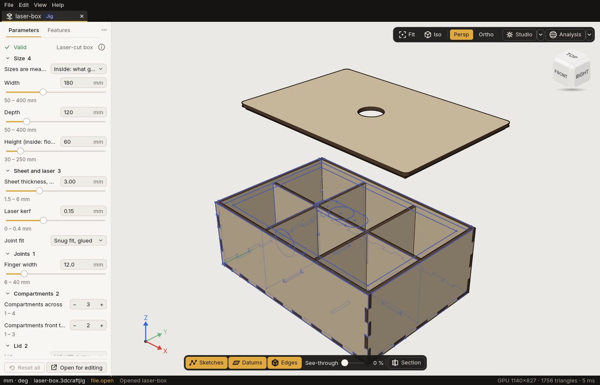
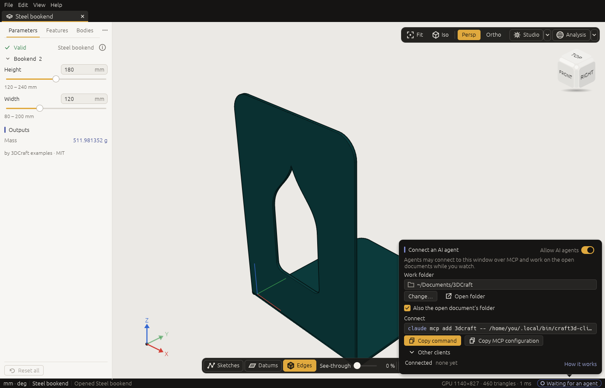
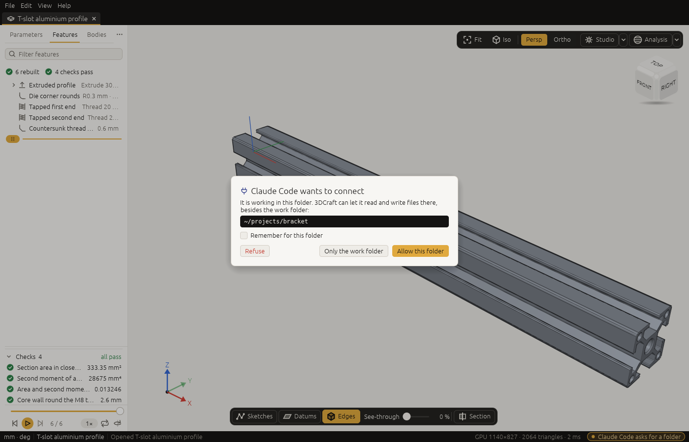

# Install 3DCraft and connect an AI agent

*Get 3DCraft running on your computer or in your browser, and let your AI agent work in the window you
are watching.*

## What you get

3DCraft comes as two programs, and every installer has both:

- **`craft3d`**, the **window**. It shows your design. You look around, click on faces, play the history,
  set a Jig's parameters, and open, save and export files.
- **`craft3d-cli`**, the **command line**. It runs commands and scripts, renders pictures and converts
  files. It is also the **MCP server** your AI agent connects through. It needs no graphics card.

There is also a **web version**: 3DCraft in your browser, with nothing to install
([below](#in-the-browser-nothing-to-install)).

## Download

Download the installer for your computer from [3dcraft.dev](https://3dcraft.dev/). The same files are on
the [release page](https://github.com/johancoppens/3dcraft/releases) of the source repository. The file
names carry the version number, here 0.1.0:

| Your computer | Download | Where `craft3d-cli` ends up |
|---|---|---|
| Windows (64-bit) | `3DCraft-0.1.0-x86_64.msi`, or `3dcraft-0.1.0-x86_64-windows.zip` | `C:\Program Files\3DCraft\craft3d-cli.exe` (on your `PATH`), or the unzipped folder |
| macOS (Apple Silicon: M1 or later) | `3DCraft-0.1.0-aarch64.dmg` | `/Applications/3DCraft.app/Contents/MacOS/craft3d-cli` |
| Linux (64-bit Intel or AMD) | `3DCraft-0.1.0-x86_64.AppImage`, or `3dcraft-0.1.0-x86_64-linux.tar.gz` | the AppImage itself, started with `cli`, or `~/.local/bin/craft3d-cli` |
| Any computer, nothing to install | the web version, [3dcraft.dev/app](https://3dcraft.dev/app/) | none: the web version has no MCP |

### Why your computer warns you

This first release is **not signed**. 3DCraft does not yet have the certificates from Apple and Microsoft
that tell your computer who made a program. So the first time you open it, Windows or macOS says it does
not know the program and stops it.

That is expected, and you only get past it once. The steps below are all it takes. Nothing is switched
off for other programs.

## Windows

1. Double-click `3DCraft-0.1.0-x86_64.msi`.
2. A blue box appears: **"Windows protected your PC"**. Click **More info**, check that the app is
   `3DCraft-0.1.0-x86_64.msi` with publisher *Unknown publisher*, and click **Run anyway**.
3. The installer may ask for an administrator's permission. It installs for all users into
   `C:\Program Files\3DCraft`.

3DCraft is now in the Start menu, `.3dcraft`, `.3dcraftjig` and `.3dcraftasm` files open with it, and
`craft3d-cli` works in a new terminal window.

> **Prefer not to install?** Unzip `3dcraft-0.1.0-x86_64-windows.zip` anywhere and start `craft3d.exe`
> from the folder. SmartScreen asks the same question the first time (More info › Run anyway).

## macOS

1. Open `3DCraft-0.1.0-aarch64.dmg` and drag **3DCraft** onto the **Applications** folder beside it.
2. Open 3DCraft from Applications. macOS refuses the first time, with a message such as *"3DCraft"
   cannot be opened because Apple cannot check it for malicious software*, or *"3DCraft" Not Opened*.
   Click **Done** (or **OK**). Do not move it to the Bin.
3. Allow it once, in one of two ways:
   - **System Settings › Privacy & Security**: scroll down to *"3DCraft" was blocked to protect your
     Mac* and click **Open Anyway**, then confirm with your password and click **Open**. This works on
     every recent macOS, and it is the only way on macOS 15 (Sequoia) and later.
   - On macOS 14 (Sonoma) and earlier you can instead **right-click** (or Control-click) 3DCraft in
     Applications, choose **Open**, and click **Open** in the question that follows.

From then on 3DCraft opens normally.

> **Terminal users:** `xattr -dr com.apple.quarantine /Applications/3DCraft.app` does the same as
> step 3. To use `craft3d-cli` by name, link it onto your `PATH`:
> `ln -s /Applications/3DCraft.app/Contents/MacOS/craft3d-cli /usr/local/bin/`.

## Linux

Linux does not warn about unsigned programs, but a downloaded file may not run until you allow it.
Both packages need a Linux from about 2022 or newer (glibc 2.35, as in Ubuntu 22.04).

**AppImage** (one file, nothing installed):

1. Make it executable: in a file manager, right-click › Properties › Permissions › *Allow executing file
   as program*; or in a terminal:

   ```sh
   chmod +x 3DCraft-0.1.0-x86_64.AppImage
   ```

2. Start it: double-click it, or `./3DCraft-0.1.0-x86_64.AppImage` for the window and
   `./3DCraft-0.1.0-x86_64.AppImage cli --version` for the command line. A link named `craft3d-cli` that
   points at the AppImage starts the command line too.

If it complains about FUSE, install your distribution's `fuse` (or `libfuse2`) package, or run it with
`APPIMAGE_EXTRACT_AND_RUN=1`.

The AppImage adds nothing to your system by itself: its menu entry, its icon and the file types `.3dcraft`,
`.3dcraftjig` and `.3dcraftasm` are inside it where AppImageLauncher looks, so integrating the AppImage
with AppImageLauncher gives you the menu entry and opens those files with 3DCraft; without it, the tarball
installs them.

**Tarball** (installs for your user into `~/.local`, with a menu entry and the file types `.3dcraft`,
`.3dcraftjig` and `.3dcraftasm`):

```sh
tar -xzf 3dcraft-0.1.0-x86_64-linux.tar.gz
cd 3dcraft-0.1.0-x86_64-linux
./install.sh            # or ./install.sh /some/prefix; uninstall.sh removes it again
```

Make sure `~/.local/bin` is on your `PATH` (most distributions do this already).

To remove 3DCraft again, run `./uninstall.sh` from the unpacked folder (with the same prefix if you gave
one): it removes exactly the files `install.sh` installed and leaves your documents and other programs'
files alone. Unpack the tarball into a folder of its own, not into `~/.local` itself: both scripts refuse
to run from inside the folder they install into.

## In the browser: nothing to install

The web version is 3DCraft as a web page. Open [3dcraft.dev/app](https://3dcraft.dev/app/) in a recent
Chrome, Edge, Firefox or Safari. It can:

- open, show, save and export `.3dcraft`, `.3dcraftjig` and `.3dcraftasm` files, and import STEP files and
  FreeCAD files (drop a file on the page, or use the File menu);
- **use Jigs**: set a Jig's parameters and export the result, so you can make a laser-cut box or a
  Gridfinity bin without installing anything ([Using a Jig](jigs.md));
- open the examples, Jigs and assemblies of its start screen.

It has no MCP and no command line, so **an AI agent cannot drive it yet**. To work with an agent, install
one of the programs above.

The web version keeps nothing on a server: files are read from and written to your computer
([Files › The web version](files.md#files-in-the-web-version)). It draws with WebGPU where the browser has
it, and with WebGL2 otherwise.



## Check that it works

Start **3DCraft** from your Start menu, Applications folder or app launcher. The window opens on the
**start screen**. Click the **T-slot aluminium profile** card: 3DCraft opens it in a new tab.
[Your first five minutes](first-steps.md) shows you around from there.

To check the command line too, open a terminal and type the lines below. Write the full path of
`craft3d-cli` from the table above when it is not on your `PATH`.

```sh
craft3d-cli --version
craft3d-cli run --new '{"units":"mm"}' \
    --cmd feature.block --params '{"size":["40 mm","20 mm","10 mm"]}' --out box.3dcraft
craft3d-cli render box.3dcraft --out box.png
```

This makes a 40 × 20 × 10 mm block, saves it as `box.3dcraft` and draws it into `box.png`. The `run` and
`render` lines print their answers as lines of JSON, such as `{"id":"F1","name":"Block1","status":"ok"}`:
that is not an error. A number such as `-5.684341886080801e-13` in them is −0.00000000000057, zero but for
the computer's rounding.

> **The window needs a graphics adapter**: a graphics card, or a software one such as Mesa's lavapipe on
> Linux. Without one it says so when it starts. Everything in `craft3d-cli` runs on any computer.

## Connect an AI agent over MCP

An AI agent works with 3DCraft through **MCP**, the Model Context Protocol. Most AI tools speak it:
Claude Code, Claude Desktop, Cursor, VS Code and others. `craft3d-cli mcp` is the MCP server. Your AI tool
starts it, and through it the agent can run every 3DCraft command.

With the steps below, **the agent models in the window you are watching**. That is the way to use it.



1. **Allow AI agents.** Click the **agent pill** at the right end of the status bar. It says **Agents
   off**. The panel *Connect an AI agent* opens; turn on its switch, **Allow AI agents**. (The start
   screen shows the same panel at its foot, where a small window has to scroll down to it, and
   **Help › Connect an AI agent…** opens it too.) 3DCraft remembers your choice for the next start. The
   pill now says **Waiting for an agent**. (**How it works**, in the panel, opens this section of the
   guide.)
2. **Add 3DCraft to your AI tool, once.** With the switch on, the panel shows what to copy, under
   **Connect**:
   - For **Claude Code**, click **Copy command** and paste the line into a terminal:

     ```sh
     claude mcp add 3dcraft -- /full/path/to/craft3d-cli mcp --bridge
     ```

   - For **Claude Desktop**, **Cursor** and other tools configured with JSON, click **Copy MCP
     configuration** and paste it into the tool's configuration file. Claude Desktop calls that file
     `claude_desktop_config.json` (Settings › Developer › Edit Config), Cursor `~/.cursor/mcp.json`,
     Gemini CLI `~/.gemini/settings.json`:

     ```text
     {
       "mcpServers": {
         "3dcraft": {
           "command": "/full/path/to/craft3d-cli",
           "args": ["mcp", "--bridge"]
         }
       }
     }
     ```

   - **Other clients** has a ready configuration for **Claude Desktop**, **Cursor**, **VS Code** (its
     `.vscode/mcp.json` takes `"servers"` with `"type": "stdio"`) and **Other (stdio)**, the bare
     command and its arguments for any client that starts a server over stdio. Choosing one copies it.

   The path is filled in for your computer: on Linux with the AppImage it is the AppImage itself,
   followed by `cli`. Nothing secret is in it: there is no password to copy or keep. Restart your AI tool
   after you change its configuration.
3. **Ask the agent something** ([Working with an AI agent](agent.md)), such as "Make a 40 × 20 × 10 mm
   block in 3DCraft". The block appears in the window. The pill turns indigo and says **Claude Code
   connected**. While the agent works, the pill names each command it runs, with a turning mark
   (**Claude Code · feature.block**), so you always see when it acts.

Click the pill at any time to see who is connected and since when. The **✕** beside an agent disconnects
it; **Disconnect all** disconnects every one; the switch turns agents off.

If no window allows agents, the agent is told to turn on **Allow AI agents**, and it can carry on as soon
as you do. With several 3DCraft windows open, the agent works in the one you used last when the agent
connected. To move it to another window, click into that window and restart your AI tool (or close the
first window).

### Other AI tools

Any tool that starts an MCP server over stdio can connect. Where a tool keeps its configuration changes
between its versions; what matters is the command and its arguments, `craft3d-cli mcp --bridge`.

**OpenAI Codex CLI** reads `~/.codex/config.toml`:

```toml
[mcp_servers.3dcraft]
command = "/full/path/to/craft3d-cli"
args = ["mcp", "--bridge"]
```

On Windows, write every `\` in a path twice, in TOML as in JSON:
`command = "C:\\Program Files\\3DCraft\\craft3d-cli.exe"`. If you write the path yourself:

| Your computer | `craft3d-cli` is |
|---|---|
| Windows | `C:\Program Files\3DCraft\craft3d-cli.exe` |
| macOS | `/Applications/3DCraft.app/Contents/MacOS/craft3d-cli` |
| Linux, AppImage | the AppImage itself, with `"cli"` as the first of the `args` |
| Linux, tarball | `~/.local/bin/craft3d-cli`, written out in full |

### Which files the agent can reach

An agent reads and writes files only in the folders the panel names:

- the **Work folder**, at first the folder *3DCraft* in your Documents folder. 3DCraft makes it the first
  time. **Change…** picks another folder, which 3DCraft remembers; **Open folder** shows it;
- while **Also the open document's folder** is ticked, the folder of the document you have open, so the
  agent can export next to it. This counts only for a document you opened or saved yourself;
- folders you allowed when 3DCraft asked (below). The panel lists them; **Remove** takes one back.

`file.open`, `file.save`, `file.export`, `file.import` and `view.render` refuse any other path, also
through a shortcut (a symbolic link) that leads out of those folders. What you open or save yourself from
the File menu stays yours to choose.

3DCraft never offers your home folder itself, the folders of your keys, settings and programs, or the
system's folders. On a Mac a folder in iCloud Drive, or in your Dropbox, OneDrive, Google Drive or Box
folder, can be given, although the rest of `~/Library` cannot.

### 3DCraft asks you first

When your AI tool connects from a project folder (Claude Code opened in `~/projects/bracket`, say), the
pill turns amber and 3DCraft asks: *"Claude Code wants to connect. It is working in this folder. 3DCraft
can let it read and write files there, besides the work folder"*, with the folder underneath.



- **Allow this folder** allows it until you close 3DCraft. With **Remember for this folder** ticked, it
  is allowed for every agent from now on, and the panel lists it.
- **Only the work folder** keeps that folder out: the agent stays connected with the work folder only.
- **Refuse** disconnects that agent, and 3DCraft refuses it until you close 3DCraft.

If you do not answer, the agent works with the work folder only. The question stays on screen for up to
ten minutes, also when the agent that asked has gone away meanwhile, and then goes by itself.

After that, "make a new document with a 10 mm cube and save it in our folder" works.

When the agent wants a file anywhere else, 3DCraft shows the file (*"Claude Code asks to write a file"*)
with **Deny**, **Allow this folder** (for every agent from now on) and **Allow once** (that file, for that
one request). The agent waits for your answer for up to two minutes, and is told when you say no.

Only you can answer these questions; the agent cannot answer them for itself. The buttons wait a moment
before they take a click, so a click meant for something else never answers.

### Why a switch, and is it safe?

With the switch off, 3DCraft does not listen at all. With it on, it listens only to programs on your own
computer, and only to those that know a secret token. 3DCraft keeps that token in a file that only you can
read; the `craft3d-cli` your AI tool starts reads it there by itself. A web page open in your browser
cannot drive 3DCraft: it cannot read that file, and 3DCraft ignores web requests.

### Headless: no window

An agent can also work without a window. It then gets a document of its own and shows you pictures it
renders:

```sh
craft3d-cli mcp --automation-read-root /path/to/work --automation-write-root /path/to/work
```

In the client's configuration, write `"args": ["mcp", "--automation-read-root", "/path/to/work",
"--automation-write-root", "/path/to/work"]`. This is useful on a server, or to let the agent work while
you do something else. Open the file it saved in the window afterwards.

### What the agent gets

The server gives the agent these tools, and tells it how to start when it connects:

| Tool | What it does |
|---|---|
| `command_list` | The commands, with their parameters and a summary each (`filter` narrows it; `brief: true` gives the first sentence of each summary, `id` one command whole) |
| `command_run` | Runs one command: `{"id": "feature.block", "params": {...}}` |
| `command_batch` | Runs up to 256 commands in order (`terse: true` returns only failures and the last result) |
| `doc_inspect` | The whole document: variables, features with their status, bodies with volume, area, faces |
| `doc_render_preview` | A picture of the model (`view`, `projection`, `box`, `zoom`, `mode: "ids"`) |
| `selection_get` | What is selected, including what you clicked in the window |
| `control_call` | In the window only: a method of the window (`ui.get`, `ui.highlight`, `ui.screenshot`, …) |

The agent needs nothing else: the command summaries and the error messages are written for it to read.
[Programs on 3DCraft](programs.md) says more about the server, for people who build on it.

## What 3DCraft sends: nothing

3DCraft has no telemetry, no account, no update check and no licence server. It does not connect to the
internet by itself. Links you click (the guide, **More examples** on the start screen) open in your web
browser.

- The connection the window opens for your agent is open only to your own computer, and only to a
  program that has the token file.
- Autosaves stay in 3DCraft's data folder on your computer (**Help › Open data folder**).
- A bug report is copied to your clipboard and goes nowhere unless you paste it somewhere.
- The web version is a page that runs in your browser. It loads its own files from 3dcraft.dev, and your
  models are read from and saved to your computer, never uploaded.

**Your AI tool is another matter.** Everything the agent sees goes to the AI provider your tool uses,
under that provider's terms: your prompts, the commands it runs, the numbers and pictures 3DCraft returns.
Do not give the agent designs you may not share with that provider.

## Build from source

To build 3DCraft yourself you need [Rust](https://rustup.rs) (rustup installs the right toolchain by
itself on the first build) and, on Linux, the windowing packages:

```sh
# Fedora
sudo dnf install libxkbcommon-devel wayland-devel libX11-devel libXrandr-devel libXi-devel mesa-libGL-devel gtk3-devel
# Debian, Ubuntu
sudo apt install libxkbcommon-dev libwayland-dev libx11-dev libxrandr-dev libxi-dev libgl1-mesa-dev libgtk-3-dev

git clone https://github.com/johancoppens/3dcraft
cd 3dcraft
cargo build --release -p craft3d -p craft3d-cli
```

This puts both programs in `target/release/`. To use 3DCraft's engine in a program of your own, see
[Programs on 3DCraft](programs.md).

**Next:** [Your first five minutes](first-steps.md).
