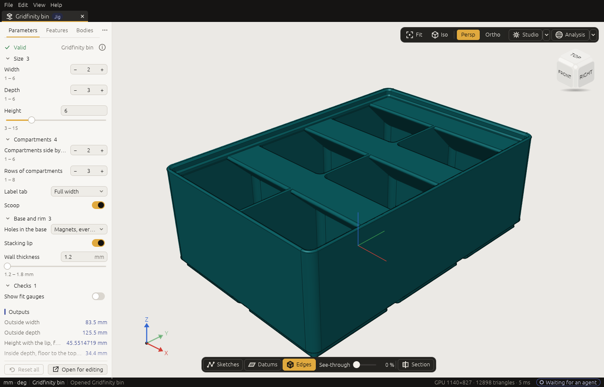

# Using a Jig

*Use a finished design by setting its sizes in a form, and export your part. No AI needed.*

A **Jig** is a finished design with a form. A laser-cut box sized for what goes in it; a Gridfinity bin by
its grid size and its compartments; a sundial for the place where it will stand. You set the sizes that
matter, and 3DCraft rebuilds the model from them, exactly and in the same way every time. Every Jig carries
its own checks, so a value that would break the design says so.

Its maker **published** the sizes that drive it as **parameters**, each with a label, a range and a step
([Making Jigs](making-jigs.md)). A Jig is shared as a **`.3dcraftjig`** file: the design, its parameters, a
title and description, and a small picture. It runs in the desktop app and in the web version.

## The Jigs on the start screen

Under **Jigs** on the start screen are six Jigs; a click on a card opens it on its **Parameters** tab.

| Jig | What it makes | Export it as |
|---|---|---|
| **Laser-cut box** | A finger-jointed plywood box sized from what goes in it, with compartments and a lid, every outline already moved out for your laser's kerf | **Sheet of set: Cut sheet**, DXF or SVG ([Files › Laser cutting](files.md#laser-cutting-flat-outlines-in-dxf-and-svg)) |
| **Gridfinity bin** | A storage bin for the Gridfinity system, with your compartments, label tabs and scoops, printed without supports | **All bodies**, 3MF (or STL, or STEP) |
| **Dovetail drawer** | A dovetailed drawer sized from the opening it must fill, its tails laid out by the old rules for the timber you choose | **Sheet of set: Marking templates**, SVG or DXF to print at 100 %; STEP of the boards |
| **Sheet-metal enclosure** | A two-part sheet-metal case around a board or a stack of them, its bend order proven for a press brake | **Flat patterns of every part**, DXF or SVG ([Sheet metal](sheet-metal.md)) |
| **Planetary gearbox** | A printable planetary reducer for a stepper motor, from the reduction and the size you ask for, with gears that mesh | One print plate at a time (*Show*: *Print plate 1* to *6*), **All bodies**, 3MF |
| **Sundial for your place** | A brass dial for your latitude and longitude, on a garden pedestal or a wall, that reads the clock time of your zone | **Sheet of set: Cut sheet** to cut, **Sheet of set: Engraving** to engrave, DXF or SVG |

Each Jig's description, at the top of its Parameters tab, says how to export it. More Jigs, and the
source of every one, are in the gallery, [3dcraft.dev/examples](https://3dcraft.dev/examples/). Anyone
can make a Jig and share it; it needs no programming ([Making Jigs](making-jigs.md)).

**Licences.** 3DCraft itself is under the MIT licence. The designs of the Jigs and assemblies shown on the
start screen are under CC BY 4.0: you may use, change and share them, with credit. The examples are under
MIT. A Jig's form names its own licence at its foot.

## Using a Jig

1. **Open it**: click its card on the start screen, or **File › Open…** and choose a `.3dcraftjig` file,
   or double-click the file (once 3DCraft is installed), or drop it on the web version's page.
2. It opens on its **Parameters** tab, beside **Features**:

   <!-- SHOT: jig-parameters.png | the same picture as first-steps.md: the Gridfinity bin on its Parameters tab | see first-steps.md -->
   

   At the top are the Jig's title and description, then the parameters in groups. Click a group's name to
   fold it.
3. **Set the parameters.** The model follows.
4. **Export** the result: **File › Export…** ([Files, export and drawings](files.md)), as the description
   says.
5. **Save** if you want to keep your settings. It saves the result as an ordinary `.3dcraft` model under a
   name you choose. The `.3dcraftjig` file itself is never changed.

### The form

Each parameter is shown by its kind:

- **A number** is a slider over its range: the value with its unit, the rail under it, and the range
  written under the rail.
  - Press the rail to put the knob there, or drag the knob. Hold **Shift** for ten times finer, **Ctrl**
    to go in whole steps.
  - Once you clicked it, the arrow keys and the wheel step it; with Shift, ten steps at a time.
  - To type a value, click the value (or press Enter with the pointer over the slider), type it with or
    without its unit (`60 mm`, `60`, even `width / 2`) and press Enter. Escape gives up.
  - A double-click on the knob puts it back to its default.
- **A whole number with only a few values** (a count from 1 to 6, say) is a stepper: **−** and **+**
  beside the value, with the range under it.
- **Yes or no** is a switch, such as *Scoop* on the Gridfinity bin.
- **A choice** is a list to pick from, such as *Lid* on the laser-cut box.

**The form keeps values in range.** Typing 500 into a width that goes up to 400 mm sets 400 mm, and says
*clamped to 400 mm* under the parameter for a few seconds (and *rounded to …* for a value between two
steps). When one parameter limits another (compartments that must stay at least 30 mm wide), changing the
first can clamp the second, and the form says that too.

**Back to the defaults.** A parameter that is not at its default has a **↺** next to it to put it back;
**Reset all** puts every parameter back.

**Undo.** **Edit › Undo** (Ctrl+Z) takes back the last value you set. A whole drag is one step to undo,
for you and for an agent (`edit.undo`).

**When a value breaks the model** (a fillet that no longer fits, a wall thicker than the box, a check that
fails), the parameter turns red with the reason. A banner over the model says *This value breaks the
model*, with a **Back to last good** button that sets the last values that built. A Jig's maker should have
chosen ranges where that cannot happen; if it does, tell them.

**Outputs.** Below the parameters, many Jigs show what they work out: an inside volume, a mass, the number
of parts to cut. You read them; you do not set them ([Measuring and assertions › Outputs](measure.md#outputs-measures-in-formulas)).

**Closing a Jig you changed** asks *Save the parameters as a model?*, with the lines *You changed the
parameters of "…".* and *The Jig itself is not changed. The values you set are lost if you close without
saving them.* The buttons are **Save as model…**, **Close** (forget the settings) and **Cancel**.

### Looking inside, and changing the design

The **Features** tab shows how the Jig is built, and the history player
([The window › The history player](window.md#the-history-player)) plays it step by step. In a Jig only
the parameters can change: the features are there to look at, and an agent that tries to edit them is
told so.

To change the design itself, click **Open for editing** on the Parameters tab (or **File › Open for
editing**). It makes a new, untitled model of the Jig, set as it is now, that you can change as you like,
by hand or with an agent.

### In the browser

Jigs work the same in the web version, with one difference: the model follows a parameter **when you let
go** of the slider, not while you drag, because the browser cannot rebuild while it draws. Export and save
as described in [Files › The web version](files.md#files-in-the-web-version).

### With an agent or a script

An agent sets a Jig's parameters with `param.list` (the form, as a list) and `param.set`. Unlike the form,
`param.set` **refuses** a value outside its range, and names the range, so the agent can correct itself:

```json
[
  ["param.list", {}],
  ["param.set", {"values": {"width": "220 mm", "height": "60 mm"}}],
  ["file.export", {"path": "box.svg", "set": "Cut sheet"}]
]
```

From a terminal, the same with `craft3d-cli run box.3dcraftjig --cmd param.set --params '…' --cmd
file.export --params '…'` ([The command line and scripts](command-line.md)).

**Next:** [Assemblies](assemblies.md).
