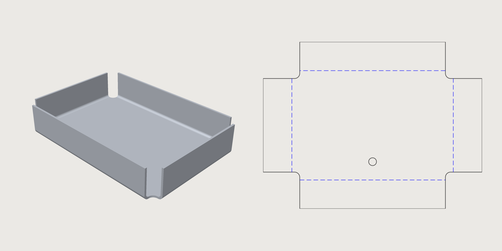
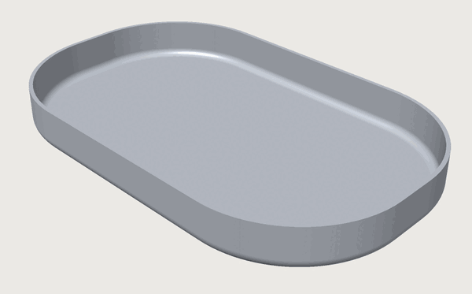

# Sheet metal

*A part bent from one sheet: its base and flanges, the flat pattern to cut, the bend table, and whether a
press brake can bend it.*

`feature.sheetMetal` makes a part bent from one sheet: a bracket, a tray, a case. You draw the **base**,
flat, and say which edges are bent up into **flanges**. 3DCraft builds the folded part, and the **flat
pattern** you cut from the sheet before bending, with every bend's allowance worked out.

The **Sheet-metal enclosure**, under **Jigs** on the start screen, is a real product made this way: a
chassis and a cover around a circuit board, each from one sheet, their flat patterns ready to cut and their
bend order proven for a press brake ([Using a Jig](jigs.md#the-jigs-on-the-start-screen)).

<!-- SHOT: sheet-metal.png | the tray of this chapter's first script beside its flat pattern: the folded tray in iso view, and the exported flat pattern with its bend lines dashed (bendUp) next to it; theme light; about 1280x640 | run the tray script (first JSON block of sheet-metal.md); view.render {"view": "iso"}; file.export {"path": "tray.svg", "sheetMetal": "Tray", "stroke": 0.3}; rasterise the SVG and put the two side by side -->


## A first part: a tray

The sketch's closed profile is the **base**; holes in it are allowed. Each **flange** is bent from a
straight edge of the base (`edge`, the line's entity id), by `angle`, `up` (towards the side the sketch's
normal points to) or `down`. A tray with four sides, its corners relieved:

```json
[
 ["variable.set", {"name": "t", "expr": "1.5 mm"}],
 ["sketch.create", {"plane": "xy", "name": "TrayBase"}],
 ["sketch.rect", {"sketch": "TrayBase", "from": [0, 0], "to": [120, 80]}],
 ["sketch.circle", {"sketch": "TrayBase", "center": [60, 12], "radius": 3}],
 ["feature.sheetMetal", {"sketch": "TrayBase", "name": "Tray", "thickness": "t", "radius": "2 mm",
   "kFactor": 0.42, "relief": {"shape": "round", "size": "4 mm"},
   "flanges": [{"edge": "e5", "length": "20 mm", "angle": "90 deg"},
               {"edge": "e6", "length": "20 mm", "angle": "90 deg"},
               {"edge": "e7", "length": "20 mm", "angle": "90 deg"},
               {"edge": "e8", "length": "20 mm", "angle": "90 deg"}]}],
 ["sheetMetal.bends", {"feature": "Tray"}],
 ["table.set", {"name": "steel", "columns": ["grade", {"name": "minRadius", "unit": "mm"}],
   "rows": [["DC01", 1.5], ["S355", 2.25]]}],
 ["assert.add", {"name": "Radius", "measure": "bendRadius", "of": "Tray", "min": "steel[\"DC01\"].minRadius"}],
 ["assert.add", {"name": "HoleClear", "measure": "holeToBend", "of": "Tray", "min": "2 * t"}],
 ["assert.add", {"name": "Relieved", "measure": "relief", "of": "Tray", "is": true}],
 ["file.export", {"path": "tray.dxf", "sheetMetal": "Tray"}]
]
```

- Every bend has an inner `radius` and a `kFactor`: the place across the thickness where the sheet keeps
  its length when it is bent (the neutral fibre), from 0 at the inside to 1 at the outside. The flat
  pattern grows by the **bend allowance**, angle × (radius + kFactor × thickness), per bend.
- A flange's `length` is its flat beyond the bend, or with `"from": "mould"` measured from the virtual
  sharp of the outside surfaces.
- `relief` cuts the base's corners where two flanged edges meet (`rect`, `round` or `tear`, reaching `size`
  along each edge), so the sheet does not tear there.
- A flange can also be bent from the far edge of an earlier flange (`tip`, its place in the list): a Z,
  a U on a U.

The script also checks the part against a shop's rules: the bend radius against the smallest a steel
grade takes (a table), the hole far enough from the bends, every corner relieved.
`file.export` with `sheetMetal` writes the flat pattern.

## The bend table and the flat pattern

`sheetMetal.bends` is the **bend table**. Per bend it gives the angle and the inner radius measured on the
part, the K-factor, the bend allowance (in closed form, and as `developed`: the bend's neutral band laid
flat), the outside setback and the bend deduction, and the flange's length. It also gives the flat
pattern's area and size.

The bends are folded by the same mechanism as `feature.fold` (a joint with a radius), and the folded sheet
is given its thickness as `feature.plate` does. So a bend's skins are the cylinders of the inner radius and
of the inner radius plus the thickness.

With a K-factor of ½ the part's volume is the flat area times the thickness. With another K-factor the part
differs from that by angle × width × thickness² × (½ − K) per bend, because its bends keep their skins at
the two radii.

**The flat pattern.** `file.export` with `sheetMetal` writes it as `.dxf` or `.svg`: the outline on the
layer `outline`, the bend lines on `bendUp` (dashed) and `bendDown` (dash-dot).

**Manufacturability measures**, for checks (assertions):

| Measure | Is |
|---|---|
| `bendRadius` | The smallest inner radius |
| `flangeLength` | The shortest flange (`"measured": "mould"` from the virtual sharp) |
| `holeToBend` | The least distance from a hole to a bend's tangent line |
| `relief` | Whether every corner where two bends meet, and every end of a bend inside its edge, is relieved |
| `cornerGap` | The least gap at the closed corners |
| `flatExtent` | The width (`axis` x) or height (`axis` y) of the flat pattern: the blank it needs |
| `flatArea` | The flat pattern's area |
| `bendStrain` | The strain of curved flanges (below) |
| `louvreStretch` | How far a formed louvre stretches the sheet (below) |
| `bendable` | Whether a press brake can bend it ([below](#checking-on-a-press-brake)) |

3DCraft has no material catalogue: the limits for a material and a thickness are yours, as expressions or
a table, as in the tray above.

The measures read a part as it was built, by its feature's name, also after a boolean took its body. With
no `of` they measure every part that is switched on; a part named while it is switched off is an error
that says so.

## Jogs

A **jog** (`jogs`) steps a flat. Draw a construction line across the base (or across a flange's flat,
where it lies beside its edge as if its bend had no width), and give the step's `offset`, the bends'
`angle` and which way the first turns (`direction`):

```json
[
 ["sketch.create", {"plane": "xy", "name": "StepBase"}],
 ["sketch.rect", {"sketch": "StepBase", "from": [0, 0], "to": [100, 40]}],
 ["sketch.line", {"sketch": "StepBase", "from": [50, -5], "to": [50, 45], "construction": true}],
 ["feature.sheetMetal", {"sketch": "StepBase", "name": "Step", "thickness": "1 mm", "radius": "1 mm",
   "kFactor": 0.4, "flanges": [{"edge": "e6", "length": "12 mm", "angle": "90 deg"}],
   "jogs": [{"line": "e11", "offset": "8 mm", "angle": "60 deg"}]}],
 ["sheetMetal.bends", {"feature": "Step"}]
]
```

The flat is cut along the line. The side on the line's left (on a flange, the side its own bend is on)
stays; the other side becomes a flat of its own, lifted `offset` by two opposite bends with a web between
them. It keeps its holes, its flanges and its edges' names. The press-brake check takes a jog as made by
an offset die (`formed`).

## Formed louvres

A **formed louvre** (`formedLouvres`) is a vent pressed by a tool. Draw its lance as a construction line
where it lies in the flat pattern, and give the hood's `width` (how far back from the line it reaches, on
the line's left), `height` (the opening's), `ends` (`closed`, rounded, the default, or `open`) and
`direction`:

```json
[
 ["sketch.create", {"plane": "xy", "name": "VentBase"}],
 ["sketch.rect", {"sketch": "VentBase", "from": [0, 0], "to": [100, 60]}],
 ["sketch.line", {"sketch": "VentBase", "from": [30, 20], "to": [70, 20], "construction": true}],
 ["feature.sheetMetal", {"sketch": "VentBase", "name": "Vented", "thickness": "1 mm", "radius": "1 mm",
   "kFactor": 0.4, "formedLouvres": [{"line": "e11", "width": "8 mm", "height": "3 mm"}]}],
 ["assert.add", {"name": "Louvre stretch", "measure": "louvreStretch", "of": "Vented", "max": "0.25"}]
]
```

The hood is not in the flat pattern: the pattern shows the lance as a cut, and where the tool lands on the
layer `form`. The part has the hood. `louvreStretch` measures how far the tool stretches the sheet (the
hood's length across over its width, less 1), for your material's limit.

## Curved flanges

A **curved flange** (`curvedFlanges`) is bent along an arc or a circle of the base (its `edge`): the rim
of a round pan, a collar round a round hole, the rounded corners of a tray.

```json
[
 ["sketch.create", {"plane": "xy", "name": "PanBase"}],
 ["sketch.line", {"sketch": "PanBase", "from": [25, 0], "to": [75, 0]}],
 ["sketch.line", {"sketch": "PanBase", "from": [100, 25], "to": [100, 35]}],
 ["sketch.line", {"sketch": "PanBase", "from": [75, 60], "to": [25, 60]}],
 ["sketch.line", {"sketch": "PanBase", "from": [0, 35], "to": [0, 25]}],
 ["sketch.arc", {"sketch": "PanBase", "center": [75, 25], "start": [75, 0], "end": [100, 25]}],
 ["sketch.arc", {"sketch": "PanBase", "center": [75, 35], "start": [100, 35], "end": [75, 60]}],
 ["sketch.arc", {"sketch": "PanBase", "center": [25, 35], "start": [25, 60], "end": [0, 35]}],
 ["sketch.arc", {"sketch": "PanBase", "center": [25, 25], "start": [0, 25], "end": [25, 0]}],
 ["feature.sheetMetal", {"sketch": "PanBase", "name": "Pan", "thickness": "1 mm", "radius": "2 mm",
   "kFactor": 0.4, "maxStrain": 0.3,
   "flanges": [{"edge": "e3", "length": "8 mm", "angle": "90 deg"},
               {"edge": "e6", "length": "8 mm", "angle": "90 deg"},
               {"edge": "e9", "length": "8 mm", "angle": "90 deg"},
               {"edge": "e12", "length": "8 mm", "angle": "90 deg"}],
   "curvedFlanges": [{"edge": "e16", "length": "8 mm", "angle": "90 deg"},
                     {"edge": "e20", "length": "8 mm", "angle": "90 deg"},
                     {"edge": "e24", "length": "8 mm", "angle": "90 deg"},
                     {"edge": "e28", "length": "8 mm", "angle": "90 deg"}]}],
 ["sheetMetal.bends", {"feature": "Pan"}],
 ["assert.add", {"name": "Corner strain", "measure": "bendStrain", "of": "Pan", "max": "0.3"}]
]
```



In the part a curved flange is exact: every section across the edge is a straight bend's, so the bend is a
piece of a torus and the flat a piece of a cone.

A torus cannot be laid flat without stretching, so the flat pattern is **approximated**. Along every line
across the edge it is laid out as a straight bend is, and the sheet is compressed along the edge (a flange
growing away from the arc's centre) or stretched (towards it). How much is proven, not estimated:

- the bend table gives each curved flange's `strain`;
- the export says the pattern is approximated, and by how much;
- `bendStrain` measures it for your material's limit;
- `maxStrain` on the part refuses a flange that would need more.

The tray's corners, a wall 8 mm high (10 mm to the rim) on a radius of 25 mm, compress the top of the wall
by up to 27 per cent along the corner: a drawn corner, not one a press brake can fold. A larger corner
radius or a lower wall lowers it. A drawn part's blank is in practice sized by equal area and corrected by
trial; the flat pattern here keeps the lengths across the bend and states the strain along it.

Where a curved flange meets a straight one tangent to it with the same angle, radius, K-factor and length,
they are one wall: a tray with rounded corners has no seam at its corners, and its flat pattern is one
outline.

## Holes and cut-outs

The base's sketch is drawn in the plane of the flat pattern. So its other closed profiles, beside the
base, are holes and cut-outs of the flange whose flat each lies in; a flange's flat starts the bend
allowance beyond its edge. `cutouts` adds the closed profiles of other sketches in the same plane (any
origin and axes) the same way, and each sketch switches with its own `when`, so a vent or a cable hole can
be an option: the sheet-metal enclosure's connector holes and vent slots are such sketches, switched by its
form. A panel with a hole in its flange and an optional vent:

```json
[
 ["variable.set", {"name": "vent", "expr": "1"}],
 ["sketch.create", {"plane": "xy", "name": "PanelBase"}],
 ["sketch.rect", {"sketch": "PanelBase", "from": [0, 0], "to": [100, 60]}],
 ["sketch.circle", {"sketch": "PanelBase", "center": [109, 30], "radius": 3}],
 ["sketch.create", {"plane": "xy", "name": "Vent"}],
 ["sketch.circle", {"sketch": "Vent", "center": [50, 30], "radius": 8}],
 ["feature.when", {"feature": "Vent", "expr": "vent"}],
 ["feature.sheetMetal", {"sketch": "PanelBase", "name": "Panel", "thickness": "1.5 mm", "radius": "2 mm",
   "kFactor": 0.42, "cutouts": ["Vent"],
   "flanges": [{"edge": "e6", "length": "20 mm", "angle": "90 deg"}]}],
 ["assert.add", {"name": "HoleClear", "measure": "holeToBend", "of": "Panel", "min": "1.5 mm"}],
 ["file.export", {"path": "panel.svg", "sheetMetal": "Panel"}]
]
```

- The holes are cut in the flat pattern and in the folded part, and `holeToBend` measures each from the
  bends beside its own flat.
- A hole drawn across a bend's strip (a slot through the bend) is cut through the bend where the bend
  allowance puts it, also beside a bend trimmed by a closed corner. A hole drawn across a jog's line is cut
  across the jog's bends.
- Refused: a hole that only touches a bend's tangent line, crosses it with a spline, or runs past the
  pattern's edge; and the part, when a `cutouts` sketch fails (fix the sketch, or switch it off).
- A hole cut later by another feature (a boolean) is carried back onto the exported flat pattern when it
  goes through the sheet square to it (`laterCuts` in the export's result). One cut at a slant fails the
  export with the reason. A pocket, a part joined on or a notch at the edge is listed in `notCarried`; the
  bend table and the export name the feature that took the part as `changedBy`.

A flange can also be bent out of a cut-out: `cutout` names the sketch and a straight edge of a cut-out in
it (`{"cutout": {"sketch": "Vents", "edge": "e7"}, ...}`). The flange grows into the hole, and the cut-out
may lie in a wall, so a louvre or a tab is bent from a slot in a flange.

## Closed corners

Where two flanges meet at a corner of the base, the corner is open: each flange ends where its bend ends.
`corner` closes it. The flanges' flats run on sideways past their bends up to the other flange, `gap`
apart; the bends stay apart, and the relief, if you give one, is the small hole where they would cross.

| `kind` | The corner |
|---|---|
| `overlap` | One flange covers the corner, its end flush with the other's outside face; the other stops `gap` short of its inside face |
| `butt` | The same, with the covering flange also stopping `gap` short of flush |
| `miter` | Both run to the plane that halves the angle between the walls, `gap` apart there, their ends bevelled (`mitre`, as plates spell it, is accepted too) |

At each corner, the flange on the edge that arrives at it (going round the base counter-clockwise) covers
it. `corners` treats one corner its own way, named by its two flanges, with `over` for the flange that
covers it. A tray with closed corners, one of them covered the other way round:

```json
[
 ["variable.set", {"name": "seam", "expr": "3"}],
 ["sketch.create", {"plane": "xy", "name": "BoxBase"}],
 ["sketch.rect", {"sketch": "BoxBase", "from": [0, 0], "to": [120, 80]}],
 ["feature.sheetMetal", {"sketch": "BoxBase", "name": "Box", "thickness": "1.5 mm", "radius": "2 mm",
   "kFactor": 0.42, "relief": {"shape": "round", "size": "4 mm"},
   "corner": {"kind": "seam", "gap": "0.3 mm"},
   "corners": [{"flanges": [0, 1], "kind": "overlap", "over": 1}],
   "flanges": [{"edge": "e5", "length": "20 mm", "angle": "90 deg"},
               {"edge": "e6", "length": "20 mm", "angle": "90 deg"},
               {"edge": "e7", "length": "20 mm", "angle": "90 deg"},
               {"edge": "e8", "length": "20 mm", "angle": "90 deg"}]}],
 ["assert.add", {"name": "Seams", "measure": "cornerGap", "of": "Box", "eq": "0.3 mm"}],
 ["file.export", {"path": "box.dxf", "sheetMetal": "Box"}]
]
```

Here the corners' kind is the variable `seam`, 3: an expression that picks by number, as a Jig's choice
parameter counts (`corner`: 1 open, 2 butt, 3 overlap, 4 miter; the relief's `shape`: 1 rect, 2 round,
3 tear). So a form can offer the choice.

- Bend angles and corner angles other than 90 degrees close the same way; the ends are then slanted in
  the flat pattern. Where the end comes nearer than the bend's end (walls that lean towards each other, a
  wide corner without a relief), the flange is cut back to it, its tip shortened, and where the end
  crosses the bend, the bend is trimmed by it too.
- Opening or closing a corner keeps every face's name: a side's end is named as the side was.
- The measure `cornerGap` is the least gap at the closed corners, measured on the part.
- Refused, with the reason: a gap that is not more than the tolerance (a butt's must also be less than the
  thickness), two flanges bent opposite ways, a corner whose end would cut one skin of a bend and not the
  other (give it a relief), and extensions that overlap in the flat pattern or run into each other when
  bent.

## Inset flanges, tabs and outlines

A flange need not span its whole edge, nor be a rectangle. A cover with an inset wall, a tab on its side,
an ear of its own outline with a hole, and a tab bent down out of a cut-out:

```json
[
 ["sketch.create", {"plane": "xy", "name": "CoverBase"}],
 ["sketch.rect", {"sketch": "CoverBase", "from": [0, 0], "to": [100, 60]}],
 ["sketch.rect", {"sketch": "CoverBase", "from": [40, 15], "to": [60, 40]}],
 ["sketch.create", {"plane": "xy", "name": "Ear"}],
 ["sketch.rect", {"sketch": "Ear", "from": [40, 60], "to": [60, 75]}],
 ["sketch.circle", {"sketch": "Ear", "center": [50, 68], "radius": 3}],
 ["feature.sheetMetal", {"sketch": "CoverBase", "name": "Cover", "thickness": "1 mm", "radius": "1 mm",
   "kFactor": 0.42,
   "flanges": [{"edge": "e5", "length": "15 mm", "angle": "90 deg", "insetStart": "10 mm", "insetEnd": "10 mm"},
               {"side": {"flange": 0, "end": "end"}, "length": "10 mm", "angle": "90 deg"},
               {"edge": "e7", "outline": "Ear", "angle": "90 deg"},
               {"edge": "e13", "length": "12 mm", "angle": "90 deg", "direction": "down",
                "insetStart": "3 mm", "insetEnd": "3 mm"}]}],
 ["file.export", {"path": "cover.svg", "sheetMetal": "Cover"}]
]
```

- **Insets.** `insetStart` and `insetEnd` stand a flange's bend back from the edge's start and end (the
  edge's direction is the base's, counter-clockwise round the outline), so one edge can carry several
  tabs, kept apart.
- **On a side.** A flange can sit on a `side` of an earlier flange (`{"flange": 0, "end": "start"}` or
  `"end"`, the side at its bend's start or end): a tab that wraps round a corner.
- **In a hole.** A flange on a straight edge of a hole of the base grows into the hole: a tab bent out of
  a cut-out, a louvre. Give it insets, or its bend's ends lie along the hole's sides.
- **An outline.** With `outline`, a flange's flat is the closed profile of a sketch of its own (holes
  allowed) instead of a rectangle `length` long. Draw it in the base sketch's plane as if the bend had no
  width (on a flange's tip or side, as if every bend from the base to it had none, so it follows a change
  of thickness or radius): one line of it on the edge's line, the rest beyond. The bend spans that line,
  and the flat is laid out the bend allowance further on; give no `length`. Such a flange has no tip or
  sides: a later flange sits on one of its outline's lines instead, `"line": {"flange": 0, "edge": "e14"}`
  (the line's id in the outline's sketch, not the line on the edge, which is the bend): a lip on a rail's
  leg.

The flat pattern is checked as a whole, so tabs whose flats would overlap in it are refused, naming them. A
flange added later changes no name the part had but the end along the edge it is bent from.

**Bend reliefs.** Where a bend ends inside its edge (an inset flange, a tab), `bendRelief`
(`{"shape": "rect", "size": "1.5 mm"}`, the shapes of `relief`) cuts a notch beside the bend's end, so the
sheet does not tear there: `size` along the edge, and `size` deep into the flat it is bent from (a tear,
the disc tangent to the edge and the bend's end, reaches twice `size` both ways). The bend table lists each
bend's `ends` inside its edge with their relief, and its `length`. A notch that would cut across another
edge of its flat (a tear on a short wall with a large bend radius) is refused, naming the flange: make it
smaller, or use round or rect.

**Insets and corners.** Corner reliefs and closed corners are for flanges that reach a corner of the base.
A corner with an inset flange is not one; a flange with an outline reaches it when its outline's line on
the edge ends there (with a relief, the relief's size short of it).

- A flange on a wall's tip that spans the tip, where a closed corner runs the wall on past it, gets its
  notch in that extension.
- A wall whose tip carries tabs (screw tabs) closes its corners like any other. A side that carries a
  flange moves to the corner's end with its flange when that end lies along it (walls square to the base
  and to each other: a tab round the corner over the other wall), and is refused where the end slants
  across the wall.
- An outlined flange closes its corner too: its side there is replaced by the corner's end, and its
  outline's next line runs on to it.

A tray closed by overlap whose front wall carries two screw tabs with bend reliefs:

```json
[
 ["sketch.create", {"plane": "xy", "name": "TrayBase"}],
 ["sketch.rect", {"sketch": "TrayBase", "from": [0, 0], "to": [60, 40]}],
 ["feature.sheetMetal", {"sketch": "TrayBase", "name": "Tray", "thickness": "1 mm", "radius": "1 mm",
   "kFactor": 0.42, "relief": {"shape": "round", "size": "3 mm"},
   "corner": {"kind": "overlap", "gap": "0.25 mm"}, "bendRelief": {"shape": "rect", "size": "1.5 mm"},
   "flanges": [{"edge": "e5", "length": "10 mm", "angle": "90 deg"},
               {"edge": "e6", "length": "10 mm", "angle": "90 deg"},
               {"edge": "e7", "length": "10 mm", "angle": "90 deg"},
               {"edge": "e8", "length": "10 mm", "angle": "90 deg"},
               {"tip": 0, "length": "6 mm", "angle": "90 deg", "insetStart": "8 mm", "insetEnd": "36 mm"},
               {"tip": 0, "length": "6 mm", "angle": "90 deg", "insetStart": "36 mm", "insetEnd": "8 mm"}]}],
 ["assert.add", {"name": "Relieved", "measure": "relief", "of": "Tray", "is": true}],
 ["sheetMetal.bends", {"feature": "Tray"}]
]
```

## Sharp bends

A `radius` of 0 is a **sharp bend**: a sharp inside corner (the inner skin is the line on the bend's
axis), and an outside rounded to the thickness. Its bend allowance is angle × kFactor × thickness, so the
flat pattern and the volume follow the same rules as any bend. Its faces are those of a bend with a radius,
less its inner skin, so a radius set to 0 and back keeps every other name.

A sharp bend is refused:

- at or near 180 degrees (a closed hem), and at a kFactor of 0;
- where another wall would touch its inner skin: two sharp flanges meeting at an open corner without a
  relief, a wall leaning in beside a sharp square wall, a flange on a side of a sharp wall;
- where a closed corner would trim it;
- where a hole crosses it other than straight across (a slot or notch whose sides run square across the
  bend line is cut through it);
- where a formed louvre's hood comes within about the thickness of its inside (the hood is checked by a
  box round it, which errs on the safe side).

A cut made later through a sharp bend is not carried onto the exported flat pattern; the export lists it
under `notCarried`.

## Changing a part

`sheetMetal.edit` changes a part; its flanges are given as a whole list.

Each flange has an `id`: `sheetMetal.bends` lists them, 1, 2, … in the order the part was made, and a new
flange never gets one used before. Every name of the flange's faces and edges is numbered by it (its bend
`face(2 · id − 1)`, its flat `face(2 · id)`, its rims and edges), not by its place in the list. So a fillet,
a colour or a set on it stays with it, whatever else you add, delete or move.

- Give the id back with the flange in `sheetMetal.edit`. A flange sent back unchanged keeps its id without
  it; one changed without it is a new flange, and its old names then name nothing (an error where used).
- `tip`, `side` and `corners` name flanges by their places in the list you send. Corners you do not send
  again are kept, and follow their flanges by id to their new places; one whose flange you deleted is
  refused, naming it.

## What is refused

Refused, with the flange: a radius below zero, a K-factor outside 0 to 1, an angle outside 0 to 180
degrees, an edge that is not a straight line of the base's outline, flanged edges meeting at an inside
corner, a relief that does not fit, and flanges that run into each other or into the base when bent. A
flange on a curved edge is a curved flange (above), not a bend.

## Checking on a press brake

`sheetMetal.bendSequence` checks whether the part can be bent on a press brake with your punch and die, and
finds an order of the bends.

**The tools.** Each is an outline in the plane square to the bend: the punch's tip centre and the die's top
at the origin, `y` up into the punch. A `{"through": [x, y]}` between two points makes that side the arc
through the point, so a punch's round tip of radius `r` is `[[-r, 50], [-r, 0], {"through": [0, -r]},
[r, 0], [r, 50]]`, exactly.

**What is proven.** Every step is proven to keep the punch at least `clearance` from every piece of the part
but the bend and its two flats, and the die from every piece but the bend, over the whole stroke. The sheet
may rest on the die's top, not go into it. The part may lie as it is or turned end for end (`turned` in
the step, for a gooseneck whose throat faces the other way).

**What it answers.** A step that does not clear is listed by bend, by the bends made before it, by tool and
by piece. `unchecked` says what is not looked at. `certain` per step and `infeasibleProven` say whether no
order is proven or only not found.

**As a check.** The measure `bendable` keeps that check with the part. With `is` true it holds when an order
is found for every part named, fails when none exists (every step tried collides for certain), and is
*notProven* otherwise, never passed: a step that is neither proven clear nor colliding, or a search that
used up its `maxWork` (distances measured, 20000 at most, shared by the parts). The tools' points may be
formulas, so a Jig keeps its tools in a table and picks one with a choice. On the closed box above:

```json
[
 ["table.set", {"name": "punches", "columns": ["tool", {"name": "half", "unit": "mm"}, {"name": "h", "unit": "mm"}],
                "rows": [["straight", 5, 100], ["wide", 30, 100]]}],
 ["variable.set", {"name": "tool", "expr": "1"}],
 ["assert.add", {"name": "Bendable", "measure": "bendable", "of": "Box",
   "punch": [["-punches[tool].half", 0], ["punches[tool].half", 0], ["punches[tool].half", "punches[tool].h"], ["-punches[tool].half", "punches[tool].h"]],
   "die": [[-15, -20], [15, -20], [15, 0], [-15, 0]], "length": "60 mm", "maxWork": 10000, "is": true}]
]
```

Each check of it searches the orders again, only when the part, the tools or the bounds change. On the
closed box above, with the straight punch, it measures 690 distances and finds the order 0, 2, 3, 1. A
search that finds no order has to try more orders, up to its `maxWork`.

**More options**, for the command and the measure:

- **Bends in one stroke.** Bends on one line of one flat with the same angle, direction and radius (two
  tabs on one edge) are made in one stroke; the tools are then a segment per bend.
- **Tool length.** By default the tools are one piece reaching past the whole part. `segmented: true`
  makes each bend's tools as long as the bend (segmented tooling set up per bend), and `length` gives one
  length for all, or a list of one per flange (`null` for the bend's own, segmented).
- **Your own order.** `order` checks the order you give (each step a flange, or a list of flanges bent in
  one stroke; with one-piece tools the flanges of one line always together) instead of searching for one.
- **Formed first.** `formed` lists flanges made before the press brake by a tool of their own (a louvre on
  a punch press, a jog by an offset die): they are made from the start and not checked themselves.
- **Hems.** `hem` presses flanges bent 180 degrees flat in two strokes: an air bend to `preBend` degrees
  with the punch and die, then a flatten stroke between a flat die under the part and a `pad` (an outline
  as the punch's, its body above its `y = 0`) that stands on the hem:
  `"hem": {"flanges": [3], "preBend": 150, "pad": [[-20, 0], [20, 0], [20, 30], [-20, 30]]}`. The steps
  list both (`stage` `pre-bend` and `flatten`).
- **Holes across a bend.** A strip not yet bent that a hole may cross (by the boxes of the hole and the
  strip) stands as its whole slab. So a clearance to it is proven, while a collision with it is never
  counted as certain (the tool may pass through the hole): such a part is then *notProven*, never `false`.
- **How much work.** The search's cap is 1 000 000 distances, some 5 to 8 minutes at most: a box of 7
  bends takes some 80 000 with one-piece tools and 700 000 segmented, at 2000 to 3500 a second. A search
  that runs out says about how much the whole search would take, so give that as `maxWork`, up to
  10 000 000. The measure `bendable` keeps its cap of 20000; with an `order` it may measure up to a million
  (some minutes).

## Several parts on one sheet

`file.export` with a list in `sheetMetal` puts several parts' flat patterns side by side on one sheet
(`gap`, `width`, as a sheet of a set's faces). In the window, **File › Export…** to DXF or SVG offers
**Flat pattern of …** each part, **Crease pattern of …** each fold, and with two parts or more **Flat
patterns of every part** on one sheet. With a part's body selected, the export is its flat pattern
([Files, export and drawings](files.md)).

**Next:** [Surfaces and developables](surfaces.md).
