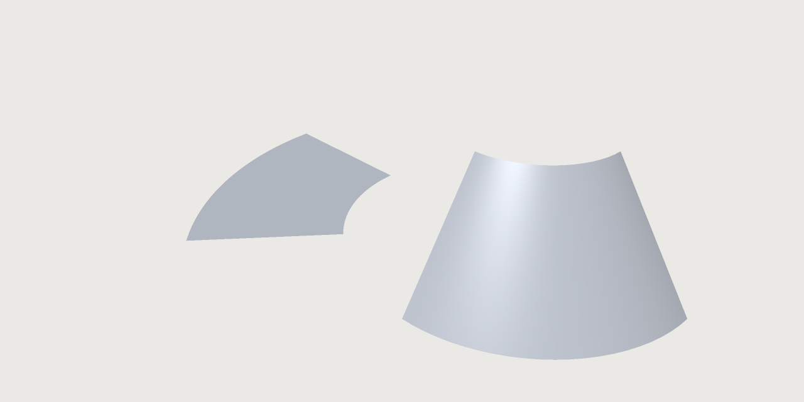

# Surfaces and developables

*Sheets that bend without stretching and the flat patterns to cut them from; smooth surfaces through
curves you draw, held to their neighbours in tangent or in curvature; and plates made of sheets.*

A **sheet** is a surface with no volume ([Modelling features › Sheets](features.md#sheets)). This chapter
makes sheets of two kinds: **developable** ones, which a flat sheet of plywood, metal or paper bends onto,
and **freeform** ones, laid through curves for flowing shapes. Sewn together, sheets make a solid; given a
thickness, they make plates.

The **Ship propeller** example under **Parts** on the start screen shows freeform surfaces in a real product: its blades
are lofted through sections computed from a published propeller series
([Modelling features › From sketches](features.md#from-sketches)).

## Developable surfaces and unfolding

A **developable** surface is one a flat sheet bends onto without stretching: the plywood panels of a boat,
sheet metal, paper, a lampshade. Two arcs, one above the other, and the piece of cone between them laid
flat:

```json
[
 ["sketch.create", {"name": "Low"}],
 ["sketch.arc", {"sketch": "Low", "center": [0, 0], "start": [20, 0], "end": [0, 20]}],
 ["sketch.create", {"name": "High", "offset": "15 mm"}],
 ["sketch.arc", {"sketch": "High", "center": [0, 0], "start": [10, 0], "end": [0, 10]}],
 ["feature.developable", {"a": "Low", "b": "High", "name": "Panel"}],
 ["feature.unfold", {"faces": ["F3:face(0)"], "at": [0, "-40 mm", 0], "name": "Pattern"}],
 ["unfold.map", {"unfold": "Pattern", "points": [[10.6, 10.6, 7.5]], "to": "flat"}]
]
```

<!-- SHOT: developable.png | the developable panel of this script (a piece of a cone between the two arcs) and its unfolded pattern beside it, a piece of a flat ring; theme light; about 1280x640 | run the first script of surfaces.md; view.render {"view": "iso"}; or rasterise file.export {"path": "pattern.svg", "faces": ["Pattern:face(0)"]} beside it -->


The two arcs make a piece of a cone; unfolded, it is a piece of a flat ring.

- `feature.developable` makes the developable sheet between two curves, `a` and `b`. Each is a sketch
  whose curves make one open chain (or one closed loop), or `{"edges": [...]}`, edges of earlier bodies
  in order (the chines of a hull, for instance).
- Straight lines (*rulings*) join the two curves where both curves' tangents and the line lie in one
  plane: that is what makes the sheet developable. Where the ruling from an end does not reach the other
  curve's end, a fan (a cone from that end) fills the corner. Where a curve has a corner, a fan from the
  corner turns it, so the sheet stays smooth; where both curves have a corner on one ruling, the sheet is
  creased along it.
- Two closed curves give a tube, cut open along one ruling when it is unfolded.
- The sheet's edges are the curves themselves, so two panels on one curve meet edge to edge.

`feature.unfold` lays faces flat as one piece, the pattern to cut, with every length, angle and area kept.
Its result says how far the pattern is from the part (`lengthChange`, `areaChange`, `mapError`).
`unfold.map` takes points from the part to the pattern (`"to": "flat"`) or back (`"to": "part"`): a hole
drawn on the pattern is found on the panel, and the other way round.

- The feature's result says under `developable` how many rulings were found (`rulings`), whether `b` was
  run the other way (`reversedB`), how far the faces were found from the true developable (`deviation`,
  within half the document's tolerance), the largest curvature found (`curvature`) and `unresolved`: how
  far the stored faces' tangent planes at the rulings where faces meet were found from the planes they were
  built with, times the ruling's length. That is what the rounding of the numbers leaves unresolved, an
  estimate and not part of the deviation: a small part of the tolerance near the origin, up to some tens
  of tolerances for narrow faces billions of tolerances away from it (a 5 m boat at a tolerance of a
  millionth of a millimetre). Positions are not affected; model nearer the origin to bring it down.
- `measure.developability` tells how far faces are from developable: the largest Gaussian curvature found
  on each face (in 1/mm²; a sphere of radius r has 1/r² everywhere, planes, cylinders and cones 0) and
  whether the stretch a flat sheet would need over the face is within the document's tolerance. As
  assertions: `"measure": "curvature"` with `max`, and `"measure": "developable"` with `is`.
- A face that is not developable (a sphere, a torus, a double-curved loft) is not unfolded: the reason
  gives its curvature and where. Two faces whose shared edge bends differently on its two sides (two hull
  panels at a chine, a fold) do not lie flat as one piece: unfold each on its own.
- **How its faces are named.** The faces of a developable are named by where they are, not by how many
  come before them, so a fan that appears at one end leaves the names at the other as they were:

  | Face | Name |
  |---|---|
  | The first run of rulings | `face(0)` |
  | The fans at the start and at the end | `face(1)`, `face(2)` |
  | The `n`-th fan (from 0) where the rulings turn back, in the first half, counted from the start | `face(10000000000 + n)` |
  | The same in the second half, counted from the end | `face(20000000000 + n)` |
  | A fan from a corner of `a` (of `b`), `c` the id of the sketch curve after the corner, or the place of the edge after it in the list, from 0 | `face(30000000000,c)` (`face(40000000000,c)`) |
  | A run of rulings after such a fan, `m` that fan's first number (after a corner where the faces part: `face(130000000000,c)`) | `face(100000000000 + m)` |
  | A run after a fan counted from the end, named by the next one | `face(200000000000 + m)` |
  | The run that reaches the end | `face(300000000000)` |

  The count has a limit: one more fold nearer the same end (or a fold that moves across the middle)
  renumbers the folds counted from that end, and a reference to `face(20000000000)` then names the new
  fold's fan, without an error. Check the faces a later feature takes after an edit that may add a fold
  near an end. A fold at the very middle (as symmetric curves give) counts from the start, also when
  rounding puts it a hair past the middle.
- A developable is refused, with where, when its rulings would cross (a curve that winds about the
  other), when the curves lie in one plane over a stretch only, when they meet between their ends, when a
  curve turns back on itself, and when one curve is closed and the other is not. Two closed curves that
  are the same are refused, and so are two closed curves in one plane that touch, cross or lie side by
  side. The fans at the ends and at the corners unfold, and so does each fan where the rulings turned
  back; the strip of rulings beside such a fan does not yet, laid flat with the rest or on its own (where
  the rulings turned it has a corner the layout does not handle yet), so unfolding the faces one by one
  leaves that strip out. Cut the curves short of the fold to unfold the rest in one piece.

## Surfaces from curve networks

For flowing shapes (a mouse, a kettle, a handle) draw the curves the surface must pass through and let
3DCraft lay a smooth sheet through them. `feature.surface.network` takes **u curves**, which follow each
other across **v curves** (2 to 64 of each): every u curve must cross every v curve, and the first and
last curve of each family are the sheet's edges, so the others end on them. A curve is a sketch whose
curves make one open chain, or `{"edges": [...]}`. With two curves each way it is a Coons patch, which
`feature.surface.coons` makes from four curves round the patch:

```json
[
 ["sketch.create", {"name": "Low"}],
 ["sketch.arc", {"sketch": "Low", "center": [0, 0], "start": [20, 0], "end": [0, 20]}],
 ["sketch.create", {"name": "High", "offset": "30 mm"}],
 ["sketch.arc", {"sketch": "High", "center": [0, 0], "start": [20, 0], "end": [0, 20]}],
 ["sketch.create", {"name": "Left", "plane": "zx"}],
 ["sketch.line", {"sketch": "Left", "from": [0, 20], "to": [30, 20]}],
 ["sketch.create", {"name": "Right", "plane": "yz"}],
 ["sketch.line", {"sketch": "Right", "from": [20, 0], "to": [20, 30]}],
 ["feature.surface.coons", {"curves": ["Low", "Right", "High", "Left"], "name": "Wall"}],
 ["feature.plate", {"faces": ["F5:side(e1,e2,e3,e4)"], "thickness": "2 mm", "side": "out", "name": "Tube"}]
]
```

Two arcs and two lines give exactly a quarter of a cylinder, and the plate makes it a quarter tube. The
sheet passes through every curve; the result says under `network` how far at most the sheet passes from
any of them (`mismatch`, a proven bound, never more than the tolerance). The curves may be drawn either way
round.

An edge can be held: `"edges": {"uFirst": {"kind": "tangent", "face": "F7:face(0)", "weight": 1}}`
makes the sheet meet that face with one tangent plane all along the edge (G1, no crease; `tangency` in the
result is the largest angle found between the two), the curves crossing the edge bent to leave it along
the face, their speed there times `weight` (larger is fuller). `"kind": "position"` only checks that the
edge lies on the face. The face may be a plane, cylinder, cone or sphere, or a spline face along any
curve on it, such as the edge of another network sheet or of a trimmed face: two sheets then join smoothly.
`feature.loft` with `guides` lays a sheet through open sections along guide curves the same way (its
sections take no `start`).

Refused, with the curves named: curves that do not cross (and how close they come), curves crossing out of
order, a curve running past an edge, a curve leaving a tangent edge square to its face or along it, curves
leaving it to opposite sides (the sheet would fold over the edge), two held edges whose corner asks two
tangent planes or two twists, and a network too large for one sheet (more than 2^20 control points: many
curves, each crossed at its own parameters, each bring their own knots). The face is named
after its four edge curves (`F5:side(e1,e2,e3,e4)`: the ids of their sketches), so editing a curve or
adding one inside the network keeps its name.

### Curvature-continuous seams (G2)

A tangent seam (G1) has no crease, but the curvature still jumps across it: reflections bend there. For
class-A work hold the edge in **curvature** instead: `"kind": "curvature"` makes the sheet meet the face
with one tangent plane *and* the same normal curvature across the edge (G2), so reflections run on
smoothly. The curves crossing the edge are bent to take the face's curvature in their direction, and the
sheet's second derivative across the edge is put exactly where the face asks it, all along:

```json
[
 ["feature.cylinder", {"radius": "20 mm", "height": "30 mm", "name": "Post"}],
 ["sketch.create", {"name": "Seam", "plane": "zx"}],
 ["sketch.line", {"sketch": "Seam", "from": [0, 20], "to": [30, 20]}],
 ["sketch.create", {"name": "Far", "plane": "yz", "offset": "35 mm"}],
 ["sketch.line", {"sketch": "Far", "from": [25, 0], "to": [25, 30]}],
 ["sketch.create", {"name": "Bottom"}],
 ["sketch.spline", {"sketch": "Bottom", "through": [[20, 0], [23, 6.5], [27, 13], [35, 25]]}],
 ["sketch.create", {"name": "Top", "offset": "30 mm"}],
 ["sketch.spline", {"sketch": "Top", "through": [[20, 0], [23, 6.5], [27, 13], [35, 25]]}],
 ["feature.surface.network", {"u": ["Seam", "Far"], "v": ["Bottom", "Top"], "edges": {"uFirst": {"kind": "curvature", "face": "F1:face(0)"}}, "name": "Fin"}],
 ["measure.continuity", {"edge": "F6:startEdge(e0,e2)", "face": "F1:face(0)"}]
]
```

The result says under `network` › `continuity` how the seam was proven to meet the face, and
`measure.continuity` measures any such seam (below). The face may be a plane, cylinder, cone or sphere, or a
spline face along any curve on it: another network sheet's edge, or a trimmed face's edge (a flank cut from a
larger spline surface by `feature.surface.trim`), where the face is written across the curve exactly. Along a
spline face the curves crossing the edge take their crossing parameters from the face's line, so that both
sides of the seam share one parametrisation; where both edges of a family are held in curvature to spline
faces, the crossing curves must cross both lines at the same parameters. The sheet is refused unless the
measure proves G2, with the gaps it found; a torus is refused as for tangency.

**A smoother face to hold to.** A network interpolates each family across the other with cubics by
default, so where a sheet is held in curvature to a network sheet made of cubic curves, the face's curvature
across the seam has a kink at each of its knots, and the held sheet has to take that kink somewhere: it puts
it on a narrow band beside the seam (a crease there, within the tolerances). Give the face's network
`"acrossDegree": 5` and draw its curves with `"degree": 5` (`sketch.spline`), and the face is smooth enough
that the held sheet needs no band. The degree used is the one asked, but never more than the family's number of
curves less one (with five curves: 3 by default, 4 when 5 is asked); `feature.edit` with `"acrossDegree": null` goes back to the default, 3.

### Sewing sheets into a solid

Sheets whose edges meet are joined by `feature.boolean` with `"op": "sew"`. Their edges are sewn where
they run along one another, nothing is cut, and the result is a solid once every edge has its partner.

Use `sew`, not `union`, for sheets that meet in curvature. A union intersects the sheets first, and two
sheets in G2 contact along their seam are too nearly one surface beside it to intersect.

Build each sheet from the edges of the ones before it (`{"edges": [...]}` as a network's curve), and the
edges meet exactly. A class-A computer mouse can be built this way:

1. *The flanks*: a flat side whose top edge is the seam, filled (`feature.fill`), turned in toward the
   nose (`feature.transform`), and mirrored so that it faces out.
2. *The top*: one surface through the curve network (`feature.surface.network`): the two seams and the
   crown as u curves, the rear, the sections and the nose as v curves, both seams held in curvature
   (`"kind": "curvature"`) to the flanks.
3. *The underside*: the flanks' feet and the same rear and nose curves in one sketch, filled, and mirrored
   in its own plane so that it faces down, out of the solid. Sewing takes sheets that face one way.
4. *Sewn* into a solid (three sews), then rounded along its foot (`feature.fillet` with `chain`), with a
   slot cut for the wheel.

Its checks hold both seams G2 (`measure.continuity` proves it at the default tolerances) and a closed
solid of the right volume. With zebra stripes (`ui.set {"analysis": {"mode": "zebra"}}`) the stripes on
the top run on into the flat flanks without a kink or a jump in width; with the curvature map (`"mode":
"curvature"`) the curvature rises from zero at each seam
([The window › Surface analysis](window.md#surface-analysis)).

## Trimmed faces and N-sided fills

`feature.surface.trim` makes a face on the surface of a face you already have, the surface itself, bounded by
curves on it: an opening, a flank, a label area. `outer` is a loop of curves end to end (a sketch's closed
loop or chains, or edges), `holes` more loops inside it. Curves drawn in space are taken onto the surface,
to their closest points or, with `along`, along a direction (a sketch on a side plane projected onto a
curved body); with `"space": "parameter"` a sketch is read as the surface's own parameters, its x and y in
percent of the surface's domain. Every edge lies on the surface exactly, on spline surfaces, planes,
cylinders, cones, spheres and tori. A window
projected onto the quarter cylinder made above:

```json
[
 ["sketch.create", {"plane": "yz", "offset": "40 mm", "name": "Window"}],
 ["sketch.circle", {"sketch": "Window", "center": [9, 15], "radius": "6 mm"}],
 ["feature.surface.trim", {"face": "F5:side(e1,e2,e3,e4)", "outer": "Window", "along": [-1, 0, 0], "name": "Patch"}]
]
```

`feature.surface.nsided` fills a closed loop of 3 to 6 curves with a smooth sheet: one four-sided patch per
curve around a centre point, so no corner is pinched. `edges` holds each curve as a network holds its
edges: `tangent` to a face makes the fill meet it with one tangent plane, `curvature` with its curvature
too. `"inner": "curvature"` makes the patches meet each other in curvature as well, so zebra stripes run
on without a kink. The result says how every seam and curve was proven (`fill.seams`, `fill.edges`, as
`measure.continuity` measures); where one asked in curvature cannot be proven, the fill is built tangent
and says why.

## Plates and joints

`feature.plate` gives faces a thickness: a sheet (a fill, a loft of open sections, a developable) becomes a
**plate**, a solid of its own beside the sheet. `side` says where the material goes along the faces'
normal: `in` behind them (the faces are the plate's outside, as when a hull is drawn as its outside), `out`
in front, `mid` half each way. Along each edge of its outline a plate ends square unless `joints` says
otherwise: `bevel` (turned by `angle`), or, with the neighbouring plate's sheet (`with`, a face of it whose
edge the plate's edge runs along), `mitre` (both end on one surface, the bisector for equal thicknesses),
`touch` (square ends whose inner edges just touch, as stitch-and-glue panels), and `over` with `under`
(one plate covers the other's edge: a deck resting on the side panel), and `onto` (the plate ends on a
surface given as `onto`: `xy`, a datum plane or any face by its name, a stem too; two panels whose ends
lie on one surface meet there in one corner, as at the bow of a hull). Give both plates the matching
joint and they meet face to face, with no gap and no overlap. A floor and a wall in an L, mitred:

```json
[
 ["variable.set", {"name": "t", "expr": "4 mm"}],
 ["sketch.create", {"plane": "xy", "name": "FloorSketch"}],
 ["sketch.rect", {"sketch": "FloorSketch", "from": [0, 0], "to": [300, 150]}],
 ["feature.fill", {"sketch": "FloorSketch", "name": "FloorSheet"}],
 ["sketch.create", {"plane": "yz", "name": "WallSketch"}],
 ["sketch.rect", {"sketch": "WallSketch", "from": [0, 0], "to": [150, 200]}],
 ["feature.fill", {"sketch": "WallSketch", "name": "WallSheet"}],
 ["feature.plate", {"faces": ["FloorSheet:startCap()"], "thickness": "t", "side": "out", "name": "Floor",
   "joints": [{"edge": "FloorSheet:startEdge(e8)", "kind": "mitre", "with": "WallSheet:startCap()"}]}],
 ["feature.plate", {"faces": ["WallSheet:startCap()"], "thickness": "t", "side": "out", "name": "Wall",
   "joints": [{"edge": "WallSheet:startEdge(e5)", "kind": "mitre", "with": "FloorSheet:startCap()"}]}],
 ["document.interference", {"pairs": [["Floor", "Wall"]]}]
]
```

`document.edges` lists the edges of a sheet to give a joint (here the floor's edge along x = 0 and the
wall's along z = 0); `document.interference` says the two plates touch on the mitre face and do not
overlap. The floor plate's faces are named `F5:copy(0)/…` (the front skin, the side the normal points
to), `F5:copy(1)/…` (the back) and `F5:rim(…)/…` (the end along an edge of the sheet), with `F5` the
plate's feature. To cut a plate from
sheet stock, `feature.unfold` lays one of its skins flat; the outline follows the joints. Refused, with the
edge: faces that meet at a crease (plate them apart and join them), plates in line with each other (no
corner to join at), an edge that does not run along the neighbour's outline, a plate so thick that its
ends run into each other.

**Next:** [Origami](origami.md).
