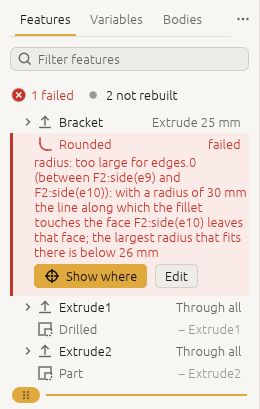
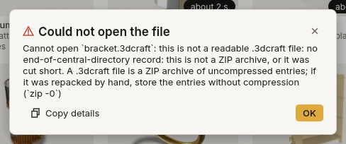

# Troubleshooting

*What to do when 3DCraft says no, when something does not show, after a crash, and how to report a
problem.*

3DCraft does not crash on bad input, and does not build a wrong solid when it cannot build the right one.
It says no, with a reason. Reading the reason is nearly always the way forward. When an agent works for
you, ask it to read the reason to you.

## Quick answers

| Problem | Look at |
|---|---|
| The window does not start | [The window](#the-window) |
| On Windows the window closes at once, or says it draws through another interface | [The window does not start or closes at once on Windows](#the-window-does-not-start-or-closes-at-once-on-windows) |
| The agent's changes do not show in the window | [The agent](#the-agent) |
| The agent cannot open or save a file | [The agent](#the-agent) |
| A feature's row is red in the feature list | [A feature fails](#a-feature-fails) |
| A check is red | [A check fails](#a-check-fails) |
| A Jig's parameter turned red | [Jigs](#jigs) |
| The web version is slow, blank or will not save | [The web version](#the-web-version) |
| 3DCraft closed unexpectedly | [After a crash](#after-a-crash) |
| Something is wrong and you want to report it | [Reporting a problem](#reporting-a-problem) |

## A command fails

When a command fails, the document is unchanged. The message starts with the command and usually the
parameter:

| Message (shortened) | What to do |
|---|---|
| *there is no feature named \`Sheet\`; features: Block* | A name is wrong, or the feature is not made yet. The message lists what there is |
| *unknown plane \`CutPlane\`; use xy, yz or zx, or the name of a datum plane* | The same, for planes |
| *give either distance … or about and angle …, not both* | Two ways of placing something were mixed. Use two datums |
| *variable.delete: \`t\` is still used by the feature \`Plate\` (F1: size.z), …* | Change those first, or give `"force": true` to delete it anyway |
| *file.save: \`/tmp/x.3dcraft\` is outside the write root …* | The path is outside the folders an agent or a program may use ([The agent](#the-agent)) |
| *variable.set: \`wall + 1 mm\` uses \`wall\` itself …* | Give the new value (`3 mm`); the message says what it is now |
| *the unit \`rad\` must follow a number, a parenthesis or \`pi\` directly …*, *\`inch\` is not a unit: write \`in\`* | Units are `um mm cm m in ft deg rad` in lower case, and `g kg s N kN Pa kPa MPa GPa J` as written here ([Reference › Units](reference.md#units-functions-and-names)), right after a number, a `)` or `pi` (`(360 / n) deg`). After a variable, multiply by one (`width * 1 mm`) |
| *an angle constraint takes a line and a line, but 1 entity was given* | Give the entities the message lists, in that order |

`command_list` (or `craft3d-cli commands --filter …`) shows which parameters a command takes.

## A feature fails

The feature is in the history but has no body: its status is `failed`, with an `error`. The features
made from it fail too, each with `causedBy` naming the first one. `document.check` lists them all. Fix
the first:



- **A size that does not fit** (a fillet radius, a shell thickness): the message gives the largest that
  fits, where 3DCraft has shown it. Make it smaller, or undo.
- **A reference that was lost**: an upstream edit took away the face or edge a feature names. The
  message names what it lost and the feature that made it. Point the feature at the right one with
  `feature.edit` (`edges`, `faces`, `sketch`, `target`), or undo the upstream edit.
- **Something made from a feature that is switched off** (a sketch on a face only that feature made, an
  extrusion of a sketch that is off): switch it on, or give the dependent feature the same condition
  ([Formulas › Switching parts on and off](formulas.md#switching-parts-on-and-off)).
- **A part that should disappear stays**: its condition is on a feature that changes the body, such as a
  transform or a fillet, which passes the body on unchanged when it is off. Put the condition on the
  feature that makes the part (same link).
- ***The body of `Bossed` already went into `Bevel`***: another feature took that body first. Build on
  the newer feature; the message gives the `feature.edit` that does it (`{"feature": "Drilled",
  "target": "Bevel"}` for a boolean; for a fillet, a chamfer or a face operation, its `edges` or `faces`
  named by faces of the newer body).
- **Not built yet**: some cases are refused as *not supported*, such as a fillet of a radius that would
  make a torus reach its own axis, a shell at a vertex where four faces meet, or a boolean the kernel
  cannot settle within the tolerance. The message says which faces. Change the design around it (a
  slightly different size, another order of features), and report it: every refusal is work owed.

Over MCP a failed feature is **not** a tool error of `command_run`: the command did what was asked, it
added the feature. So an agent reads `status` in each result. A change that makes *other* features fail
lists them in its result under `failed`
([Programs on 3DCraft › What a command answers](programs.md#what-a-command-answers)).

## A check fails

The model was built, but it does not meet what was asked. `assert.list` shows what was measured and what
was expected. Either the design changed in a way you did not want (undo it), or the check needs to be
written differently (`assert.edit`).

*notProven* is not a failure: the value found is fine, but the proof did not reach the bound
([Measuring and assertions](measure.md#assertions)).

### A face folds over itself

`document.check` warns with kind `fold` when a face of a body folds over itself: two of its
layers face each other through air nearer than the document's tolerance ("face 4 folds over itself
at (5.12, -2.84, -4.73): two of its layers face each other 4.57e-7 apart with air between them,
within the tolerance 2e-2"), or its surface has no normal at a point. The body is still built and
`ok` stays true, but a mesh, an offset, a shell or a boolean near that place may go wrong. Look at
the place it names (`at`): it is usually a fillet or a blend whose radius is smaller than the bend it
runs round, a fade that turns back on itself, a loft or a sweep whose sections cross, or a spline
surface drawn through points that double back. Make the radius larger, move the sections apart, or,
when the layers are meant to be that close, give the document a finer tolerance.

`foldsNotProven` lists faces the rule could not settle: two layers that face each other only at an
edge of the face, loops it cannot follow, or a face too large to examine. They are not errors; look at
the place if the face matters.

The rule can also stay silent on a fold. It searches a face only where some part of it bends sharply
(tighter than half the tolerance), so two layers of a smoothly curved face that close in on each other
(a hem, a neck above a wider hollow) are not reported. An answer without a `fold` warning is not a
proof that no face folds.

## Undo

**Edit › Undo** (Ctrl+Z) undoes one change, yours or the agent's, and **Edit › Redo** (Ctrl+Shift+Z or
Ctrl+Y) redoes it. An agent does the same with `edit.undo` and `edit.redo`; a batch of ten steps is ten
changes. Undo also brings back a deleted feature or variable. The selection is not part of the history
and is not undone. In a Jig, **↺**, **Reset all** and **Back to last good** are there as well.

## A sketch does not do what you meant

`sketch.inspect` shows every entity with its solved coordinates, every constraint with its state, and
`dof`, the freedom left ([How 3DCraft thinks › Sketches](concepts.md#sketches-and-constraints)).

- **A point moved.** A point drawn with plain numbers may be moved by the solver. Write its coordinates as
  expressions (`"0 mm"`) to hold it there. In one `sketch.path`, once a corner is written with an
  expression, its corners given as plain numbers are held too.
- **The sketch fails.** A constraint that contradicts the ones before it fails the sketch and is named
  (`"conflicting": ["c10"]`), and so are the ones it contradicts (`"conflicts": [{"constraint": "c10",
  "contradicts": ["c3"]}]`). Change one of them (`sketch.edit` with `constraint` and `value`) or delete
  it (`sketch.delete` with `constraint`).
- **A line has no length.** A contradiction the solver can meet by shrinking a line to nothing (a line
  both `horizontal` and `vertical`) solves, but the result lists the line under `collapsed`, and
  `document.check` reports it as a problem. A line with no length under one direction only is a warning
  there (`kind: "collapsedLine"`).
- **An arc no longer passes through its point.** An arc drawn through a point keeps the way round it was
  drawn with. When a change of the variables moves the point across the line through the arc's ends, the
  arc goes the long way round its centre, its circle still through the point. `document.check` warns
  (`kind: "pointOffArc"`). Draw the arc again through the point, or give it a centre.

## Pictures

If a face is hard to identify, render with `mode: "ids"`: one flat colour per face, with a legend. For a
close-up, ask for `projection: "orthographic"` and a `box`.

In `craft3d-cli` (`render`, `run`, `serve` and a headless `mcp`), `view.render` and `doc_render_preview`
draw on the graphics card when the computer has one, and with the CPU renderer otherwise. Asked through
the window, they draw with the CPU renderer. The CPU renderer is the reference the graphics card is checked
against: `"renderer": "cpu"` asks for it.

## Jigs

- **A parameter turned red** and the banner says *This value breaks the model*: that combination of values
  cannot be built (the reason is under the parameter). Click **Back to last good**, or change the value
  back. Tell the Jig's maker: a Jig's ranges should always build.
- **A value jumped** after you typed it: it was outside the parameter's range, or between two steps. The
  note under the parameter (*clamped to …*, *rounded to …*) says what was set.
- **An agent cannot change the Jig's features**: in a Jig only the parameters change. Use **Open for
  editing** to get a model you can change ([Using a Jig](jigs.md#looking-inside-and-changing-the-design)).

## The window

- **It does not start**, and a terminal (on Windows, a message box) says *no graphics adapter can show
  it*. 3DCraft's window is drawn through Vulkan, Metal, DirectX 12 or OpenGL. On a computer without a
  suitable graphics card, install a software one: on Linux Mesa's lavapipe (`mesa-vulkan-drivers`) or
  llvmpipe for OpenGL; on Windows, update the graphics driver. Everything else works without it:
  `craft3d-cli` can still model, render and export.
- **0.1.0 does not start on Windows**, and says *"The code execution cannot proceed because
  VCRUNTIME140.dll was not found"*. The Windows programs of 3DCraft 0.1.0 needed Microsoft's Visual C++
  runtime, which many computers do not have; from 0.1.1 on they carry it inside them. Install the current
  version over 0.1.0 ([Installing a newer version](install.md#installing-a-newer-version)), or install Microsoft's
  Visual C++ Redistributable for x64
  ([vc_redist.x64.exe](https://aka.ms/vs/17/release/vc_redist.x64.exe), from Microsoft).
- **The model looks rough at first.** A heavy model first shows a quick picture, then the sharp one; the
  status bar says `refining` meanwhile.
- **A datum plane, axis or point does not show.** Datums are hidden until you switch **Datums** on in the
  display bar at the foot of the view; a double click on a datum's row in the feature list switches it on
  and flies there.

## The window does not start or closes at once on Windows

3DCraft's window is drawn through one of three graphics interfaces of Windows: Vulkan, OpenGL or DirectX 12,
each of them a part of your graphics card's driver. A driver can fail so badly that it takes the program
with it: the window opens and closes again at once, without a word. 3DCraft 0.1.0 and 0.1.1 did that on
many computers, with Intel and with AMD graphics.

**What 3DCraft does by itself, since 0.1.2:**

- Through Vulkan it draws see-through bodies and cut-open models in another way: the old way handed the
  driver a shader Vulkan's rules forbid, and the Vulkan drivers of Intel and AMD on Windows crashed on it
  while the window started. The new way was measured with Intel and AMD graphics on Windows and with Mesa's
  drivers on Linux.
- When an interface ended a start, the next start passes over it and takes the next one: Vulkan first,
  then OpenGL, then DirectX 12. `3DCraft.exe` (the Start menu entry, a double-clicked file) starts the
  window again by itself, at most three times in a row, so you need not do anything. A bar under the menu
  then says so, for example: *3DCraft draws through OpenGL on this computer: starting with Vulkan failed
  here (Intel(R) UHD Graphics 615, driver …)*. **Details…** says more; **Try Vulkan next time** tries it
  again at the next start; **Dismiss** hides the bar for good.
- An interface is passed over for seven days, or until your graphics driver or 3DCraft is updated; then it
  is tried again. If every interface failed, 3DCraft tries them again from the first: it never refuses to
  start. Several windows can start at the same time (two files opened at once): a window that is still
  starting is never taken for one that failed. Starting `craft3d.exe --reset-graphics` forgets what it learnt, so every interface is tried
  again.
- `3DCraft.exe` starts the window again only when it closed while it was still starting on its graphics
  interface; a window that closes later is not started again. When every start fails, it says so in a
  message box, with the error code.

**Which interface 3DCraft draws through:** **Help › About 3DCraft** names the renderer in use, your
graphics card and the interface, for example `gpu (Intel(R) UHD Graphics (Vulkan, IntegratedGpu, …);
direct, 4 samples)`; **Copy system info** there copies it for a report.

**Choosing the interface yourself.** Start 3DCraft from a terminal with `CRAFT3D_BACKEND_ORDER` set to
the interfaces to try, in order (`vulkan`, `gl`, `dx12`); one you choose is never passed over. In the
Command Prompt:

```bat
set CRAFT3D_BACKEND_ORDER=gl
"C:\Program Files\3DCraft\craft3d.exe"
```

In PowerShell, `$env:CRAFT3D_BACKEND_ORDER = "gl"` and then the program. OpenGL draws without
multisampling (edges look a little rougher); DirectX 12 can take minutes to show the studio look the first
time.

**Making a trace to send us.** When the window still closes at once, a trace says what the graphics card
was asked to build when it closed: its last line names it. In the Command Prompt:

```bat
set CRAFT3D_GPU_TRACE=%USERPROFILE%\Desktop\3dcraft-trace.txt
"C:\Program Files\3DCraft\craft3d.exe"
```

With `CRAFT3D_GPU_TOUR=1` set as well, the window shows a small model in every kind of picture (plain,
see-through, cut open, the studio look), writes a picture of each beside the trace and closes by itself:
one run that asks the driver for everything. Attach the trace (and the pictures) to your report
([Reporting a problem](#reporting-a-problem)). Two more switches help when we ask for them:
`CRAFT3D_SAMPLES=1` draws without multisampling, and `CRAFT3D_PEEL_VARIANT=persample` (or `today`) forces
the way see-through and cut-open pictures are drawn.

## The agent

- **The agent's changes do not show in the window.**
  1. Check the agent pill at the right of the status bar. *Agents off*: click it and turn on **Allow AI
     agents**. *Waiting for an agent*: the window is ready, but your AI tool has not connected.
  2. Check that your AI tool starts `craft3d-cli mcp --bridge`, as **Copy command** or **Copy MCP
     configuration** in that panel gives it, and restart the AI tool after you change its configuration
     ([Install › Connect an AI agent](install.md#connect-an-ai-agent-over-mcp)).
  3. With several 3DCraft windows open, the agent works in the one you used last when it connected. To
     move it to another window, click into that window and restart your AI tool (or close the first
     window).
  4. Without `--bridge`, the agent works headless, in a document of its own that the window does not
     show.
- **The agent cannot open or save a file.** The path is outside the folders it may use: the work folder,
  a folder you allowed, and the open document's folder
  ([Install › Which files the agent can reach](install.md#which-files-the-agent-can-reach)). The error
  says so. Allow the folder when 3DCraft asks, ask the agent to use the work folder, or save there from the
  File menu yourself.
- **The agent was refused.** **Refuse**, the ✕ beside an agent in the panel and **Disconnect all** keep
  that connection out until 3DCraft restarts. Restarting your AI tool is enough to let it in again: it
  connects as a new agent.

## The web version

- **It is slow on a big model.** In the browser 3DCraft rebuilds the model beside the page, in a worker of
  its own, and measures the checks and outputs in another. So the page stays usable while they run: the
  last picture stays, the view turns, and a new value cancels the rebuild that was running. Selecting a
  face, measuring and exporting still rebuild the model on the page the first time after a change, so they
  can take a moment on a big model. Where the browser refuses the workers, the page rebuilds one feature at
  a time and draws the page in between; `?pageregen` in the address does that on purpose.
- **The page stays blank or the model does not show.** The page needs WebGPU or WebGL2. Try a recent
  Chrome, Edge or Firefox; add `?webgl` to the address to use WebGL2 instead of WebGPU.
- **Save makes a download** instead of asking where: that is how Firefox and Safari work
  ([Files › The web version](files.md#files-in-the-web-version)).
- **Copy details does not copy.** Browsers let a page use the clipboard only over https (or from your own
  computer). Select the text in the details window and copy it yourself.

## After a crash

On Windows, a 3DCraft started as `craft3d.exe` itself also closes when you close the black console window
beside it: leave that window open, or start 3DCraft from the Start menu or with `3DCraft.exe`, which open
none.

Start 3DCraft again. A bar under the menu says *3DCraft did not close properly* and offers what was
autosaved:

- **Recover** opens it as an unsaved document; save it under a name;
- **Discard** throws it away (click twice: it cannot be undone);
- **Later** keeps it for next time.

The autosaves are in 3DCraft's data folder (**Help › Open data folder**). The web version has no
autosave: save often. A crash is the most important thing you can report.

## Reporting a problem

When a file action you started fails (Open, Save, Import, Export), a dialog says what went wrong, with
**Copy details**:



Such a message is written to be exact, so it can read as technical. You need not follow all of it: its
first words say what failed (here, `bracket.3dcraft` is not a file 3DCraft can read, or it was cut short).
When you cannot see why, click **Copy details** and report it, as below.

When a command fails in the window, the status bar at the bottom shows the command in red with its
message, and a **Copy details** button.

**Copy details** copies a short plain-text report: the 3DCraft version and the commit it was built from,
your system, the graphics card and how 3DCraft draws with it, and the command that failed with its
parameters and the whole message. A window shows the same text, so you can read it first. **It contains
file paths and the values you or your agent gave: read it before you post it publicly.**

An agent gets the same report from the command `session.report`, so you can also ask it: *"something went
wrong; give me the bug report"*. When the agent works in the window, the report names the graphics card
too.

**Where to report.** A question (does it read my file, how do I connect my agent, how was it built) goes to
[Discussions, in Q&A](https://github.com/johancoppens/3dcraft/discussions/categories/q-a); a problem, a
refusal included, stays an issue. Open an issue in 3DCraft's public repository:
[github.com/johancoppens/3dcraft/issues](https://github.com/johancoppens/3dcraft/issues), *Report a
problem*. Write down:

- what you were trying to do, and what you asked the agent (copy the prompt);
- what happened, and what you expected;
- the details 3DCraft copied;
- the `.3dcraft` file or the script, if you can share it (GitHub takes a `.zip`: put the file in one).

A refusal ("not supported", "does not fit") is worth reporting too: in 3DCraft a refusal is work still to
do. Things that went well are worth a line as well: they say what must not break.

**A security problem** (a file or an agent that reaches what it must not, the control token leaking) is
not reported in an issue. Report it privately through the repository's private vulnerability reporting,
as its [security policy](https://github.com/johancoppens/3dcraft/security/policy) describes.

**Next:** [Reference](reference.md).
