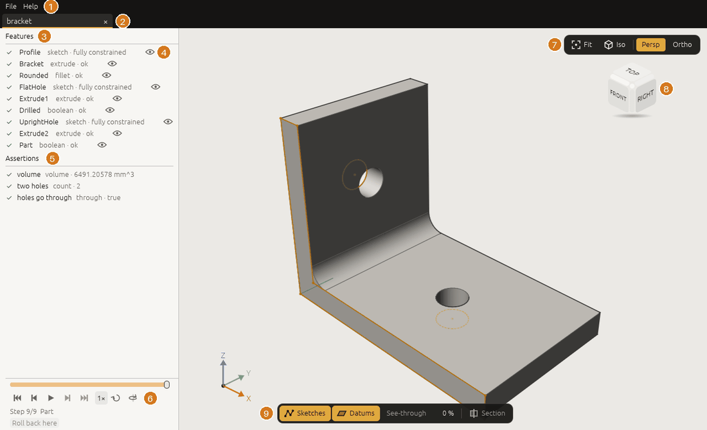
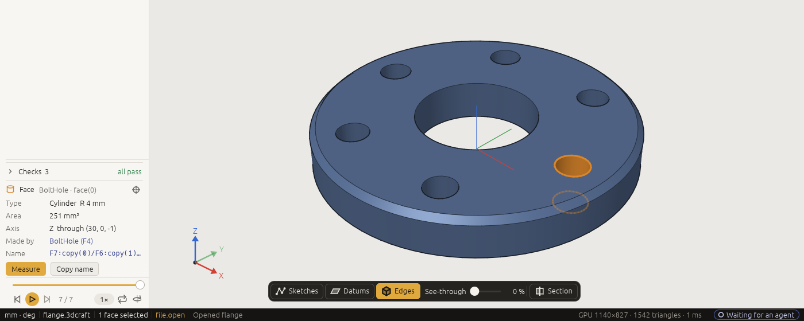
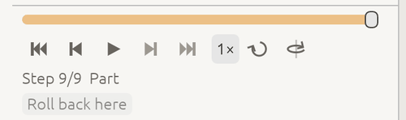
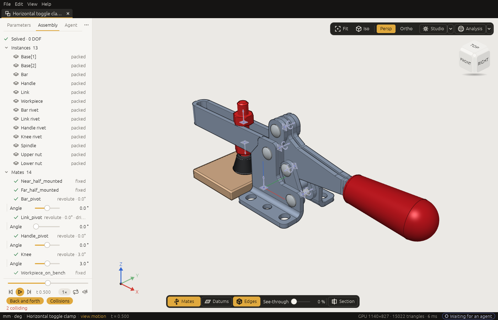
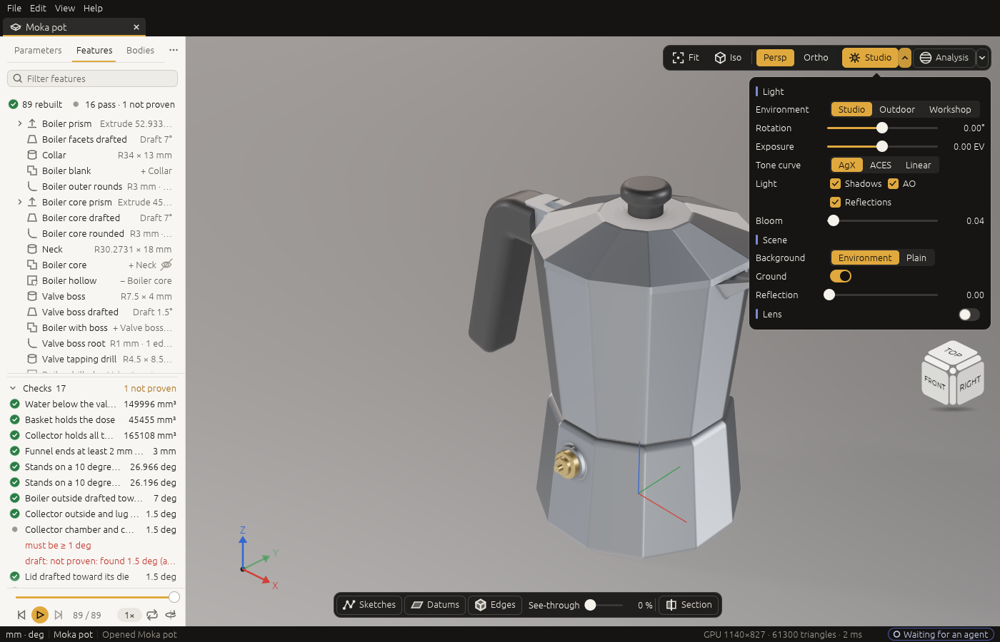
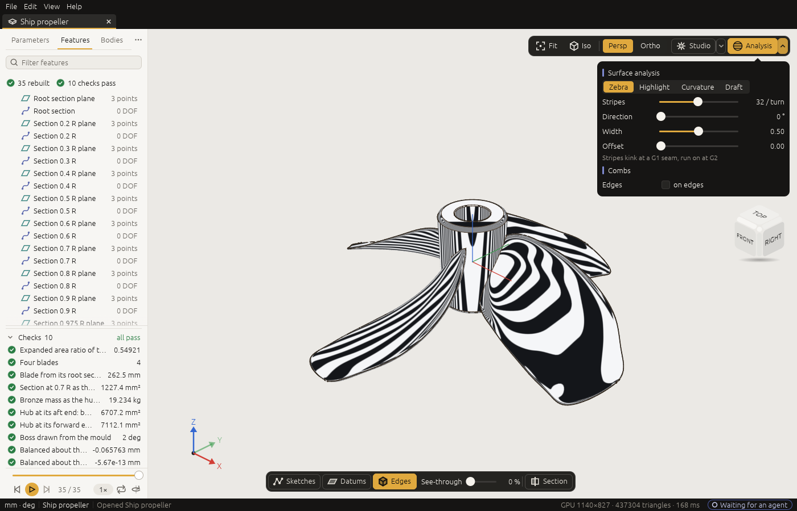

# The window

*Everything you see in the 3DCraft window, and how to look around, play the history and point at things.*

The window (`craft3d`) is where you watch the agent work, look at a design and show the agent what you
mean. 3DCraft has no toolbar of modelling buttons: every change to a design comes in as a command. An
agent sends it ([Install › Connect an AI agent](install.md#connect-an-ai-agent-over-mcp)), a Jig's form
sends it ([Using a Jig](jigs.md)), or a program does ([Programs on 3DCraft](programs.md)).

What the window does by itself is open, save, import and export files, and let you look, play, click and
select.

| | Part | What it is for |
|---|---|---|
| 1 | **File**, **Edit**, **View** and **Help** menus | Files, recent files, Jigs; Undo and Redo; panels and light or dark; the guide, the keys, About |
| 2 | **Tabs** | One per open document |
| 3 | **Feature list** | The history of the design, in order, with each step's status |
| 4 | **Eye** | Hides a feature's body, sketch or datum in the view |
| 5 | **Checks** | The checks (assertions) the design must pass |
| 6 | **History player** | Watch the design being built, step by step |
| 7 | **View buttons** | **Fit**, **Iso**, **Persp**, **Ortho**, **Studio** and **Analysis** |
| 8 | **View cube** | Click a side, edge or corner to look from there |
| 9 | **Display bar** | **Sketches**, **Datums**, **Edges**, **See-through** and **Section** |
| 10 | **Agent pill** | How agents stand, and what one does now |

## The status bar

At the bottom is the **status bar**. It shows the document's units, its file, when it was autosaved, the
last command and its answer, and which renderer drew the picture.

When 3DCraft works for more than a moment, a small spinner on the right says what it is doing: *Opening
gridfinity-bin… 41/57* while a file's features are built, then *Checking 27 assertions… 5/27* while its
checks are measured. The model is already there to look at. Quick work never shows the spinner, and once
shown it stays a little while, so it does not blink.

Until a newly opened file has something to show, the middle of the view says *Opening …*. While a motion
plays, the status bar says *Playing* and the moment's `t`. An error shows at once and stays.

At the right end of the status bar is the **agent pill**. Its colour says how agents stand:

- outlined grey, *Agents off*;
- outlined indigo, *Waiting for an agent*;
- indigo, *Claude Code connected*; with a turning mark, what the agent does at this moment
  (*Claude Code · feature.fillet*);
- amber, when an agent asks you something (*Claude Code asks for a folder*).

Click it for the agent panel ([Install › Connect an AI agent](install.md#connect-an-ai-agent-over-mcp)).
The browser has no pill: agents drive the desktop app only.

## The start screen

Without a document, the window shows the **start screen** (its picture is in
[Your first five minutes](first-steps.md)):

1. At the top, the name and version, and the line *Parametric CAD built with and for AI. Start a
   document, open one, or let an agent model while you watch.*
2. **New part**, **New assembly** and **Open…**.
3. **Examples**, with three tabs at its right: **Parts**, **Jigs** and **Assemblies**. Only the chosen
   tab's cards show. The tab you chose stays chosen while 3DCraft runs.
4. A line that says what the tab holds, with **More examples** at its right. **More examples** opens the
   gallery of every example, Jig and assembly, [3dcraft.dev/examples](https://3dcraft.dev/examples/), in
   your browser, at the part for the tab you are on.
5. The cards. A click on a card opens it in a new tab, named after the example. Nothing is asked when
   you close it again, unless you changed something: then 3DCraft asks whether to save your version.
   One that takes a while to open says so on its
   picture, such as *about 3 s*.
   - **Parts**: ten finished parts, with their whole history to play back. The first two, the steel
     bookend and the T-slot aluminium profile, are marked **Start here**: they are the simplest. A part
     with sizes you may change opens on its **Parameters** tab.
   - **Jigs**: the laser-cut box, the Gridfinity bin, the dovetail drawer, the sheet-metal enclosure, the
     planetary gearbox and the sundial. Each opens on its **Parameters** tab ([Using a Jig](jigs.md)).
   - **Assemblies**: the toggle clamp, the Jansen walker, the scissor jack and the radial engine. Each
     opens on its **Assembly** tab with its player on **Motion**: press play and it moves
     ([Assemblies](assemblies.md)). Its sizes, where it has any, are on the **Parameters** tab beside it.
6. **Recent** at the left: the files you opened or saved last, each with the icon of its kind and how long
   ago it changed. **Connect an AI agent** at the right: the same panel as the agent pill's, with the
   **Allow AI agents** switch, the work folder, and the buttons that copy the configuration for your AI
   tool. In the browser, it says instead: *In the browser an agent cannot drive 3DCraft yet. Use the
   desktop app to connect one.*

The start screen comes back when you close the last tab.

## Menus and tabs

**Tabs** run along the top, one per open document, each with a small icon of its kind (a part, an
assembly, a Jig). A Jig opened to be used also says **Jig**. An amber dot at a tab's right marks unsaved
changes; the close × takes its place under the pointer.

**Ctrl+Tab** goes to the next tab and **Ctrl+Shift+Tab** to the previous one. **Ctrl+W** closes one, and
asks first when it has unsaved changes (**Save**, **Don't Save**, **Cancel**). On a Mac, ⌘W closes a tab;
Ctrl+Tab stays Ctrl+Tab.

The **File** menu:

| Item | Keys | Does |
|---|---|---|
| **New Part** | Ctrl+N | A new, empty part in a new tab |
| **New Assembly** | Ctrl+Shift+N | A new, empty assembly in a new tab ([Assemblies](assemblies.md)) |
| **Open…** | Ctrl+O | Opens a `.3dcraft` document, a `.3dcraftjig` Jig or a `.3dcraftasm` assembly (a STEP file is imported with Import…) |
| **Open for editing** | | For a Jig in use: a new untitled model of it, to change as you like ([Using a Jig](jigs.md)) |
| **Save** | Ctrl+S | Saves to the document's file (asks for a name the first time) |
| **Save As…** | Ctrl+Shift+S | Saves under a new name |
| **Import…** | Ctrl+I | Reads a STEP file or a FreeCAD document into the document |
| **Export…** | Ctrl+E | Writes STEP, STL, 3MF, OBJ, DXF or SVG ([Files, export and drawings](files.md)) |
| **Export as Jig…** | | Publishes a document with parameters as a `.3dcraftjig` ([Making Jigs](making-jigs.md)) |
| **Open recent** | | The last ten files opened or saved, by you or by an agent, newest first; **Clear recent** empties the list |
| **Close** | Ctrl+W | Closes the active tab |

Under them are the open documents: click one to switch to it. A recent file that is not there any more is
greyed out. The list is kept in `3dcraft/recent-files.json` in your state folder, next to the autosaves,
and two windows open at once each keep what the other added. The browser keeps no recent files.

The **Edit** menu:

| Item | Keys | Does |
|---|---|---|
| **Undo** | Ctrl+Z | Undoes the last change to the active document; the item names it (**Undo Set teeth**) |
| **Redo** | Ctrl+Shift+Z or Ctrl+Y | Redoes the change last undone |

Every change counts, whoever made it: you, or an agent over MCP. An item is greyed out when there is
nothing to undo or redo, and while a parameter is being dragged or set. While you type into a field,
Ctrl+Z undoes your typing instead. In a Jig in use the only changes are those of its parameters, so Undo
takes back the last parameter you set.

The **View** menu:

| Item | Keys | Does |
|---|---|---|
| **Side panel** | Ctrl+B | Shows or puts away the panel on the left |
| **Status bar** | | Shows or puts away the bar at the bottom |
| **System**, **Light**, **Dark** | | The **appearance**: the panels and dialogs light or dark. **System**, the default, follows your desktop's setting (in the browser, the browser's) |
| **Full screen** | F11 | The window over the whole screen (the desktop app) |

The appearance changes the panels, the start screen and the dialogs. The menu bar, the tabs, the status
bar, the menus and the popovers stay dark, and the model's view stays as it is, so pictures look the same
whichever you choose.

The **Help** menu:

- **User guide** opens this guide in your browser, for the version of 3DCraft you have.
- **Keyboard shortcuts** (also **F1**) lists every key and mouse action
  ([Reference › Keys and mouse](reference.md#keys-and-mouse)).
- **Open data folder** shows 3DCraft's folder: the autosaves, what can be recovered after a crash, and the
  recent files (not in the browser).
- **Connect an AI agent…** opens the agent panel over the pill (not in the browser).
- **About 3DCraft** gives the version and the commit it was built from, the platform, the licence (MIT),
  links to the guide and the source, and the renderer in use. **Copy system info** copies those lines
  for a bug report.

## The side panel

The left panel has tabs, chosen by the kind of document:

- a part has **Features**, **Variables** and **Bodies**, and **Agent** (below);
- an assembly has **Assembly** (its instances, mates and checks) and **Variables**;
- a document with public parameters, such as a Jig, has **Parameters** first.

When the tabs do not fit, the rest are behind **⋯**. Drag the panel's right edge to make it wider or
narrower; it keeps that width whatever it shows.

### Features

One row per step of the history: an icon for its kind (sketches in indigo, datums in petrol, as in the
view), its name, and its key value at the right, such as *Extrude 8 mm*, *R18 × 60 mm* (a cylinder),
*3 × 22 mm* (a pattern) or *− Bore* (a subtraction and its tool).

- **A sketch sits under the feature made from it**, folded: click **›** to open it. **Datums that follow
  one another** fold into one *Datums* row in their place. The order shown is always the history's.
- **The filter** at the top keeps the rows whose name, kind or value holds what you type.
- **The line under the filter** says how it went: *23 rebuilt · 7 checks pass*, *1 failed · 3 not
  rebuilt*, *89 rebuilt · 16 pass · 1 not proven*, or *Rolled back to Bored · 10 of 25*. A dot that says
  done or failed carries a tick or a cross, so it does not rest on colour alone; the others are small and
  plain: grey for what is not rebuilt, not proven or still being measured, indigo when rolled back.
- **Hold the pointer on a row**: what it uses (↑) and what uses it (↓) get an indigo tint, and a strip at
  the foot of the list names them and counts the later features that depend on it. The row's grip (⠿) and
  eye show too.
- **Click a row** to select the feature. **Click the value of the selected row** to edit it in place:
  Enter sets it, as one step to undo; Escape leaves it.
- **Double-click a row**, or click the **⌖** on the row under the pointer, to **fly to** what it made.
- **The eye** hides that feature's body, sketch or datum in the view. It stays on a hidden row, struck
  through. The model itself does not change.
- **A feature that fails** is a red row with its reason and two buttons: **Show where** flies to what it
  is made from, **Edit** opens its value. The features made from it are dimmed: they are not rebuilt.
  The ones that do not depend on it are built as usual
  ([Troubleshooting › A feature fails](troubleshooting.md#a-feature-fails)).
- **Drag a row by its grip** to move it in the history (`feature.move`). A place before what it is made
  from, or after what is made from it, is refused before you drop it: the indigo line does not show there.
- **Right-click a row** for its menu: *Edit…*, *Rename*, *Show dependencies* (the hover's marks stay until
  Escape), *Roll back to here* (*Roll forward to end* on the last row), *Suppress*, *Hide*, *Copy id* (for
  a message to an agent) and *Delete*. Each is a command, so an agent can do the same, and every one can be
  undone.

**Checks** sit under the list: *Checks 7 · all pass*, then each check measured against its limit, such as
*7 mm ≥ 5 mm*. A failing check is red, with its reason under it, and the line at the top says *1 of 7
checks fails*. Click a check to fly to what it measures. The checks fold to their heading while something
is selected, or when the panel is short, to make room.

**What is selected** shows at the foot of the panel:

- a face: its surface (plane, cylinder R …, cone, sphere, torus, spline), its area, and its normal or axis;
- an edge: its curve, its length, the two faces it lies between and the angle there;
- a body: its volume, mass, area and box.

*Made by* links to the feature that made it, and *Name* is its persistent name, the name an agent uses.
**Measure** measures a face's wall thickness, or the distance between the first two things selected;
**Copy name** copies the name.

### Variables

The document's variables as a table: name, value or formula, result. Variables are grouped by the group a
public parameter was given, or by a prefix two of them share (*base_t*, *base_r* under *Base*). A formula is
written in indigo on a line of its own, its result at the right.

**Click a value or a formula to edit it**: Enter sets it, as one step to undo; one that does not work out
says why under it. **Add variable** opens a new one to fill in; Enter makes it. The document's units and
tolerance fold away at the foot.

### Bodies

One row per body the design ends with: its colour, its name, its mass (or its volume without a material)
and its eye. Click a body for its card: **Material** (choose a preset: it sets the density and the look),
density, colour, volume, mass, area, box, faces and edges, and whether it is a valid closed solid.

When the body's faces carry colours of their own, the card has **Clear face colour** (or **Clear 3 face
colours**, with their number), and a **Shared** row
when some of those colours are shared with another body
([Modelling features › Colours and materials](features.md#colours-and-materials)). The totals are at the
foot. The bodies that booleans used up are folded under *Tool bodies*: open it to see them and where they
went.

### Parameters

A Jig opens on **Parameters**, its form ([Using a Jig](jigs.md)). Its other tabs are there to look at.

### Agent

While agents are allowed, or once an agent has worked on the document, the side panel has an **Agent**
tab. It shows who is connected, then what agents did to this document, newest first: when and which agent,
the command in words, the features it made, why a command failed, and in italics what the agent said it
meant to do.

A feature an agent made, or last changed, carries a small indigo ✦ after its name in the Features tab.
The desktop app only: in the browser, agents cannot connect.

## The history player

At the foot of the side panel is the **timeline**: drag it to see the design as it was after any step of
its history. Features after that step are greyed, and the step is named at the top of the view, such as
`Step 2/6 · Extruded profile · extrude` (its place, the number of steps, its name and its kind). Looking back never changes the document.

Under the timeline is the **player**, one row like a video player's. The round amber button plays and
pauses, and where you are is beside it (`3 / 6`).

| Button | Key | Does |
|---|---|---|
| Step back | ← | One step back |
| ▶ Play / ⏸ Pause | Space | Plays the history step by step, or pauses |
| Step forward | → | One step forward |
| | Home | Shows the first step (the timeline's start) |
| | End | Back to the whole design (the timeline's end) |
| **1×** | | The speed: 0.5×, 1× or 2× (click to change) |
| Loop | | Starts again at the first step after the last |
| Orbit | | Turns the camera slowly while it plays |

The keys work while the pointer is over the view or the feature list and you are not typing in a field.
In a narrow feature panel Orbit is left out.

Each step is shown once its model is built, and for at least 0.8 s at 1×, so a heavy model never skips a
step. Playing stops at the end, when the document changes or when you switch tabs. While you play, the row
of the step shown is outlined with a dashed line in the feature list, which scrolls to keep it in view.

Every step is shown as finely meshed as the whole design, so a part that does not change between steps
keeps its look, and stepping through a history you have seen before is immediate.

### The roll-back bar

The amber **roll-back bar** in the feature list sits after the last step built. Drag it up to a step, or
choose **Roll back to here** on a row's menu, and the design is built only up to that step. New features
then go in right after it: a way to insert something early in the history.

Drag it back to the end, or choose **Roll forward to end** (on the last row's menu, or a right click on the
bar), to build the whole history again. Unlike the timeline, the bar changes what is built. While you look
back with the timeline, clicks in the view do not select; press **End** first.

### Playing a motion

A design can also move: a crank that turns, a lid that opens. Its motion is driven by a **timeline**
variable `t`, a plain number from 0 to 1, and formulas of `t`, such as a crank angle `360 deg * t`
([Engineering checks › Over a motion](engineering-checks.md#over-a-motion)). A `t` with a unit (a
thickness called `t`) is not a timeline: rename it first.

With a timeline, **History** and **Motion** appear above the player. In **Motion**:

- the slider runs over `t`, and the player plays it from 0 to 1 in 4 s at 1×;
- the step buttons move `t` by 0.05, and **Loop** starts again at 0;
- **Back and forth**, under the row, turns round at the end;
- **Collisions** draws the parts that overlap in red. The view names the moment, such as
  `t = 0.500 · collision: Wall and Crank`.

As with the history, nothing in the document changes. Only the features that use `t` are rebuilt for each
moment, so a heavy model plays slower rather than skipping. An assembly has no history of its own, so it
shows only **Motion**: its parts are moved, not rebuilt ([Assemblies](assemblies.md#motion)).

While a motion plays, the view draws lighter so it keeps up. In the studio look it leaves out the frames a
still picture averages, the depth of field, the ambient occlusion and the reflections; the shadows stay.
As soon as you pause or stop, the full look comes back and settles. Screenshots and recordings are always
at full quality.

When the moments of a motion are slow to make (an assembly whose parts are rebuilt as it moves, a heavy
part), the player asks **This motion is heavy — bake first?** under the slider. **Bake** makes the moments
of a play ahead (`motion.bake`) while it goes on playing, with a bar that shows how far it is; afterwards
it plays smoothly. **Not now** hides the question for that document until you close 3DCraft. A motion that
is quick to show, but whose parts are rebuilt as it moves, is baked by itself the first time it plays.

An agent drives the motion with commands of its own ([Reference › The window, for agents and
programs](reference.md#the-window-for-agents-and-programs)).

## Looking around

| Do | To |
|---|---|
| Drag with the left button | Orbit |
| Drag with the right or middle button, or Shift and the left | Pan |
| Wheel, or pinch on a touchpad | Zoom about the point under the pointer |
| **F** | Fly to the selection, or frame the whole model when nothing is selected |
| **Fit** | Frame the whole model |
| **Iso**, or a click on the view cube | A standard view (Iso looks from the front-right corner) |
| **Persp** / **Ortho** | Perspective, or orthographic (to scale, no vanishing point) |
| **Studio** | The studio look on or off; the **▾** caret on its right opens or closes its options |
| **Analysis** | A surface analysis on or off; its **▾** caret opens or closes its options and legend |

The **display bar** at the bottom of the view:

- **Sketches** and **Datums** show or hide sketches and construction planes, axes and points.
- **Edges** shows or hides the dark lines along the bodies' edges. An edge you point at or select is still
  drawn.
- **See-through** makes the bodies transparent (drag its slider), to look at pockets and cavities.
- **Section** cuts the view open with a plane across X, Y or Z, through the middle of the model at first.
  **Offset** moves it and **Flip side** keeps the other half.

In a narrow window, Sketches, Datums and Edges show their icons only, and the See-through and Offset
sliders lose their labels: hover for the names.

None of this changes the document. Each tab remembers its own camera, section and see-through. A heavy
model first shows a quick picture, then the sharp one (the status bar says `refining`).

### On a phone or a tablet

The browser on a phone or a tablet, and any window narrower than about 800 points, gets a narrow layout:

| Do | To |
|---|---|
| Drag one finger | Orbit |
| Drag two fingers | Pan |
| Pinch | Zoom about the middle of your fingers |
| Tap | Select, as a click does |
| Double-tap | What **F** does: fly to what you tapped, or frame the whole model |
| Press and hold | The list of everything under your finger (as a right click) |
| **☰** at the left of the menu bar | Open or close the feature list, Parameters and the player as a drawer (a tap beside it, or Escape, closes it too) |

- The buttons get finger-sized as soon as you touch the screen, at any width. The drawer is for narrow
  windows only, so a tablet held upright at 820 points keeps the feature list beside the view.
- Where the display bar has no room for the section's options, they get a row of their own just above it.
- A model with a history or a motion gets a small player above the bar (play or pause, the steps or the
  slider, and where it is) while the drawer is shut; the drawer holds the whole player. On a phone or a
  tablet only the three buttons and where you are stay; the timeline's ends take you to the first step
  and the last.
- A Jig in use shows its parameters as a sheet under the model on a phone, so every change shows at once
  above it; on a tablet the side panel stays docked beside the model.
- The Studio and Analysis options open as a sheet from the bottom of the view, with **Light**, **Scene**
  and **Lens** as tabs for the studio look; × or the chip closes it.
- When the tabs do not fit, **All** at the end of their row lists every open document, and the status bar
  keeps to what you act on. A question about an agent's access comes as a sheet with the answers one under
  the other.

### The studio look

**Studio**, beside Persp and Ortho at the top right, switches between two looks:

- the **plain look**, flat and clear, which is best for modelling;
- the **studio look**, which shows what a part will look like: its colours, how metal and how rough its
  faces are, lit by a photographed environment.

Three environments come with 3DCraft: `studio` (soft boxes, the default), `outdoor` (sky and sun) and
`workshop`. The light falls from the environment's brightest direction and casts soft shadows on the
model and on a ground under it; corners and grooves darken where little light reaches. A see-through or
cut-open view is lit the same way.

**Studio** is a split button. The chip switches the look on and off; the small **▾** caret on its right
opens and closes the look's options. Switching the look on opens them in a popover under the button row:

- the environment and how far it is turned;
- the exposure, the background, the ground and how much it reflects;
- the tone curve (AgX, ACES or Linear), shadows, ambient occlusion, reflections and bloom;
- a **Lens** that blurs what is out of focus.

A change shows at once. Click the caret again, or press Escape, to close the options: the look stays on.
In a short window the options scroll inside the popover.

**The lens.** **Lens** switches depth of field on. **Aperture** is a slider of the usual f-stops, f/1.4
(most blur) to f/22 (nearly all sharp). **Focus** says where it focuses:

- **Selection** (the default when you switch it on): on what is selected, in the view or in the feature
  list; it follows as you select something else;
- **Click**: on the point you clicked last;
- **Centre**: on the model's centre;
- **Distance**: at a distance along the view, with a slider of its own.

With nothing selected, a selection that is hidden, or no click yet, the lens focuses on the centre, and
the popover says so. In an orthographic view there is no lens, and nothing is blurred. While the lens is
on, what is selected keeps its own colour and is marked by its outline. The blur follows the document's
length unit, as a real camera would: a small part seen close up has a shallow depth of field.

While the camera stands still, the window keeps refining the picture, so edges smooth out and the blur
fills in. Moving the camera starts again from a sharp first frame.

In the browser the studio look is drawn simpler while you turn, pan or zoom the view, and in full again a
moment after you let go. On older graphics (WebGL2) it has no shadows, no darkening in corners, no
reflections and no depth of field.

The look is a view: the document does not change. Colours, metals and materials are given to the bodies
themselves ([Modelling features › Colours and materials](features.md#colours-and-materials)). An agent
sets the same look with `ui.set`, and `craft3d-cli render` takes it too
([Reference › The window, for agents and programs](reference.md#the-window-for-agents-and-programs)).

### Surface analysis

**Analysis**, beside Studio, shows the quality of the surfaces instead of their shading. It is a split
button as Studio is: its popover chooses what to show, with its options as sliders and a legend that says
what the colours mean. Its **▾** caret (or Escape) closes the popover and keeps the analysis on. While an
analysis is on, the view is drawn plainly, so the studio look's caret is greyed out until the analysis is
off.

- **Zebra**: black and white stripes reflected in the surfaces, as a car body reflects the lights of a
  tunnel. Where two faces meet with the same tangent plane (G1) but a jump in curvature, the stripes kink.
  Where the curvature carries on too (G2), they run on smoothly. The stripes follow the view, as
  reflections do: turn the model to see a seam from several sides.
- **Highlight**: highlight lines, the lines of a light panel above the model, drawn where the surface's
  normal points at them. They stay put when you turn the view, so they show a surface's flow on the part
  itself.
- **Curvature**: a colour map of the curvature, from blue (most negative) through pale to red (most
  positive). *Gaussian* is negative on saddles, positive on domes, and zero on flat and cylindrical faces;
  *mean* is positive where the part bulges out; *max* is the larger of the two principal curvatures. The
  numbers come from the exact surfaces, not from the triangles on screen.
- **Draft**: for moulded parts. Faces that leave the mould along the pull direction with at least the least
  draft are green, faces that leave it the other way blue, and faces too steep to leave either way red.

**Combs** draw the curvature of edges as spikes standing off the curve, as long as the curvature: where the
comb's outline jumps, the curvature does.

The analysis is a view, like the look: the document does not change. The numbers behind the colours are
measures too ([Measuring and assertions › Surface quality](measure.md#surface-quality)).

## Pointing at things

A click selects what is under the pointer: a corner (vertex) when one is within a few points, else an
edge, else the face.

| Do | To |
|---|---|
| Click | Select a vertex, an edge or a face |
| Shift+click | Add to or take from the selection |
| Click again at the same place, or Alt+click | Select the next face behind |
| Right click | List every face under the pointer, to choose one |
| Double-click in the view | Select the whole body |
| Ctrl+drag | Select what lies inside a box |
| Click empty space, or Escape | Clear the selection (Escape first folds an open Studio or Analysis panel) |

**The agent sees your selection.** The selection belongs to the document, not to the window, so the agent
reads it: each item with its name, the body, the feature that made it, its shape (a hole's radius and
axis, a face's direction) and the size that drives it. So you can say:

> Make the hole I selected 6.5 mm.

and the agent finds the size behind that hole and changes it.

The other way round, the agent can show you what it means. It can light up a face, an edge or a corner in
your view, set the selection you see, fly the camera to a feature, play the history, and take a picture of
the window to look at itself ([Programs on 3DCraft › The window's control
channel](programs.md#the-windows-control-channel)).

## When something goes wrong

When a command fails, the status bar shows it in red with its message, and a **Copy details** button that
copies a short report for a bug report. When a file action you started yourself fails (Open, Save,
Import, Export), a dialog says what went wrong
([Troubleshooting › Reporting a problem](troubleshooting.md#reporting-a-problem)).

When 3DCraft was not closed properly (a crash, a power cut), the next start shows a bar under the menu that
offers to **Recover** what was autosaved ([Troubleshooting › After a crash](troubleshooting.md#after-a-crash)).

## Without the window

An agent working headless looks at its work with `doc_render_preview` (the command `view.render`): the same
picture `craft3d-cli render` makes. `view.pick` answers "what is at this pixel of that picture", as a click
does in the window.

**Next:** [Using a Jig](jigs.md).
